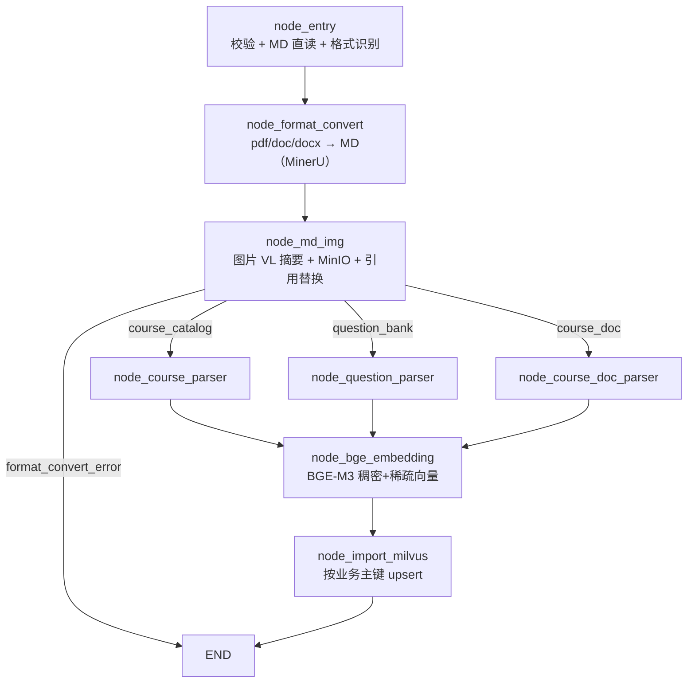

# 导入流程总览

> 本文是整个导入链路的地图。读完它再看各节点的单篇解析，能知道"当前这一步为什么存在、它的输入从哪来、输出给谁用"。

## 一、这条链路要解决什么问题

把一份**结构不固定的原始资料**（Markdown / PDF / Word / 资料包 zip）变成**可被混合检索的向量库记录**。

难点集中在三处：

1. **格式不统一** —— 用户上传的可能是 `.md`、`.pdf`、`.doc`、`.docx`，`md` 直读、其余三种走 MinerU；
2. **结构不统一** —— 同样是 MD，`course_catalog`（课程目录）、`question_bank`（题库）、`course_doc`（课程文档）需要抽出完全不同的实体；
3. **检索效果依赖入库质量** —— 图片语义、章节上下文、答案归一化，任何一环偷懒都会直接体现在召回率上。

整条链路就是针对这三点做的"归一化 → 分类型解析 → 语义增强 → 向量化 → 入库"。

## 二、图的形状

`processor/import_processor/main_graph.py` 用 LangGraph 的 `StateGraph` 串起来，形状是一条主干加一个三分叉：



关键点：

- **入口只有一个**，`content_type` 在入口就做枚举校验，所以分叉时不需要再兜底非法值；
- **图片节点放在分叉之前**，三种内容类型共用一次图片处理，避免每个 parser 各写一遍；
- **分叉后必然汇聚**到 `node_bge_embedding`，因为向量化逻辑与内容类型无关（只认 `record["content"]`）；
- **失败不抛异常**：所有可预期的失败都写进状态字段，图继续走完自己的边；真正的"任务失败"由上层 `api/file_import_service.py` 根据状态字段判定。

## 三、状态（State）是怎么流转的

`ImportGraphState` 是 `TypedDict`，节点返回的 dict 会被**浅合并**进全局状态。所以每个节点只返回自己负责的那几个键，不碰别人的。

| 字段 | 写入节点 | 读取节点 | 说明 |
|---|---|---|---|
| `task_id` / `local_dir` / `local_file_path` / `source_file` / `source_path` | API 层 `create_import_default_state` | 全部节点 | 溯源信息，最终写入 Milvus 的 `source_*` 字段 |
| `content_type` | API 层 | `node_entry`、路由函数 | 决定分叉走向 |
| `project_name` | API 层（zip 导入缺省取包名） | `node_course_doc_parser` | 有值 → `doc_kind=project` |
| `file_format` | `node_entry` | `node_format_convert` | `md` / `pdf` / `doc` / `docx` |
| `md_text` | `node_entry`（md）/ `node_format_convert`（pdf/doc/docx，MinerU）/ `node_md_img`（替换后覆盖） | 三个 parser | 全链路唯一的"内容载体" |
| `normalized_md_path` | `node_entry`（md）/ `node_format_convert`（仅 pdf） | `node_md_img` | 为 `None` 时图片节点自动跳过 |
| `format_convert_error` | `node_entry` / `node_format_convert` | 路由函数 | 非空 → 直接 `END` |
| `course_series_records` / `course_module_records` | `node_course_parser` | `node_bge_embedding` | 课程目录两类实体 |
| `question_records` / `bank_name_map` | `node_question_parser` | `node_bge_embedding` | 题库 |
| `course_doc_records` | `node_course_doc_parser` | `node_bge_embedding` | 文档分块 |
| `parse_failed_entities` | 三个 parser | API 层展示 | 单实体失败清单，**不阻断**整体 |
| `pending_collections` | `node_bge_embedding` | `node_import_milvus` | `{集合名: [记录]}`，记录里已带向量 |
| `embedding_error` / `import_error` | 对应节点 | API 层 | 用于任务状态标记 |

**一个容易被忽略的细节**：`node_bge_embedding` 是**原地修改** `record` 字典（把 `dense_vector` 塞进去），而不是造新对象。因为 `pending_collections` 里存的就是 parser 产出的那些 dict 的引用，改完不需要再回写状态，天然就带上了向量。

**ZIP 导入时有两个字段的取值不同**（任务由 `_expand_zip` 创建）：

- `local_dir` = **解压根目录**（不是单个任务的目录），它同时充当 `node_md_img` 的图片定位兜底根；
- `source_file` = **包内相对路径**（如 `docs/02_x.md`），用于区分不同子目录的同名文件。

## 四、四条失败通道

链路里没有 `raise` 穿透到图外层（除非是没预料到的异常），而是四个状态字段分工：

| 字段 | 语义 | 后果 |
|---|---|---|
| `format_convert_error` | 入口校验失败 / 格式转换失败 | 路由到 `END`，任务 `failed` |
| `parse_failed_entities` | 单个实体结构不合规（缺主键、缺题型、答案无法归一化） | 任务仍 `completed`，失败实体数上报 |
| `embedding_error` | 向量化整体异常 | 任务 `failed` |
| `import_error` | 无可入库记录 / Milvus 客户端不可用 | 任务 `failed` |

这个划分很重要：**"文档里某一道题格式不对"不应该让整份资料白导**。所以 parser 层一律 `continue`，把问题记进清单，让运营后续补数据。

## 五、四条数据流的实体数量级（实测基准）

写完任何改动后，可以用这些数字做回归对照（各 parser 文件底部的 `__main__` 就是干这个的）：

| 输入 | content_type | 产出 | 实测规模 |
|---|---|---|---|
| `课程介绍.md` | `course_catalog` | 系列 219 条 + 课程模块 657 条 | 见 `node_course_parser.__main__` |
| `题目资料.md` | `question_bank` | 题库 73 个 + 题目 1752 条 | 见 `node_question_parser.__main__` |
| LangGraph 讲义 `.docx` | `course_doc` | 26 个章节 → 44 个块（min 42 / max 1527 / avg 994 字符），9 张图全部保留 | 见 `node_course_doc_parser.__main__` |

## 六、四个 Collection

| Collection | 业务主键 | 来源节点 | 向量化字段 |
|---|---|---|---|
| `edu_course_series` | `series_code` | `node_course_parser` | `content`（系列全文字段拼接） |
| `edu_course_module` | `course_code` | `node_course_parser` | `content` |
| `edu_course_doc` | `id`（uuid，无业务主键） | `node_course_doc_parser` | `content`（含章节前缀） |
| `edu_question` | `question_code` | `node_question_parser` | `content`（题干 + 选项） |

## 七、怎么单独跑某一步

每个节点文件都可以脱离图单独执行，这是调试的主要方式：

```python
from processor.import_processor.nodes.node_question_parser import node_question_parser
result = node_question_parser({
    "md_text": open("题目资料.md", encoding="utf-8").read(),
    "source_file": "题目资料.md",
    "source_path": "/abs/path/题目资料.md",
})
```

`node_bge_embedding` / `node_import_milvus` 需要真实依赖（模型、Milvus），调试时建议先用一个 `pending_collections` 假数据打通。

## 八、单篇文档索引

| 顺序 | 文档 | 节点 |
|---|---|---|
| 1 | `导入_01_node_entry.md` | 入口校验与格式识别 |
| 2 | `导入_02_node_format_convert.md` | PDF / DOCX → Markdown 归一化 |
| 3 | `导入_03_node_md_img.md` | 图片 VL 摘要 + MinIO + 引用替换 |
| 4 | `导入_04_node_course_parser.md` | 课程目录解析 |
| 5 | `导入_05_node_question_parser.md` | 题库解析与答案归一化 |
| 6 | `导入_06_node_course_doc_parser.md` | 课程文档分块 |
| 7 | `导入_07_node_bge_embedding.md` | BGE-M3 混合向量化 |
| 8 | `导入_08_node_import_milvus.md` | Milvus 建表与幂等入库 |
| 9 | `导入_09_zip资料包导入.md` | ZIP 资料包：安全解压 + 发现 md + 拆任务 |

## 九、ZIP 资料包是一条"前置通道"

上面八节描述的是**单个文档**进入图之后的路径。ZIP 不走图，它发生在图之前：


它只解决三件事：**保住目录结构**（图片相对引用才有意义）、**拆成独立任务**（一篇失败不影响其它）、**把包根作为图片定位的第二落点**（`local_dir = extracted/`）。

细节见 `导入_09_zip资料包导入.md`。
