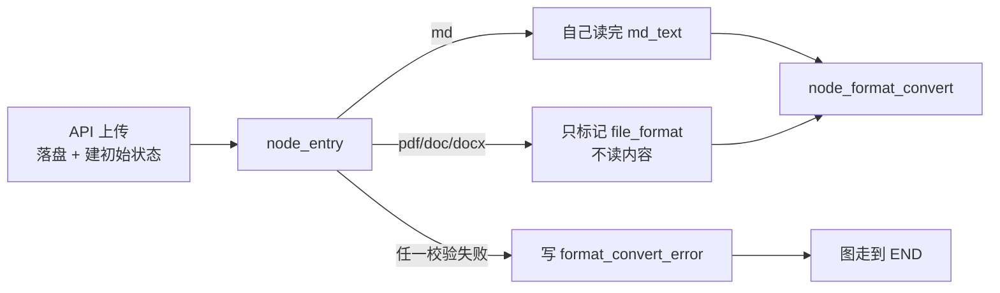

# 导入_01 node_entry —— 入口校验与格式识别

> 文件：`processor/import_processor/nodes/node_entry.py`
> 职责：**四道关卡 + 一次分流**。还没开始解析任何内容，先把"这文件到底能不能导"问清楚。

## 一、它在流程里的位置



注意一个容易误解的点：**失败时图并不会在这里中断**。节点只是返回 `{"format_convert_error": "..."}`，边照常连到 `node_format_convert`，但那个节点第一件事就是发现 `md_text` 为空且 `file_format` 也可能为空，于是返回 `{}`；真正终止发生在 `node_md_img` 之后的条件路由：

```python
def route_after_convert(state: ImportGraphState) -> str:
    if state.get("format_convert_error"):
        return END          # 在这里才真正停
```

为什么要绕这一圈？因为 LangGraph 的边是静态声明的，入口节点没有条件边；用"状态字段 + 后续路由"实现中止，比在入口就 `raise` 更可控——**异常会让 `stream` 抛错，任务状态难以落库**，而返回错误字段可以让 API 层正常收尾并写入 `failed`。

## 二、四个常量，三种拒绝

```python
VALID_CONTENT_TYPES = {"course_catalog", "question_bank", "course_doc"}
VALID_EXTENSIONS = {".md", ".pdf", ".docx", ".doc"}
MAX_FILE_SIZE = 50 * 1024 * 1024  # 50MB
```

| 常量 | 拒绝什么 | 为什么在这里拒绝 |
|---|---|---|
| `VALID_CONTENT_TYPES` | 非法 `content_type` | 它决定后面走哪个 parser。放到后面才发现，等于白白转换完一个 50MB 的 PDF 才告诉用户参数错了 |
| `VALID_EXTENSIONS` | `.txt` / `.pptx` / 无后缀 | 白名单之外一律拒绝；`.md` 直读，`.pdf/.doc/.docx` 交给 MinerU |
| `MAX_FILE_SIZE` | 超大文件 | `MinerU` 转换是云端 API，超大文件既慢又容易超时；50MB 也是"一份正常讲义"的上限 |

**`.doc` 现在也在白名单里**。早期它被拒（`python-docx` 读不了老二进制格式，提示用户另存为 `.docx`）；改成 MinerU 之后，云端直接支持 `doc`，本地不再需要 python-docx，所以这个限制自然取消了。

代价是 `.doc` 和 `.docx` 一样必须联网、必须消耗 MinerU 配额——见 `导入_02` 第八节。

## 三、逐步实现

主函数是个很薄的编排层，四个 `step_*` 各管一件事，任何一个返回错误就短路：

```python
@node_log("node_entry")
def node_entry(state: dict) -> dict:
    content_type = state.get("content_type", "")
    local_file_path = state.get("local_file_path", "")

    error = step_1_validate_content_type(content_type)        # 1. 枚举
    if error:
        return {"format_convert_error": error}

    path_obj, ext, error = step_2_validate_file(local_file_path)  # 2. 存在性 + 后缀
    if error:
        return {"format_convert_error": error}

    error = step_3_validate_file_size(path_obj)               # 3. 体积
    if error:
        return {"format_convert_error": error}

    return step_4_normalize_by_format(path_obj, ext)          # 4. 分流
```

这种"串行短路"写法比嵌套 `if` 好读，也让每一步能被单独测试（`step_*` 都是无状态纯函数）。

### step_1：`content_type` 枚举校验

```python
def step_1_validate_content_type(content_type: str):
    if content_type not in VALID_CONTENT_TYPES:
        return f"非法 content_type：{content_type}（合法值：{sorted(VALID_CONTENT_TYPES)}）"
    return None
```

返回值语义统一为 **"错误信息 or None"**，调用处只判断真值。把合法值 `sorted()` 后拼进错误信息，是为了让前端/用户能直接看到正确取值，不用去翻文档。

### step_2：存在性 + 后缀白名单

```python
def step_2_validate_file(local_file_path: str):
    path_obj = Path(local_file_path)
    if not path_obj.exists():
        return path_obj, "", f"文件不存在：{local_file_path}"
    ext = path_obj.suffix.lower()
    if ext not in VALID_EXTENSIONS:
        return path_obj, ext, f"不支持的文件类型 {ext}（白名单：.md/.pdf/.doc/.docx）"
    return path_obj, ext, None
```

三个细节：

1. **`return` 三元组**（Path, 后缀, 错误），让下游不用再算一遍 `Path(...)` 和 `suffix`；
2. **`.lower()`** —— Windows 上传的 `讲义.PDF` 也能过，否则大小写会误杀；
3. **先 `exists()` 再取后缀**，顺序不能反：文件不存在时 `suffix` 仍能算出来，但错误信息应该说"不存在"而不是"类型不支持"，否则误导排查。

### step_3：体积校验

```python
def step_3_validate_file_size(path_obj: Path):
    file_size = path_obj.stat().st_size
    if file_size > MAX_FILE_SIZE:
        return f"文件超过 50MB 上限：{file_size / 1024 / 1024:.1f}MB"
    return None
```

用 `stat().st_size` 而不是读文件算长度——**O(1)**，对大文件也不吃内存。错误信息里把实际大小格式化成 MB 保留一位小数，用户一眼知道超了多少。

### step_4：按格式决定归一化路径

这是整个节点唯一"有业务含义"的一步。

#### `.md`：当场读完，一步到位

```python
if ext == ".md":
    try:
        md_text = path_obj.read_text(encoding="utf-8")
    except UnicodeDecodeError:
        try:
            md_text = path_obj.read_text(encoding="gbk")
        except Exception as e:
            return {"format_convert_error": f"MD 文件编码无法解析（utf-8/gbk 均失败）：{e}"}
    return {
        "file_format": "md",
        "normalized_md_path": str(path_obj),
        "md_text": md_text,
    }
```

三个返回字段的含义：

- `file_format="md"`：告诉下游"已经归一化好了"；
- `normalized_md_path`：**指向原文件本身**。这是 `node_md_img` 的工作依据——它需要知道 MD 落在哪个目录，才能按相对路径找图片；
- `md_text`：全文进内存。为什么不做流式？因为后续所有 parser 都是"先切块再遍历"，一次性拿到全文最简单；50MB 上限保证了内存可控。

**GBK 兜底**是实战经验：从 Windows 上导出的中文文档（尤其是老版 Typora / 记事本保存的）经常是 GBK。只捕获 `UnicodeDecodeError` 而不是裸 `Exception`，是为了不吞掉真正的 IO 错误（比如权限问题）。

#### `.pdf` / `.doc` / `.docx`：只标记，不读

```python
if ext == ".pdf":
    return {"file_format": "pdf"}

if ext == ".docx":
    return {"file_format": "docx"}

if ext == ".doc":
    return {"file_format": "doc"}
```

**只写 `file_format`，不写 `md_text`**。这是刻意的职责切分：

- 入口节点只做"廉价校验 + 无损读取"，不碰任何需要重依赖的转换（`requests` 调 MinerU）；
- 转换失败可能耗时几十秒甚至 10 分钟（轮询），放在入口会让"校验失败"和"转换失败"混在同一个节点的日志里，排查困难。

所以 `node_format_convert` 的第一步就是判断"`md_text` 有没有值"，有就说明 md 已经直读过了，直接 `return {}` 跳过。

## 四、输入输出速查

| 方向 | 字段 | 说明 |
|---|---|---|
| 入 | `content_type` | 必须属于三个枚举之一 |
| 入 | `local_file_path` | 上传落盘后的绝对路径 |
| 出（md） | `file_format` / `normalized_md_path` / `md_text` | 三件套齐全 |
| 出（pdf/doc/docx） | `file_format` | 仅此一个，`md` 内容由下游 MinerU 节点补齐 |
| 出（失败） | `format_convert_error` | 只有这一个字段，其他都不写 |

## 五、边界与坑

| 场景 | 行为 | 备注 |
|---|---|---|
| 文件路径是目录 | `exists()` 为 True，`suffix` 为空 → 报"不支持的类型 ：" | 提示语里后缀为空会显得怪，但不会崩 |
| 文件名无后缀 | `suffix` 为 `""` → 拒绝 | 正确行为，无法判断格式 |
| md 文件是空文件 | 通过校验，`md_text=""` | 后续 parser 会返回 `归一化后 Markdown 为空` |
| md 超过 50MB | 拒绝 | 即使能读也拒绝，因为后续正则全量扫描会很慢 |
| `content_type` 传 `None` | `None not in set` → 拒绝 | `state.get(..., "")` 的默认值只在**键不存在**时生效 |
| PDF 是扫描件 | 入口不判断 | `MinerU` 请求里带 `is_ocr: true`，交给云端 OCR |
| Word 文件超过 200MB | 入口先按 50MB 拒掉 | MinerU 本身支持到 200MB，但本系统收紧到 50MB |

## 六、怎么验证这一步

```python
from processor.import_processor.nodes.node_entry import node_entry

# 合法 md
print(node_entry({
    "content_type": "course_catalog",
    "local_file_path": "/path/to/课程介绍.md",
}))
# {'file_format': 'md', 'normalized_md_path': '...', 'md_text': '...'}

# 非法类型
print(node_entry({"content_type": "exam", "local_file_path": "/path/to/a.md"}))
# {'format_convert_error': '非法 content_type：exam（合法值：[...]）'}
```

单测应覆盖：非法枚举、文件不存在、`.pptx` 等非法后缀、超 50MB、GBK 编码 md、正常 pdf/doc/docx 各一条（后三者断言 `file_format` 取值）。
