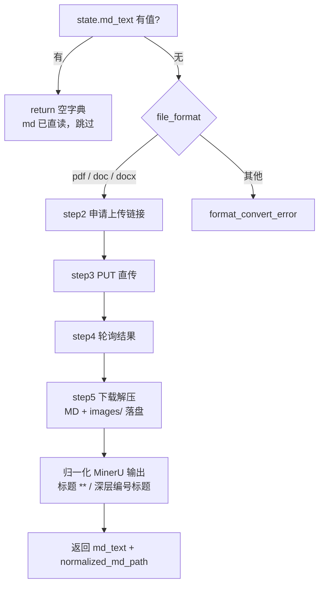
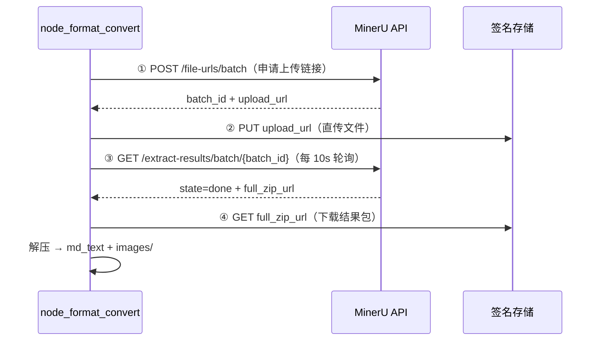

# 导入_02 node_format_convert —— PDF / Word → Markdown 归一化

> 文件：`processor/import_processor/nodes/node_format_convert.py`
> 职责：把"人看的文档格式"变成"程序能正则的 Markdown"。**pdf / doc / docx 统一走 MinerU 云端解析。**

## 一、为什么要归一化

后面三个 parser 全靠正则匹配 `## ` / `### ` / `- 字段: 值` 这类 Markdown 锚点。如果每个 parser 都要额外兼容 Word 的段落对象、PDF 的文本框，复杂度会爆炸。

所以设计的核心是：**只做一次格式归一化，把复杂度收敛在一个节点里**。归一化之后的 `md_text` 是一条"扁平的行序列"，三个 parser 对它的假设完全一致。

## 二、整体流程



**三种格式走的是同一套代码**，只在申请任务时有一个参数不同（`is_ocr`）：

| 格式 | `is_ocr` | 原因 |
|---|---|---|
| `.pdf` | `True` | PDF 可能是扫描件，必须 OCR 才能取到文字 |
| `.docx` | `False` | Word 是原生文本，强制 OCR 反而把可结构化解析的排版交给识别模型 |
| `.doc` | `False` | 同上（MinerU 内部先做格式转换） |

## 三、第一步：判断要不要干活

```python
def step_1_validate_and_get_data(state: dict):
    file_format = state.get("file_format")
    if state.get("md_text"):
        return None                      # md 已直读，无需转换
    local_file_path = Path(state.get("local_file_path", ""))
    local_dir = Path(state.get("local_dir", str(local_file_path.parent)))
    return file_format, local_file_path, local_dir
```

判断依据是 **`md_text` 有没有内容**，而不是 `file_format == "md"`。这个选择有讲究：

- 如果按 `file_format` 判断，就要保证上游一定写对了这个字段；
- 按 `md_text` 判断，等于"有内容就不用转"，是**幂等**的——即使将来有别的节点也产出 `md_text`，这里依然正确。

`local_dir` 的兜底是 `local_file_path.parent`：`local_dir` 由 API 层写入（zip 导入时是解压根目录），正常情况下总有值；兜底是为了单节点调试时不至于 `KeyError`。

## 四、为什么 Word 也改成走 MinerU

早期实现用 `python-docx` 在本地把段落/表格重组成 Markdown，好处是**快、无外部依赖**，代价是**图片全部丢失**：

| 能力 | 本地 python-docx | MinerU 云端 |
|---|---|---|
| 段落 / 标题 / 列表 | ✅ 靠样式名映射，方言多 | ✅ 版面模型识别 |
| 表格 | ✅ 手工拼 Markdown 表格 | ✅ 结构化输出 |
| **图片** | ❌ **完全丢弃**（连占位符都没有） | ✅ 导出 `images/` + `` |
| 公式 | ❌ 纯文本 | ✅ LaTeX |
| 速度 | 毫秒级 | 10~30 秒 |
| 依赖 | 无 | 网络 + `MINERU_API_TOKEN` |

图片为什么在本地方案里必丢：`paragraph.text` 只拼接 `<w:t>` 文本节点，而图片是 `<w:drawing>` 里的 `<a:blip r:embed="rId8"/>`，文本层面等于不存在；图片段落 `text == ""` 又被 `if not text: continue` 整段跳过。实测一份 10 张图的 Word 讲义，转换后 ``，`images/` 下 9 个文件。下游 `node_md_img` 就能像处理 PDF 一样做 VL 摘要 + MinIO 上传。

> **这个节点不再有本地降级路径**：MinerU 失败就直接写 `format_convert_error`，任务终止。理由是"降级到丢图的解析"会让同一批资料的质量变得不可预测——用户以为图导进去了，实际没有。

## 五、MinerU 四步

MinerU 是异步任务：申请上传链接 → 直传 → 轮询 → 下载结果包。



### 5.1 申请上传链接

```python
headers = {"Authorization": f"Bearer {mineru_config.api_key}"}
apply_url = "https://mineru.net/api/v4/file-urls/batch"
apply_resp = requests.post(
    apply_url,
    headers={**headers, "Content-Type": "application/json"},
    json={"enable_formula": True, "enable_table": True,
          "language": "ch", "files": [{"name": data_name, "is_ocr": is_ocr}]},
    timeout=30,
)
apply_resp.raise_for_status()
apply_data = apply_resp.json()
if apply_data.get("code") != 0:
    raise RuntimeError(f"MinerU 申请任务失败：{apply_data.get('msg')}")
batch_id = apply_data["data"]["batch_id"]
upload_url = apply_data["data"]["file_urls"][0]
```

请求体四个参数都是**针对教育资料的定向配置**：

| 参数 | 值 | 作用 |
|---|---|---|
| `enable_formula` | `True` | 数学公式转 LaTeX（`$...$`），否则公式会变成乱码图片或空行 |
| `enable_table` | `True` | 表格转 Markdown 表格 |
| `language` | `"ch"` | 中文版面模型，影响 OCR 与分词 |
| `is_ocr` | 按格式 | 见第二节的表格 |

`files` 里传的是 `{"name": ...}` 而不是文件内容——这是 MinerU 的"本地文件模式"：它返回一个**预签名 URL**，由客户端自己 PUT 上去，避免大文件走 API 网关。

错误判断有两层：`raise_for_status()` 管 HTTP 层（401/429/500），`code != 0` 管业务层（配额不足、参数错误）。两层都要查，否则 MinerU 返回 `200 + {"code": -10002}` 时会被当成成功。

### 5.2 直传文件

```python
with open(src_path, "rb") as f:
    put_resp = requests.put(upload_url, data=f, timeout=300)
put_resp.raise_for_status()
```

注释里特别写了 **"不设置 Content-Type 头"**。原因：预签名 URL 在生成时已经确定了签名范围，如果客户端额外加了 `Content-Type`，某些 S3 兼容实现会认为签名不匹配而返回 403。用 `data=f` 而不是 `files=...`，也是为了避免 `requests` 自动生成 `multipart/form-data` 边界和 `Content-Type`。

`timeout=300` 是 5 分钟——50MB 的文件在慢网下传 5 分钟是合理的上界。

### 5.3 轮询结果

```python
result_url = f"https://mineru.net/api/v4/extract-results/batch/{batch_id}"
deadline = time.time() + 600
md_zip_url = None
while time.time() < deadline:
    time.sleep(10)                        # 先等再查：刚提交必然 pending
    poll = requests.get(result_url, headers=headers, timeout=30)
    poll_data = poll.json()
    results = (poll_data.get("data") or {}).get("extract_result") or []
    if results:
        state = results[0].get("state")
        if state == "done":
            md_zip_url = results[0].get("full_zip_url") or results[0].get("md_url")
            break
        if state == "failed":
            raise RuntimeError(f"MinerU 转换失败：{results[0].get('err_msg')}")
if not md_zip_url:
    raise RuntimeError("MinerU 转换超时（>10 分钟）")
```

四个细节：

1. **`while time.time() < deadline`** 而不是 `for _ in range(60)`：把"次数"换成"绝对时间"，即使某次请求本身很慢也不会把总时长拖到 10 分钟以上；
2. **`sleep(10)` 放在请求前**：提交后立刻查一定是 `pending`，白跑一次；
3. **`(poll_data.get("data") or {})`**：`data` 可能是 `null`，直接 `.get` 会 `AttributeError`；
4. **`full_zip_url or md_url`**：优先整包（含图片），退化到纯 MD（丢图片但至少内容在）。

### 5.4 下载解压

```python
dl = requests.get(md_zip_url, timeout=120)
md_text = ""
with zipfile.ZipFile(io.BytesIO(dl.content)) as zf:
    for name in zf.namelist():
        if name.endswith(".md"):
            md_text = zf.read(name).decode("utf-8", errors="ignore")
        elif "/images/" in name or name.startswith("images/"):
            img_name = Path(name).name
            img_dir = local_dir / "images"
            img_dir.mkdir(parents=True, exist_ok=True)
            (img_dir / img_name).write_bytes(zf.read(name))
if not md_text:
    raise RuntimeError("MinerU 结果包中无 .md 文件")
```

产物目录：

```
local_dir/
├── 讲义.docx              ← 原始文件（pdf 则是 .pdf）
├── 讲义.md                ← 归一化产物（node_md_img 按它定位图片）
└── images/
    ├── 1aae03bc...jpg
    └── ...
```

MinerU 返回的 MD 里图片引用是 `` 这类相对路径，而 MD 就写在 `local_dir` 下，所以相对路径天然成立。**目录结构是两侧的隐式契约**——`node_md_img` 拿到 `normalized_md_path` 就能找到图。

`decode("utf-8", errors="ignore")` 用 `ignore` 而不是抛错：MinerU 偶尔会在公式区域混入非法字节，为几个字符让整份资料失败不值得。

## 六、输出归一化：MinerU 与下游 parser 的方言差异

MinerU 的输出是"给人看的 Markdown"，和 `node_course_doc_parser` 的假设有两处不兼容，在落盘前统一处理：

```python
def _normalize_mineru_markdown(md_text: str) -> str:
    lines = []
    for line in md_text.splitlines():
        deep = _DEEP_NUMBERED_HEADING_RE.match(line)          # ^#{5,6}\s+\d+(\.\d+)+
        if deep:
            lines.append(f"- {deep.group('num')} {deep.group('text')}".rstrip())
            continue
        m = _HEADING_LINE_RE.match(line)
        if m:
            lines.append(f"{m.group(1)}{m.group(2).replace('**', '')}".rstrip())
        else:
            lines.append(line)
    return "\n".join(lines)
```

### 6.1 Word 的加粗标题 → 标题里带 `**`

Word 的标题样式通常是加粗的，MinerU 会把加粗原样导出：

```markdown
# 1 **LangGraph概述**

## 1.1 **什么是LangGraph**
```

如果不处理，`**` 会一路带进两个地方：

1. `node_course_doc_parser` 的 `chapter_name` → 入库字段变成 `1 **LangGraph概述**`，引用展示时很脏；
2. 块首的 `【章节路径】` 向量前缀 → `**` 对语义检索是纯噪音 token。

只去 `**`（不动 `__`），因为 `# __init__ 方法` 这种标题是合法的，去 `__` 会破坏它。

**实测**：56 个标题里 41 个含 `**`，清洗后 0 个。

### 6.2 多级列表编号 → 5~6 级标题

Word 的列表编号（`2.2.1.1.1.1` 这种）会被 MinerU 映射成深层标题：

```markdown
###### 2.2.1.1.1.1 定义状态；

###### 2.2.1.1.1.2 定义节点函数；
```

而 `node_course_doc_parser` 的 `_flush_section()` **对任何标题都会切分 section**（见 `导入_06` 4.4）。结果：每个列表项都成了一个独立 section → 一堆只有一句话的碎块。

规则是"5~6 级 + 点分编号"才降级为列表项，保留原文：

```markdown
- 2.2.1.1.1.1 定义状态；
- 2.2.1.1.1.2 定义节点函数；
```

**实测对比**（同一份讲义）：

| 版本 | 章节数 | 块数 | 平均块长 | <200 字的块 |
|---|---|---|---|---|
| 不归一化 | 49 | 65 | 680 | 27 |
| 归一化后 | 26 | 44 | 994 | 8 |

块粒度回到合理区间（旧的本地 python-docx 方案是 17 章 / 37 块 / 平均 1108），同时没有丢任何文本。

## 七、返回值与下游契约

```python
md_path = local_dir / f"{local_file_path.stem}.md"
return {"md_text": md_text, "normalized_md_path": str(md_path)}
```

三种格式的返回现在**完全一致**：

| 格式 | 返回 | `normalized_md_path` | 图片 |
|---|---|---|---|
| `.md` | `node_entry` 已给 | 指向原文件 | 由 `node_md_img` 就地处理 |
| `.pdf` | `md_text` + 路径 | `{stem}.md` | ✅ `images/` + 相对引用 |
| `.docx` / `.doc` | `md_text` + 路径 | `{stem}.md` | ✅ 同上 |

下游契约变得非常简单：**只要有 `normalized_md_path`，就说明有本地 MD 和可能的 `images/` 目录，`node_md_img` 就会接管**。这也是为什么"去掉本地降级"是个净收益——不再有"有 md_text 但没图"的中间态。

## 八、能力边界与失败语义

| 限制 | 值 | 说明 |
|---|---|---|
| 本系统文件上限 | 50MB | `node_entry.MAX_FILE_SIZE` |
| MinerU 文件上限 | 200MB / 600 页 | 超出会在申请或解析阶段报错 |
| 本节点超时 | 10 分钟 | 轮询 `deadline` |
| 调用配额 | 账号级 | 超额时 `code != 0`，报错信息来自 `msg` |

**失败即终止**，不降级：

```python
except Exception as e:
    logger.exception("格式转换失败")
    return {"format_convert_error": f"格式转换失败：{e}"}
```

`logger.exception` 打出完整堆栈（loguru 的 `diagnose=True` 还会带变量值），返回给用户的只有一句摘要——**堆栈进日志，摘要进状态**。

### 8.1 已知的质量差异（相较旧的本地解析）

| 维度 | 影响 | 说明 |
|---|---|---|
| **代码块围栏丢失** | 中 | 实测该讲义的 ` ``` ` 围栏数为 0，`pip install ...` 变成普通段落。代码文本还在，但结构没了 |
| 标题带编号 | 低 | `## 1.1 什么是LangGraph`，比原来多一个 `1.1` 前缀，不影响层级 |
| 正文下划线转义 | 低 | `langgraph\_venv`，MinerU 会转义 `_`，对检索影响很小 |
| 页眉页脚 | 低 | 不导出（该讲义页眉 1 张图未导入） |

代码围栏丢失是这次切换的主要代价。如果某类资料**代码占比很高**，可以考虑：

1. 给申请任务加 `"model_version": "vlm"`（官方推荐模型，版面/代码识别更细，未在本项目实测）；
2. 或者这类资料仍以 PDF 交付（MinerU 对 PDF 的代码块识别更好）。

## 九、排查手册

| 现象 | 大概率原因 | 怎么确认 |
|---|---|---|
| 401 / `code` 非 0 | Token 失效 / 配额用尽 | 看日志里的 `msg`；检查 `.env` 的 `MINERU_API_TOKEN` |
| PUT 403 | 上传时带了 `Content-Type` | 确认用的是 `data=f` 而不是 `files=` |
| 报超时（>10 分钟） | 文档页数多 / 云端排队 | 看轮询次数；必要时提高 `deadline` |
| `结果包中无 .md 文件` | 压缩包结构变了 / 转换异常但 state 报 done | 手工下载 `full_zip_url` 看目录 |
| 图片数量比 Word 里少 | 页眉页脚、浮动图不导出 | 对比 `word/media/` 数量 |
| 章节名带 `**` | 归一化函数被绕过 | 检查 `_normalize_mineru_markdown` 是否在落盘前调用 |
| 块数暴涨、大量短块 | 深层编号标题未降级 | 检查 `_DEEP_NUMBERED_HEADING_RE` |
| 代码块没有围栏 | MinerU 输出特性 | 见 8.1 |
| Word 导入后 `doc_kind` 是 project | zip 导入会带 `project_name` | 与格式无关，见 `导入_09` 6.2 |

## 十、设计取舍

| 决定 | 替代方案 | 为什么选现在这个 |
|---|---|---|
| Word 也走 MinerU | python-docx 本地解析 | 本地方案丢全部图片（实测 10 张 → 0） |
| 失败即终止，无降级 | 降级到本地解析 | 避免"同一批资料有的有图有的没图" |
| `is_ocr` 只给 PDF | 全部 True | Word 原生文本不该交给 OCR |
| 输出归一化两处 | 改下游 parser | 方言差异收敛在生产者侧，parser 保持通用 |
| 只去 `**` 不去 `__` | 全部强调标记都去 | `__init__` 这类标题会被破坏 |
| 落盘 `{stem}.md` | 用临时目录 | 便于审计，也让 `node_md_img` 的相对路径成立 |
