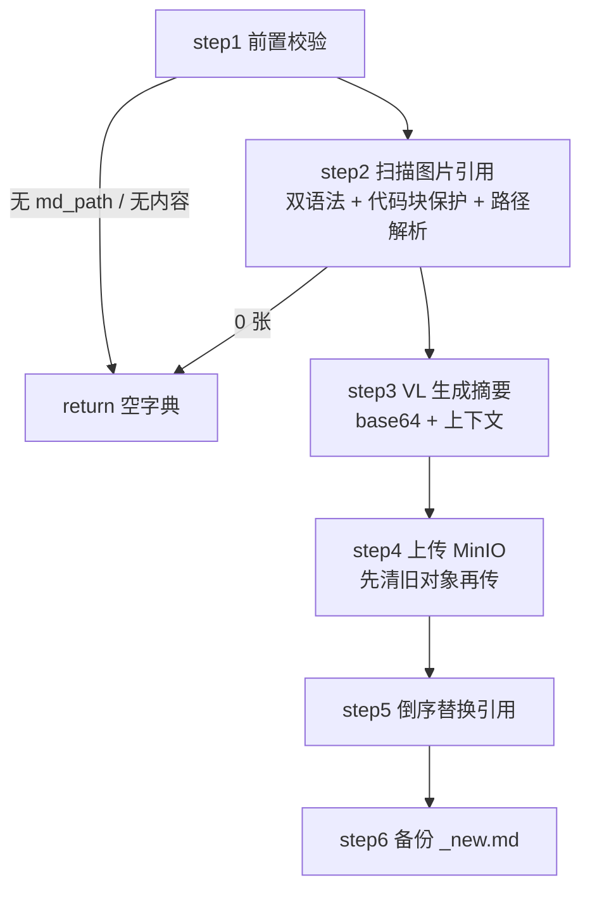

# 导入_03 node_md_img —— 图片 VL 摘要 + MinIO + 引用替换

> 文件：`processor/import_processor/nodes/node_md_img.py`（工具：`utils/md_image_utils.py`）
> 职责：让图片**既能被检索，又能被展示**。

## 一、为什么这一节值得单独存在

原始 MD 里图片长这样：

```markdown
下图为 Transformer 的整体结构：


编码器由 N 个相同的层堆叠而成。
```

向量化只吃 `content` 文本。`` 这段在向量模型眼里就是噪音——**图片承载的知识完全丢失**。用户问"Transformer 的结构图长什么样"，永远检索不到这段。

所以这一步做两件事，缺一不可：

| 目标 | 手段 | 产出 |
|---|---|---|
| 图片语义进入向量空间 | VL 多模态模型生成 50 字摘要 | 摘要写进 `` 的 alt 位 |
| 前端能正常显示图片 | 上传 MinIO（公开读桶） | 替换成可访问的 HTTP URL |

替换后的形态：

```markdown
下图为 Transformer 的整体结构：


编码器由 N 个相同的层堆叠而成。
```

**alt 位放摘要是一个很巧的复用**：Markdown 语法本身允许 alt 文本，而解析 MD 的 `content` 时会保留 alt，于是摘要天然进入向量化文本，不需要额外的字段。

## 二、整体流程



## 三、step1：三重前置校验

```python
md_path = state.get("normalized_md_path")
md_content = state.get("md_text", "")
search_root = state.get("local_dir") or ""

if not md_path or not md_content:
    logger.info("无 MD 文件路径（非 MD 链路），跳过图片处理")
    return None

md_path_obj = Path(md_path)
if not md_path_obj.is_file():
    logger.warning(f"MD 文件不存在，跳过图片处理：{md_path}")
    return None

return md_path_obj, md_content, search_root
```

三个字段各有分工：

- `md_path`：**是否需要处理图片的总开关**。只有 `md` / `pdf` / `doc` / `docx` 四种链路都会给出 `normalized_md_path`（Word 现在也走 MinerU，会落盘 MD 与 `images/`），所以这里正常不会为空；为空只发生在旧状态 / 手工调用节点的场景；
- `md_content`：正文，用于正则扫描；
- `search_root`：`local_dir`，即任务工作目录 / zip 解压根目录。它解决一个具体问题：**MD 在子目录，图片在包根 `images/`**。

比如 zip 结构：

```
资料包/
├── images/
│   └── fig1.png          ← 图片在这
└── docs/
    └── 第一章.md          ← MD 在这，引用 ../images/fig1.png 或写错成 images/fig1.png
```

只按 MD 目录找会失败，`search_root` 提供了第二落点。

注意 `md_path_obj.is_file()` 用的是 `warning` 而非 `info`：文件不存在属于异常情况（可能是被清理了），值得提醒；而"非 MD 链路"是正常设计，用 `info`。

## 四、step2：扫描与定位（最复杂的一步）

### 4.1 两种图片语法

同一篇文档里可能混用：

```markdown
      ← Markdown 原生

   ← Typora 缩放 / 语雀 / Word 导出
```

对应两个正则：

```python
# Markdown 图片：
_MD_IMAGE_RE = re.compile(
    r"!\[(?P<alt>[^\]\n]*)\]\(\s*(?P<src><[^>\n]+>|[^)\s]+)"
    r"(?:\s+(?:\"[^\"\n]*\"|'[^'\n]*'))?\s*\)"
)
# HTML img 标签及 src 属性（双引号/单引号/无引号）
_HTML_IMG_RE = re.compile(r"]*>", re.IGNORECASE)
_HTML_SRC_RE = re.compile(
    r"""\bsrc\s*=\s*(?:"(?P<dq>[^"]*)"|'(?P<sq>[^']*)'|(?P<bare>[^\s>]+))""",
    re.IGNORECASE,
)
```

`_MD_IMAGE_RE` 的三个设计点：

1. `src` 支持 `<...>` 尖括号包裹（含空格的路径必须这样写才符合 CommonMark）；
2. `alt` 用 `[^\]\n]*` 排除 `]` 和换行，避免跨行误匹配；
3. title 部分整体可选（`(?:...)?`），不捕获。

`_HTML_SRC_RE` 用三选一命名捕获组处理引号差异，取值时取第一个非 None：

```python
src = next((v for v in src_match.groupdict().values() if v is not None), "")
```

### 4.2 保护区间：代码里的图片不算图

文档里如果有一段"Markdown 语法教学"：

````markdown
示例写法：

```markdown

```
````

这个 `demo.png` 根本不存在，如果去解析它，会产生一条 missing 警告甚至误传。

解决方案是**先算出"不可解析区间"，再判断每个匹配是否落在区间内**：

```python
def _protected_ranges(md_content: str) -> list[tuple[int, int]]:
    """不参与图片解析的区间：围栏代码块 + 行内代码"""
    ranges = _code_block_ranges(md_content)                       # ``` / ~~~ 围栏
    ranges.extend((m.start(), m.end()) for m in _INLINE_CODE_RE.finditer(md_content))
    return _merge_ranges(ranges)
```

围栏的识别要处理"起止配对"：

```python
for line in md_content.splitlines(keepends=True):
    m = _FENCE_RE.match(line)
    if m:
        marker = m.group(1)
        if not fence_char:
            fence_char, fence_start = marker[0], offset     # 遇到开栅栏，记录起点
        elif marker[0] == fence_char:
            ranges.append((fence_start, offset + len(line)))  # 同字符栅栏 → 闭合
            fence_char = ""
    offset += len(line)
if fence_char:
    ranges.append((fence_start, len(md_content)))             # 未闭合：吃到文末
```

- `marker[0]` 取首字符（`` ` `` 或 `~`），保证 ``` 只能被 ``` 关闭，不会被 ~~~ 误配；
- `splitlines(keepends=True)` + 累加 `offset`，才能算出**字符偏移**（后续替换依赖偏移，不能用行号）；
- 未闭合的栅栏吃到文末，与 Markdown 渲染器的行为一致。

### 4.3 判定是否落区间：用二分而不是遍历

图片可能有几十上百处，保护区间的扫描必须够快：

```python
def _in_protected(pos: int, ranges: list, starts: list[int]) -> bool:
    if not ranges:
        return False
    idx = bisect_right(starts, pos) - 1        # 找到 pos 之前的最后一个区间起点
    return idx >= 0 and ranges[idx][0] <= pos < ranges[idx][1]
```

`bisect_right` 是 **O(log n)**。先按起点排序（`_merge_ranges` 里 `sorted`），再用"最后一个起点 ≤ pos 的区间"去判断——如果这个区间没覆盖 pos，后面的区间起点更大，更不可能覆盖。这是区间查询的标准写法，比 `any(s <= pos < e for s, e in ranges)` 快得多。

### 4.4 去重叠

一个 `` 标签内部不会同时是 Markdown 图片，但正则边界可能产生重叠（极端情况：alt 里嵌了 ``）。按出现位置排序后，用"已消费到的末尾"过滤：

```python
refs.sort(key=lambda r: r.start)
deduped = []
last_end = -1
for ref in refs:
    if ref.start < last_end:
        continue                 # 与上一个引用重叠，丢弃
    deduped.append(ref)
    last_end = ref.end
```

### 4.5 路径解析：四级候选 + 递归兜底

```python
def resolve_image_path(src, md_dir, search_root=None) -> Path | None:
    raw = normalize_image_src(src)
    if not raw:
        return None
    name = PurePosixPath(raw).name
    if Path(name).suffix.lower() not in IMAGE_EXTENSIONS:
        return None                          # 不是图片后缀，直接放弃

    candidates = []
    raw_path = Path(raw)
    if raw_path.is_absolute():
        candidates.append(raw_path)
    candidates.append(md_dir_obj / raw)        # 相对 MD 目录
    if search_root:
        candidates.append(Path(search_root) / raw)   # 相对资料包根
    candidates.append(md_dir_obj / name)       # 只保留文件名

    for candidate in candidates:
        if candidate.is_file() and candidate.suffix.lower() in IMAGE_EXTENSIONS:
            return candidate

    # 兜底：按文件名在 MD 目录 / 资料包根递归查找
    for base in ([md_dir_obj] if not search_root else [md_dir_obj, Path(search_root)]):
        for found in base.rglob(name):
            if found.is_file() and found.suffix.lower() in IMAGE_EXTENSIONS:
                return found
    return None
```

四级候选顺序是有讲究的：

1. **绝对路径**：直接可用就用（本机导出常见的 `/Users/xx/images/a.png`）；
2. **相对 MD 目录**：标准情况，也是最快命中的；
3. **相对资料包根**：解决 MD 在子目录、图片在包根的情况；
4. **只留文件名**：解决 `../../images/a.png` 这种跑出包外的路径（解压后结构变了）。

四级都不中，才走 `rglob` 递归——这是 **O(整个目录树)** 的操作，只在异常情况下触发，所以放在最后。

`normalize_image_src` 的清洗链也值得看一眼：

```python
text = (src or "").strip()
if text.startswith("<") and text.endswith(">"):
    text = text[1:-1].strip()          # 去 <>
text = unquote(text)                   # URL 解码 %20 → 空格
text = text.split("#", 1)[0].split("?", 1)[0].strip()   # 去锚点/查询串
text = text.replace("\\", "/")         # Windows 反斜杠
while text.startswith("./"):
    text = text[2:]                    # 去 ./ 前缀
```

URL 解码这步很关键：中文文件名在 MD 里常被编码成 `%E8%AE%B2%E4%B9%89.png`，不解码就永远找不到文件。

### 4.6 同一张图被引用多次 → 合并

```python
resolved: dict[str, ResolvedImage] = {}
for ref in refs:
    if is_remote_src(ref.src):
        remote_count += 1
        continue
    image_path = resolve_image_path(ref.src, md_dir, search_root or None)
    if image_path is None:
        missing.append(ref.src)
        continue

    key = build_image_key(image_path, md_dir, search_root or None)
    item = resolved.get(key)
    if item is None:
        item = ResolvedImage(key=key, path=image_path)
        resolved[key] = item
    item.refs.append(ref)
    if item.context is None:
        item.context = (
            md_content[max(ref.start - 100, 0):ref.start],       # 上文 100 字
            md_content[ref.end:min(ref.end + 100, len(md_content))],  # 下文 100 字
        )
```

**为什么要合并**：同一张图被引用 5 次，只需要 1 次 VL 调用和 1 次上传，但 5 个位置的引用都要替换。所以 `ResolvedImage.refs` 是个列表。

**`build_image_key` 用相对路径而不是文件名**：

```python
def build_image_key(image_path, md_dir, search_root=None) -> str:
    for base in (search_root, md_dir):     # 优先相对资料包根
        if not base:
            continue
        try:
            return Path(image_path).relative_to(Path(base)).as_posix()
        except ValueError:
            continue                        # 不在这个 base 下面，换下一个
    return Path(image_path).name
```

因为资料包里可能有 `ch01/images/fig1.png` 和 `ch02/images/fig1.png` **同名不同图**。用文件名做 key 会导致后者覆盖前者，上传到 MinIO 也会互相覆盖。用相对路径就能区分。

**上下文只取第一次出现的位置**：图片摘要只需要"这张图在讲什么"，同一张图在不同位置的上下文可能有细微差异，但生成一次摘要足够，取首次出现处最稳定。

远程图片（`http://` / `data:` / `//`）直接跳过——它们已经有了可访问 URL，不需要重新上传。

## 五、step3：VL 生成摘要

```python
vl_model = get_llm_client(lm_config.vl_model)

for item in image_list:
    prompt_text = load_prompt(
        name="image_summary",
        root_folder=root_folder,             # MD 文件名（不含扩展名）
        image_content=item.context or ("", ""),
    )
    mime_type = guess_type(item.path.name)[0] or "image/jpeg"
    image_data = base64.b64encode(item.path.read_bytes()).decode("utf-8")
    message = HumanMessage(content=[
        {"type": "text", "text": prompt_text},
        {"type": "image_url", "image_url": {"url": f"data:{mime_type};base64,{image_data}"}},
    ])
    chains = vl_model | StrOutputParser()
    apply_api_rate_limit()
    image_summary = chains.invoke([message])
    summary_image_dict[item.key] = image_summary.strip()
```

### 5.1 为什么要给上下文

提示词模板（`common/prompt/image_summary.prompt`）：

```
这是"{root_folder}"文件中的一张图片，图片上文部分为"{image_content[0]}"，
下文部分为"{image_content[1]}"，请用中文简要总结这张图片的内容，用于 Markdown 图片标题，控制在50字以内。
```

只有图片本身时，模型容易给出"一张流程图"这种无用摘要。给了上下文，它能结合章节主题说出"Transformer 编码器-解码器结构示意图"——**这才是能提升召回的信息**。

`load_prompt` 用 `str.format(**kwargs)` 渲染，注意 `{image_content[0]}` 这种索引占位符要求传入的是**可索引对象**（这里是 tuple），传字符串会变成取字符。

### 5.2 base64 内联 vs 上传后给 URL

这里选了 `data:{mime};base64,{data}` 内联，理由是**这些图片此刻还没上传 MinIO**（上传在 step4）。如果先上传再识别，顺序就反了；如果先传临时位置再识别，多一次 IO。

代价是内存：一张 2MB 的图 base64 后约 2.7MB，全部拼进请求体。对单张图完全没问题，所以不需要分片。

`guess_type` 从文件名推断 MIME；推断失败兜底 `image/jpeg`（比兜底 `application/octet-stream` 更容易被 VL 接口接受）。

### 5.3 限速

```python
apply_api_rate_limit()   # 默认 3000 次 / 60 秒，滑动窗口
```

实现在 `utils/rate_limit_utils.py`，用一个 `deque` 记录请求时间戳：

```python
while _GLOBAL_REQUEST_TIMES and current_time - _GLOBAL_REQUEST_TIMES[0] >= window_seconds:
    _GLOBAL_REQUEST_TIMES.popleft()          # 清掉窗口外的旧记录
if len(_GLOBAL_REQUEST_TIMES) >= max_requests:
    sleep_duration = window_seconds - (current_time - _GLOBAL_REQUEST_TIMES[0])
    time.sleep(sleep_duration)               # 等到最早的请求滑出窗口
_GLOBAL_REQUEST_TIMES.append(current_time)
```

**为什么是全局队列**：VL 调用可能来自多个任务（API 层用 `BackgroundTasks`，多文件并发），限速必须是**进程级**的才能防止整体打爆配额。

### 5.4 摘要清洗：剥掉模型的"复述指令"

VL 模型有时不直接给标题，而是先复述 prompt 再给结论：

```
基于图片及上下文内容，为您拟定以下Markdown图片标题（48字）： **展示LangGraph工作流图结构：…**
基于图片内容和上下文，这张图展示了…。 **建议标题（48字）：** 展示LangGraph带分支图的执行流程：…
```

这段前导语会原样写进 `content`，既占块内正文，也把"拟定标题""48字"这类指令词混进向量。实测该讲义 9 张图里有 3 张带这种前缀。清洗放在摘要落库前：

```python
_VL_PREAMBLE_RE = re.compile(r"^[^：:]{0,40}(?:拟定|建议|总结|如下|标题)[^：:]{0,20}[：:]\s*")
_VL_INSTRUCTION_RE = re.compile(r"(?:拟定|建议|总结)[^：:]{0,20}标题[^：:]{0,20}[：:]")

def _clean_image_summary(text: str) -> str:
    s = (text or "").strip().replace("**", "")
    m = _VL_INSTRUCTION_RE.search(s)          # 中段复述：只保留冒号后的结论
    if m:
        tail = s[m.end():].strip("：: 　")
        if len(tail) >= 10:                   # 太短说明匹配到正文，放弃
            s = tail
    s = _VL_PREAMBLE_RE.sub("", s)            # 句首前导语
    s = re.sub(r"\s+", " ", s).strip("：: 　")
    if len(s) > _VL_MAX_CHARS:                # 上限 200 字
        s = s[:_VL_MAX_CHARS].rstrip() + "…"
    return s
```

三条约束：

1. **两道正则**：句首前导语用 `^` 锚定；中段复述（`**建议标题（48字）：**`）没有锚点，只能先定位"建议…标题…冒号"再取后文；
2. **`len(tail) >= 10` 的兜底**：正常摘要里也可能出现"建议"二字，冒号后过短说明匹配错了，宁可不动；
3. **只用 `**` 不做全量 markdown 清洗**：alt 里保留 `\`` 这类字符是安全的，`**` 会干扰阅读才去掉。

实测三条噪声摘要分别从 78/76/115 字降到 38/35/34 字，正常摘要（"这张图片展示了…"）原样保留，函数幂等。

## 六、step4：上传 MinIO（含幂等清理）

```python
minio_client = get_minio_client()
# 配置里的图片目录带前导斜杠（`/upload-images`）：统一去掉，避免对象键和 URL 出现 `//`
img_dir = minio_config.minio_img_dir.strip("/")

# 幂等：清理同前缀旧图片
old_objects = minio_client.list_objects(
    bucket_name=minio_config.bucket_name,
    prefix=f"{img_dir}/{stem}",
    recursive=True,
)
errors = minio_client.remove_objects(
    bucket_name=minio_config.bucket_name,
    delete_object_list=[DeleteObject(obj.object_name) for obj in old_objects],
)
for error in errors:
    logger.warning(f"删除旧图片出现问题：{error}")
```

**为什么先删**：同一份讲义重新导入时，如果图片有增删，旧对象会永久残留（MinIO 不会自动过期）。先按前缀清空，**这次导入的图片集合 = MinIO 上的图片集合**，不会累积垃圾。

`remove_objects` 返回的是**错误迭代器**（不是结果列表），必须显式遍历才会真正执行批量删除，并把失败信息读出来——这是 `minio-py` 的一个反直觉 API。

然后逐个上传：

```python
for item in image_list:
    object_name = f"{img_dir}/{stem}/{item.key.replace('/', '__')}"
    minio_client.fput_object(
        bucket_name=minio_config.bucket_name,
        object_name=object_name,
        file_path=str(item.path),
        content_type=guess_type(item.path.name)[0] or "image/jpeg",
    )
    url = f"http://{minio_config.endpoint}/{minio_config.bucket_name}/{quote(object_name)}"
    image_url_dict[item.key] = url
```

三个细节：

1. **`key.replace('/', '__')` 把目录层级压平**。`key` 是相对路径（`ch01/images/fig1.png`），如果原样做 object_name，MinIO 里会建出多级"目录"，虽然 S3 协议支持，但清理时前缀匹配会更麻烦；压平成 `ch01__images__fig1.png` 后，一个任务的所有图都在同一层，且不同子目录的同名图不冲突。
2. **`fput_object` 而不是 `put_object`**：`fput` 对大文件会分片，且不用自己开文件句柄。
3. **`quote(object_name)`**：中文文件名的路径要 URL 编码，否则前端 `` 可能被浏览器截断。`quote` 的默认 `safe='/'` 会保留路径分隔符，只把中文、空格等字符转成 `%XX`，正好符合需要。

### 6.1 前导斜杠与双斜杠 URL

`minio_config.minio_img_dir` 配的是 `'/upload-images'`（带前导斜杠），直接拼会得到：

```
object_name: /upload-images/xxx/images__a.jpg
URL        : http://localhost:9000/knowledge-base-files//upload-images/...
                                                          ^^ 双斜杠
```

MinIO 自己会容忍（实测返回 200），但换成 nginx / S3 网关 / CDN 时 `//` 常被判成非法路径直接 404。修复方式是**在入口统一 `strip("/")`**，对象键和 URL 都用同一个 `img_dir`：

```python
img_dir = minio_config.minio_img_dir.strip("/")
```

不要只改 URL 不改对象键——那样会出现"键里有斜杠、前缀清理用无斜杠"的两套前缀，幂等删除会漏。实测修复后：

```
object_name: upload-images/示例文档/images__a.jpg
URL        : http://localhost:9000/knowledge-base-files/upload-images/%E7%A4%BA...
双斜杠      : False
```

桶的创建与公开读策略在 `utils/clients/minio_utils.py` 里：

```python
policy = {
    "Version": "2012-10-17",
    "Statement": [{
        "Effect": "Allow",
        "Principal": {"AWS": "*"},
        "Action": "s3:GetObject",
        "Resource": f"arn:aws:s3:::{minio_config.bucket_name}/*",
    }],
}
client.set_bucket_policy(minio_config.bucket_name, json.dumps(policy))
```

**匿名只读**——前端不携带凭证也能显示图片。

## 七、step5：倒序替换（关键技巧）

```python
replacements = []
for item in image_list:
    image_url = image_url_dict.get(item.key)
    image_summary = summary_image_dict.get(item.key)
    if not image_url or not image_summary:
        continue                              # 任一缺失：保留原样，不破坏文档
    new_text = render_image_markdown(image_summary, image_url)
    for ref in item.refs:
        replacements.append((ref.start, ref.end, new_text))

for start, end, new_text in sorted(replacements, reverse=True):
    md_content = md_content[:start] + new_text + md_content[end:]
```

**必须倒序**，原因是偏移失效：

```
原串:  A [ref1] B [ref2] C
         ↑5      ↑12
先把 ref1 换成更长的文本（摘要通常比  长），ref2 的 start 就从 12 变成了 12 + Δ
→ 正序替换时，第二次的切片位置就错了
倒序替换：先改后面的，前面的偏移不受影响
```

`sorted(replacements, reverse=True)` 对 `(start, end, text)` 元组排序，按 `start` 降序——正好满足要求。

`render_image_markdown` 做两处清洗：

```python
def render_image_markdown(summary: str, url: str) -> str:
    text = " ".join((summary or "").split())                  # 所有空白（含换行）压成单空格
    text = text.replace("[", "［").replace("]", "］")          # 方括号转全角
    return f""
```

- **换行必须去掉**：alt 文本里的换行会把 Markdown 语法打断，渲染失败；
- **方括号转全角**：如果摘要里出现 `[示例]`，`` 的语法会被 `]` 提前闭合，导致解析错乱。转成全角后视觉几乎无差异，但语法安全。

## 八、step6：备份与状态回写

```python
md_path_obj_new = md_path_obj.with_name(f"{md_path_obj.stem}_new.md")
md_path_obj_new.write_text(md_content_new, encoding="utf-8")
```

命名为 `xxx_new.md` 而不是覆盖原文件，两个原因：

1. **审计对照**：出问题时能直接 diff 原 MD 和替换后的 MD，看图片摘要质量；
2. **避免二次扫描**：zip 导入时 `discover_md_files` 在上传阶段就完成了（早于本节点），所以 `_new.md` 不会被当成新文档；如果同一个目录被重新扫描，`_new.md` 会变成重复任务——这是当前实现的一个隐含前提，改 zip 逻辑时要注意。

节点最终返回：

```python
return {"md_text": md_content_new}
```

**只覆盖 `md_text`，不动 `normalized_md_path`**。所以下游 parser 读到的 `md_text` 是替换后的版本，而文件系统上的原文件保持原样。

## 九、边界与排查

| 现象 | 原因 | 处理 |
|---|---|---|
| 日志显示"无可定位的本地图片" | 图片在别处 / 路径写法特殊 | 打印 `refs` 与 `missing`，检查 `local_dir` 是否传对 |
| 图片摘要全是"一张图片" | 上下文为空（图片在文档开头） | 正常现象，可考虑给 `root_folder` 更有信息量的值 |
| MinIO 上图片重复堆积 | 前缀清理的 `stem` 与实际 object 前缀不一致 | 核对 `minio_img_dir` 是否带尾部 `/` |
| 前端图片 404 | URL 里中文未编码 / MinIO 桶策略未公开读 | 直接复制日志里的 URL 到浏览器验证；检查 `set_bucket_policy` |
| 替换后 MD 语法断裂 | 摘要含 `]` 或换行 | 确认走的是 `render_image_markdown` |
| 大量图片时很慢 | 每张图串行调用 VL | 可改并发（注意限速器是全局的，并发时仍会串行等待） |

## 十、设计取舍总结

| 决定 | 替代方案 | 为什么选现在这个 |
|---|---|---|
| 图片摘要放 alt | 单独存 `image_summary` 字段 | 复用 Markdown 语法，零改动进入 `content` 参与向量化 |
| 先删旧图再上传 | 直接覆盖同名对象 | 图片有增删时，直接覆盖会留下孤儿对象 |
| 按相对路径做 key | 按文件名做 key | 资料包内不同章节常有同名图片 |
| 倒序替换 | 正序 + 偏移补偿 | 倒序无需维护偏移修正表 |
| 备份 `_new.md` | 覆盖原文件 | 可 diff 审计，且保留原始资料 |
| 找不到图只 warn | 直接报错 | 图片缺失不该阻断整份资料导入 |
