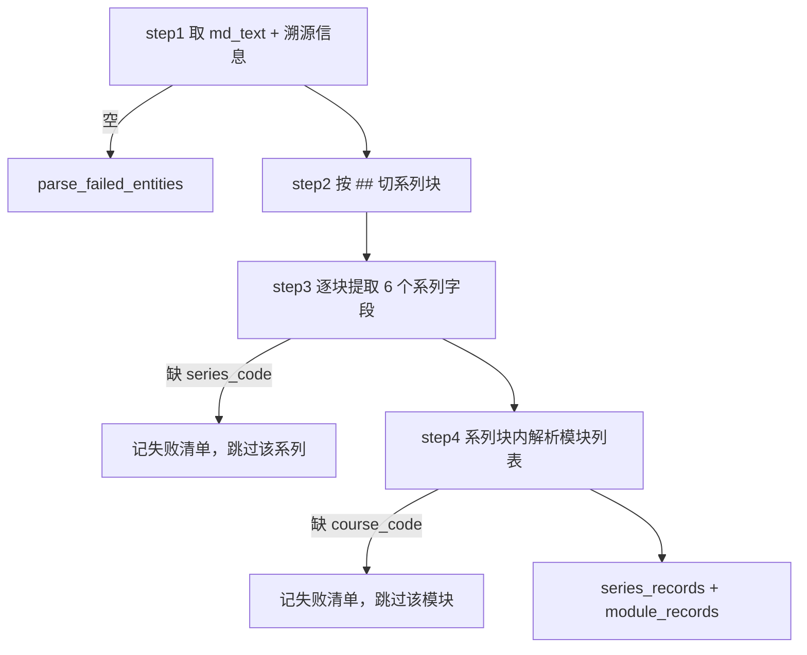

# 导入_04 node_course_parser —— 课程目录解析

> 文件：`processor/import_processor/nodes/node_course_parser.py`
> 职责：把一份"课程介绍.md"拆成**系列（series）**和**课程模块（module）**两类实体，一次产出两条 Collection 的数据。

## 一、输入长什么样

`course_catalog` 类型的资料有严格的层级约定（PRD 3.2）：

```markdown
## 通用编程入门班

- **系列编码**: prog_intro
- **描述**: 面向零基础学员的编程入门系列
- **课程分类**: 编程基础
- **适合人群**: 零基础学员、转行人员
- **学习目标**: 掌握编程基础语法与开发环境
- **适合年级**: 大学一年级

### 课程

- **语法基础与开发环境**
  - 编码: prog_intro_m01, 课时: 8, 学时: 16.00
  - 描述: 环境搭建、IDE 配置与第一个程序

- **流程控制**
  - 编码: prog_intro_m02, 课时: 6, 学时: 12.00
  - 描述: 条件、循环与跳转
```

结构抽象成两层：

```
## {系列名称}                  ← 一级边界：系列
  - 系列编码: xxx              ← 系列字段（6 个锚点）
  ...
  ### 课程                     ← 二级边界：模块列表开始
    - {课程名}                 ← 模块条目
      - 编码: xxx, 课时: N ...  ← 模块子字段（同行逗号分隔）
```

**产出**：

| Collection | 一条记录对应 | 业务主键 |
|---|---|---|
| `edu_course_series` | 一个 `##` 系列块 | `series_code` |
| `edu_course_module` | 一个 `- 课程名` 条目 | `course_code` |

## 二、整体流程



注意 step3 和 step4 之间有**数据依赖**：step4 需要 `series_code` 来回填到模块记录上（`course_module.series_code` 是外键）。所以 step3 返回的是 `[(series_record, block_lines)]` 配对列表，而不是两个独立列表。

## 三、正则：所有锚点的定义

```python
# 系列标题行：## 通用编程入门班
_SERIES_HEADER_RE = re.compile(r"^##\s+(?P<name>.+?)\s*$")

# 系列字段锚点：- **系列编码**: xxx（原生 MD）/ - 系列编码: xxx（docx 归一化产物，无 ** 加粗）
_SERIES_FIELD_RES = {
    "series_code":     re.compile(r"^-\s*(?:\*\*)?系列编码(?:\*\*)?\s*[:：]\s*(?P<value>.+?)\s*$"),
    "description":     re.compile(r"^-\s*(?:\*\*)?描述(?:\*\*)?\s*[:：]\s*(?P<value>.+?)\s*$"),
    "course_category": re.compile(r"^-\s*(?:\*\*)?课程分类(?:\*\*)?\s*[:：]\s*(?P<value>.+?)\s*$"),
    "target_audience": re.compile(r"^-\s*(?:\*\*)?适合人群(?:\*\*)?\s*[:：]\s*(?P<value>.+?)\s*$"),
    "learning_goal":   re.compile(r"^-\s*(?:\*\*)?学习目标(?:\*\*)?\s*[:：]\s*(?P<value>.+?)\s*$"),
    "suitable_grade":  re.compile(r"^-\s*(?:\*\*)?适合年级(?:\*\*)?\s*[:：]\s*(?P<value>.+?)\s*$"),
}
```

这段正则在**容忍两种写法**上下了功夫，因为输入可能来自两条不同的链路：

| 写法 | 来自 | 例子 |
|---|---|---|
| 带加粗 | 用户手写的原生 MD | `- **系列编码**: prog_intro` |
| 不带加粗 | `node_format_convert` 的 docx 产物 | `- 系列编码: prog_intro` |

`(?:\*\*)?` 把加粗标记变成可选，一个正则吃两种格式。同理 `[:：]` 同时接受半角和全角冒号——中文输入法下用户经常打出全角冒号。

`^#\#\s+` 的 `\s+` 也重要：`## 系列名` 和 `##  系列名`（两个空格）都能匹配，标题后必须有空格则避免了 `##xxx` 这种非标准写法被误判。

模块相关：

```python
_COURSE_SECTION_RE = re.compile(r"^###\s*课程\s*$")     # 「### 课程」小节标题
_MODULE_ITEM_RE   = re.compile(r"^-\s*(?:\*\*)?(?P<name>.+?)(?:\*\*)?\s*$")
_MODULE_CODE_RE     = re.compile(r"编码\s*[:：]\s*(?P<value>.+?)\s*[,，]")
_MODULE_DURATION_RE = re.compile(r"课时\s*[:：]\s*(?P<value>\d+)")
_MODULE_CREDIT_RE   = re.compile(r"学时\s*[:：]\s*(?P<value>[\d.]+)")
_MODULE_DESC_RE     = re.compile(r"描述\s*[:：]\s*(?P<value>.+?)\s*$")
```

`_COURSE_SECTION_RE` 用 `\s*` 而不是 `\s+`（`### 课程` 和 `###课程` 都收），因为标题里没有其他内容，放宽不会误伤。

`_MODULE_ITEM_RE` 的非贪婪 `.+?` 配合尾部可选的 `**`，能从 `- **语法基础与开发环境**` 里精确剥出 `语法基础与开发环境`（正则引擎先尝试最短 name，只有尾部 `**` 和行尾都能对上才成立，最终回溯到正确长度）。

模块子字段用 `search` 而不是 `match`，因为它们在**同一行内用逗号连写**：`编码: prog_intro_m01, 课时: 8, 学时: 16.00`。

## 四、step1：取数

```python
def step_1_validate_and_get_data(state: dict):
    md_text = state.get("md_text", "")
    source_file = state.get("source_file", "")
    source_path = state.get("source_path", "")
    if not md_text:
        return None
    return md_text, source_file, source_path
```

`source_file` / `source_path` 会被写进每条记录，最终进 Milvus 的 `source_file` / `source_path` 字段——**溯源能力**：检索命中的任意一条记录，都能反查它来自哪个文件的哪个路径。zip 导入时 `source_file` 是包内相对路径（如 `docs/第一章.md`），比文件名更有用。

`md_text` 为空直接返回 `{"parse_failed_entities": [{"reason": "归一化后 Markdown 为空"}]}`，注意这里**不带 `entity_type`**，因为连实体都谈不上，属于"整份文档级"失败。

## 五、step2：按 `##` 切系列块

这是一个朴素的状态机：

```python
lines = md_text.splitlines()
blocks = []
current_name = None
current_lines = []
for line in lines:
    m = _SERIES_HEADER_RE.match(line)
    if m:
        if current_name is not None:        # 保存上一个系列块
            blocks.append((current_name, current_lines))
        current_name = m.group("name").strip()
        current_lines = []
    elif current_name is not None:
        current_lines.append(line)
if current_name is not None:                # 收尾：最后一个系列块
    blocks.append((current_name, current_lines))
```

三个设计点：

1. **`current_name is None` 时丢弃行**——文档开头的总标题、说明文字（在第一个 `##` 之前）全部不进入任何块。这是正确的：它们不属于任何系列；
2. **收集的是原始行，不是解析结果**——因为 step4 还要用这些行找模块，保留原文最灵活；
3. **收尾必须补一次**——循环结束时最后一个系列还没归档。这个"漏掉最后一块"是状态机最经典的 bug，代码里专门用注释标了出来。

切分结果（对上面的样例）：

```python
[
  ("通用编程入门班", [
      "", "- **系列编码**: prog_intro", ..., "", "### 课程", "",
      "- **语法基础与开发环境**", "  - 编码: prog_intro_m01, 课时: 8, 学时: 16.00", ...
  ])
]
```

## 六、step3：提取系列字段（第一个"双状态"技巧）

```python
for series_name, block_lines in blocks:
    series_fields = {}
    in_course_section = False
    for line in block_lines:
        if _COURSE_SECTION_RE.match(line):
            in_course_section = True       # 命中「### 课程」，后续行属于模块列表
            continue
        if in_course_section:
            continue                        # 模块列表内的行不再匹配系列字段
        for field_name, field_re in _SERIES_FIELD_RES.items():
            m = field_re.match(line)
            if m:
                series_fields[field_name] = m.group("value").strip()
```

**为什么需要 `in_course_section` 这个开关**：

没有它的话，模块子字段里的 `- 描述: 环境搭建...` 会被 `description` 的正则命中，**后面覆盖前面**（`series_fields["description"]` 从系列描述变成最后一个模块的描述）。这类"同名锚点在不同层级重复出现"是文本解析里最隐蔽的 bug——解析不报错，数据悄悄错。

用一个布尔量把块切成"字段区 / 模块区"两段，就彻底避免了跨层污染。

拿到字段后做主键校验：

```python
series_code = series_fields.get("series_code")
if not series_code:
    failed.append({
        "entity_type": "course_series",
        "series_name": series_name,
        "reason": "缺少系列编码（业务主键）",
    })
    continue                             # 跳过该系列，不影响其他系列
```

`series_code` 是 Milvus 的 upsert 键（见 `导入_08`），没有它就无法幂等入库，所以只能丢弃。但注意 `continue` 而不是 `return`——**其余系列照常解析**。

组装记录：

```python
series_record = {
    "series_code": series_code,
    "series_name": series_name,                       # 来自 ## 标题，不是字段
    "description": series_fields.get("description", ""),
    "course_category": series_fields.get("course_category", ""),
    "target_audience": series_fields.get("target_audience", ""),
    "learning_goal": series_fields.get("learning_goal", ""),
    "suitable_grade": series_fields.get("suitable_grade", ""),
    "source_file": source_file,
    "source_path": source_path,
}
series_record["content"] = _build_series_content(series_record)
```

`series_name` 特意从标题取而不从字段取——标题是"系列叫什么"的唯一真实来源，字段表里没有"系列名称"这一项。

### 6.1 `content` 为什么要单独拼

```python
def _build_series_content(record: dict) -> str:
    parts = [
        f"课程系列：{record['series_name']}",
        f"系列编码：{record['series_code']}",
    ]
    if record.get("description"):
        parts.append(f"描述：{record['description']}")
    if record.get("course_category"):
        parts.append(f"课程分类：{record['course_category']}")
    if record.get("target_audience"):
        parts.append(f"适合人群：{record['target_audience']}")
    if record.get("learning_goal"):
        parts.append(f"学习目标：{record['learning_goal']}")
    if record.get("suitable_grade"):
        parts.append(f"适合年级：{record['suitable_grade']}")
    return "\n".join(parts)
```

因为下游 `node_bge_embedding` **只向量化 `content` 这一个字段**：

```python
texts = [r["content"] for r in records]
```

如果直接把 6 个字段丢给向量模型，要么得改向量化逻辑，要么字段根本进不去。拼成一个自然语言段落有三个好处：

1. **语义完整**：`"课程系列：X\n系列编码：Y\n描述：Z..."` 读起来像一段介绍，模型能理解；
2. **字段名也是语义**："适合人群"这四个字本身携带信息，比只给值召回更准；
3. **空字段自动省略**：`if record.get(...)` 让内容长度可控，不会出现一堆 `描述：` 空值污染向量。

这个约定贯穿全部三类记录（series / module / question / doc），是本项目的一条核心规范。

## 七、step4：解析模块列表（第二个"双状态"技巧）

```python
for series_record, block_lines in series_pairs:
    in_course_section = False
    current_module = None
    for line in block_lines:
        if _COURSE_SECTION_RE.match(line):
            in_course_section = True
            continue
        if not in_course_section:
            continue                       # 还没到「### 课程」，跳过
        # 模块条目行：- 课程名（排除含冒号的字段行，如 - 编码: xxx）
        m = _MODULE_ITEM_RE.match(line)
        if m and ":" not in line and "：" not in line:
            if current_module is not None:
                _finish_module(current_module, series_record, module_records, failed)
            current_module = {"course_name": m.group("name").strip()}
            continue
        # 模块子字段行
        if current_module is not None:
            stripped = line.strip()
            if not stripped:
                continue
            stripped = stripped.lstrip("-•· ").strip()   # 兼容 docx 列表项前缀
            ...
```

这里有三个关键判断：

### 7.1 `":" not in line` —— 区分"模块名"和"字段行"

`_MODULE_ITEM_RE` 会匹配**任何** `- xxx` 形式的行。模块子字段行 `- 编码: prog_intro_m01, 课时: 8` 也是 `- xxx`，如果不排除，它会被当成一个新模块，`course_name` 变成 `"编码: prog_intro_m01, 课时: 8"`。

用"这一行有没有冒号"来区分，是最简单可靠的启发式：**模块名是纯名称，字段行一定带冒号**。半角全角都检查，因为两种都可能出现。

代价：如果某个课程名本身含冒号（如 `- Python: 从入门到实战`），会被误判成字段行而丢失。这是已知的启发式边界，实际课程命名基本不用冒号。

### 7.2 `lstrip("-•· ")` —— 兼容 docx 产物的平级列表

docx 转换后，缩进信息往往已经丢失（`python-docx` 的 `paragraph.text` 不含缩进层级），子字段可能变成**同级的** `- 编码: xxx`。所以不能靠缩进判断层级，而是先剥掉列表前缀再匹配：

```python
stripped = stripped.lstrip("-•· ").strip()   # "- 编码: xxx" → "编码: xxx"
```

`lstrip` 的参数是**字符集合**，会把开头所有的 `-`、`•`、`·`、空格都剥掉。

### 7.3 `if "xxx" not in current_module` —— 只取第一次

```python
m = _MODULE_CODE_RE.search(stripped)
if m and "course_code" not in current_module:
    current_module["course_code"] = m.group("value").strip()
```

四个字段都带这个守卫。原因：模块描述里可能**顺带提到**"编码"、"课时"这些词，例如：

```
- 描述: 本模块共 8 课时，编码规范部分占 2 课时
```

这一行会被 `_MODULE_DURATION_RE` 命中（`课时, 8` → 不匹配，因为要求 `课时: 数字`）……

实际风险更主要来自**文档格式抖动**：某些资料会把字段重复写两遍（模板填充 + 人工补充），后一个可能是空值或错误值。`not in` 守卫保证"第一次出现的值优先"，符合"按文档顺序解析"的直觉。

### 7.4 `_finish_module`：主键校验 + 外键回填

```python
def _finish_module(module, series_record, module_records, failed):
    course_code = module.get("course_code")
    if not course_code:
        failed.append({
            "entity_type": "course_module",
            "series_code": series_record["series_code"],
            "course_name": module.get("course_name", ""),
            "reason": "缺少课程编码（业务主键）",
        })
        return

    record = {
        "course_code": course_code,
        "course_name": module.get("course_name", ""),
        "series_code": series_record["series_code"],     # 外键：来自所属系列
        "series_name": series_record["series_name"],     # 冗余，便于展示
        "duration": module.get("duration"),              # 可能 None
        "credit_hours": module.get("credit_hours"),      # 可能 None
        "description": module.get("description", ""),
        "source_file": series_record["source_file"],
        "source_path": series_record["source_path"],
    }
    record["content"] = _build_module_content(record)
    module_records.append(record)
```

两个设计点：

- **`series_name` 冗余存储**：Milvus 不是关系库，没有 JOIN。查询"某系列的课程模块"时要能直接展示系列名，冗余一份比二次查快得多；
- **`duration` / `credit_hours` 允许 `None`**：不是所有资料都写课时。Milvus 侧对这两个字段声明了 `nullable`（见 `导入_08`），`None` 会被跳过写入。

`_build_module_content` 同样做"字段名 + 值"的拼接，且对 `None` 用 `is not None` 判断（而不是真值判断）——因为 `课时: 0` 是合法值，用 `if record.get("duration")` 会把它当空值丢掉。

## 八、失败清单的结构

```python
# 系列级
{"entity_type": "course_series", "series_name": "xxx", "reason": "缺少系列编码（业务主键）"}

# 模块级
{"entity_type": "course_module", "series_code": "...", "course_name": "xxx", "reason": "缺少课程编码（业务主键）"}
```

`entity_type` 让前端/运营能区分"哪一类实体出的问题"；`reason` 直接是中文可读句子，不需要二次翻译。

API 层把它取出来上报：

```python
failed_entities = final_state.get("parse_failed_entities") or []
set_task_result(task_id, "failed_entities_count", str(len(failed_entities)))
set_task_result(task_id, "failed_entities", str(failed_entities[:20]))   # 只存前 20 条
```

## 九、性能与规模

对 219 个系列 / 657 个模块的实测数据：

- step2 一次 `splitlines()` + 单遍扫描 → O(行数)；
- step3 每行最多试 6 条正则，每个系列独立 → O(行数 × 6)；
- step4 再扫一遍 → O(行数 × 4)。

整体是线性复杂度，实测在百毫秒级。**不需要做任何缓存或索引优化**。

真正需要注意的是**正则回溯**：`(?P<value>.+?)\s*$` 这类"非贪婪 + 行尾锚"的组合在超长行（几千字无换行）上可能退化。当前 50MB 上限 + 正常讲义的行长不会触发，但如果遇到极端数据，可在正则前加行长保护。

## 十、调试手册

| 现象 | 原因 | 排查 |
|---|---|---|
| 系列数远少于预期 | 标题不是 `## ` 开头，或层级用了 `###` | 打印 `md_text.splitlines()[:20]` 看实际标题 |
| 模块全丢 | 缺少 `### 课程` 小节 | `_COURSE_SECTION_RE` 要求独占一行且只有"课程"二字，"### 课程列表"不匹配 |
| 描述字段是最后一个模块的描述 | `in_course_section` 逻辑被改动 | 检查 step3 的两个 `continue` |
| 模块名变成 `编码: xxx, 课时: 8` | `":" not in line` 判断被删 | 恢复冒号判断 |
| `duration` 全为 None | 课时写成中文数字或"约 8 课时"（冒号后不是数字） | `_MODULE_DURATION_RE` 要求冒号后紧跟阿拉伯数字 |
| `credit_hours` 是整数却报 float 错 | 值形如 `16.00` → `float("16.00")` 正常 | 若写成 `16 学时` 需扩正则 |

单节点验证（文件底部已内置）：

```bash
python -m processor.import_processor.nodes.node_course_parser
# 系列数: 219  (期望 219)
# 模块数: 657  (期望 657)
# 失败数: 0
```

## 十一、这条链路的隐含契约

如果将来要改资料模板，有 5 个"不可动"的约定，动一个就要同步改正则：

1. 系列标题必须是 `## ` 开头，且该行只有标题；
2. 系列字段必须是 `- 字段名: 值` 的列表项；
3. 模块列表必须由 `### 课程` 独占一行开始；
4. 模块名必须是 `- 名称` 且不含冒号；
5. 模块子字段必须写成 `编码: X, 课时: N, 学时: M`，**编码后必须有逗号**（`_MODULE_CODE_RE` 依赖它作为结束符）。

第 5 条最容易被忽略：如果写成 `- 编码: prog_intro_m01`（行尾无逗号），编码就提取不到，整个模块会被判为"缺少课程编码"。
