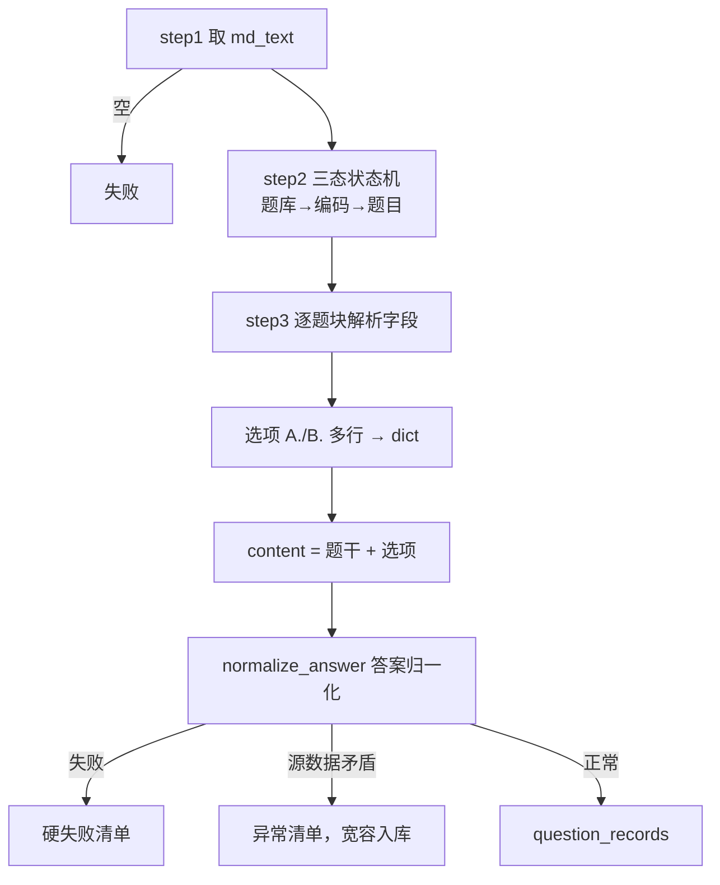

# 导入_05 node_question_parser —— 题库解析与答案归一化

> 文件：`processor/import_processor/nodes/node_question_parser.py`
> 职责：把题库 Markdown 拆成一条条题目记录，并把**五花八门的答案写法**统一成可比较的规范值。

## 一、输入长什么样

```markdown
## 通用程序设计题库

- 题库编码: general_purpose_programming_bank

### general_purpose_programming_bank_q001

- **题型**: 单选题
- **题干**: 下列关于变量命名的说法，正确的是？
- **选项**:
  A. 变量名可以以数字开头
  B. 变量名区分大小写
  C. 变量名可以包含空格
  D. 变量名不能包含下划线
- **答案**: B
- **解析**: Python 中标识符区分大小写，且不能以数字开头。

### general_purpose_programming_bank_q002
...
```

三层结构：

```
## {题库名称}                    ← 题库边界
- 题库编码: {bank_code}          ← 题库主键
  ### {question_code}            ← 题目边界（一行标题，没有"题目"字样）
    - **题型**: xxx              ← 5 个字段锚点
    - **题干**: xxx
    - **选项**: (空) + 后续 A./B. 行
    - **答案**: xxx
    - **解析**: xxx
```

**注意 `### {question_code}` 是"裸标题"**——标题内容就是题目编码本身，没有"题目："前缀。正则靠"只含字母数字下划线连字符"来识别。

## 二、整体流程



## 三、题型映射表：15 种中文 → 英文枚举

```python
QUESTION_TYPE_MAP = {
    "单选题": "single_choice",
    "多选题": "multiple_choice",
    "判断题": "true_false",
    "案例分析题": "case_analysis",
    "公式推导题": "formula_derivation",
    "阅读理解题": "reading_comprehension",
    "完形填空题": "cloze",
    "材料分析题": "material_analysis",
    "简答题": "short_answer",
    "计算题": "calculation",
    "编程题": "programming",
    "情境分析题": "situation_analysis",
    "证明题": "proof",
    "数据分析题": "data_analysis",
    "翻译题": "translation",
}
```

**为什么要在入库前转成英文枚举**：中文题型名会有细微变体（"单选题" vs "单选"），一旦写进库里就没法做精确过滤。统一成固定枚举后，检索侧可以用 `question_type == "single_choice"` 做标量过滤，索引也是稳定的。

`QUESTION_TYPE_MAP` 被设计成**开放集而不是封闭集**：表里没有的题型不会猜，直接判失败：

```python
question_type_en = QUESTION_TYPE_MAP.get(question_type_cn)
if question_type_en is None:
    return None, {"reason": f"未知题型（需先在配置表登记）：{question_type_cn}"}
```

注释里写了原因：新增题型必须**先插配置表**。这样做的好处是"题型"这个维度永远是可控的枚举集合，不会因为某份资料写了个"连线题"就让库里多出一种没人认识的值。

## 四、step2：三态状态机（本题库最绕的一段）

```python
blocks = []
bank_name_map = {}
current_bank_name = None
current_bank_code = None
current_question_code = None
question_block = []

def _flush_question():
    nonlocal current_question_code, question_block
    if current_question_code is None:
        return
    blocks.append({
        "question_code": current_question_code,
        "bank_code": current_bank_code,
        "bank_name": current_bank_name,
        "lines": question_block,
    })
    current_question_code = None
    question_block = []

for line in md_text.splitlines():
    # 题库边界
    m = _BANK_HEADER_RE.match(line)
    if m:
        _flush_question()
        current_bank_name = m.group("name").strip()
        current_bank_code = None              # 新题库，编码重置
        continue
    # 题库编码行
    m = _BANK_CODE_RE.match(line)
    if m and current_bank_name is not None:
        current_bank_code = m.group("value").strip()
        bank_name_map[current_bank_code] = current_bank_name
        continue
    # 题目边界
    m = _QUESTION_HEADER_RE.match(line)
    if m and current_bank_code is not None:
        _flush_question()
        current_question_code = m.group("code")
        question_block = []
        continue
    # 题目块内的行
    if current_question_code is not None:
        question_block.append(line)
```

### 4.1 为什么需要三态而不是两态

因为"题目"归属于"题库"，而题库名和题库编码在**不同的两行**上：

```
## 通用程序设计题库                 ← 这行只知道名字
- 题库编码: general_purpose_...     ← 这行才知道编码
```

如果在看到 `##` 时就认为题库就绪，`current_bank_code` 还是 `None`，题目记录里的 `bank_code` 就是空的。所以题目边界判断加了 `and current_bank_code is not None`：

```python
if m and current_bank_code is not None:
```

**效果是：编码行之前出现的 `### xxx` 会被丢弃**。这是有意的——没有题库编码的题目无法归属，也无法做幂等，解析了也没用。

### 4.2 `_flush_question` 的 `nonlocal`

`question_block = []` 在闭包里是**重新绑定**而不是修改原列表，所以必须声明 `nonlocal`，否则会创建一个局部变量，外层的 `question_block` 一直累积（经典 Python 闭包坑）。`current_question_code` 同理。

### 4.3 三种边界共享同一个"归档"动作

题库切换、题目切换、文件结束，三处都要把当前题目归档。抽成 `_flush_question()` 后，三个调用点各一行，避免了"复制三份 bug 也要改三处"。

`if current_question_code is None: return` 这个守卫让函数可以被**无条件调用**——第一个 `##` 之前、连续两个 `##` 之间都不会产生空块。

## 五、step3：字段解析（for-else 技巧）

```python
fields = {}          # 字段名 -> 首行值
options_lines = []   # 选项多行文本缓冲
current_field = None # 当前正在收集的字段名

for line in block_lines:
    for field_name, field_re in [
        ("question_type", _FIELD_TYPE_RE),
        ("stem", _FIELD_STEM_RE),
        ("options", _FIELD_OPTIONS_RE),
        ("answer", _FIELD_ANSWER_RE),
        ("analysis", _FIELD_ANALYSIS_RE),
    ]:
        m = field_re.match(line)
        if m:
            current_field = field_name
            value = m.group("value")
            if field_name == "options":
                options_lines = [value] if value else []
            else:
                fields[field_name] = value
            break
    else:
        # 非锚点行：作为当前字段的续行
        if current_field == "options":
            options_lines.append(line)
        elif current_field in ("stem", "analysis", "answer"):
            fields[current_field] = (fields.get(current_field, "") + "\n" + line).strip("\n")
```

### 5.1 `for ... else` 的语义

Python 的 `for-else` 中，`else` 在**循环正常结束（没有 break）**时执行。这里正好表达"这行不是任何字段锚点"：

- 命中锚点 → `break` → 跳过 `else`；
- 全都没命中 → 循环跑完 → 进 `else` → 当续行处理。

比用 `matched = False` 标志位清爽得多。

### 5.2 为什么要"续行累积"

题目的**题干和解析都是多行文本**：

```markdown
- **题干**: 阅读下面的代码，回答问题：
  ```python
  x = [1, 2, 3]
  print(x[3])
  ```
  上述代码的执行结果是？
```

这些行都不是字段锚点，必须归到"当前字段"里。用 `current_field` 记录"最后一个出现的锚点"，天然实现了"续行归属"。

累积用的是 `+ "\n" + line` 再 `strip("\n")`，保留内部换行、去掉首尾空行——注释里强调 `content 入库保留 \n 与缩进（题干与选项不粘连）`，这正是 PRD 的要求。

### 5.3 选项的两次处理

**第一次**：把选项相关行收集到 `options_lines`。

```python
if field_name == "options":
    options_lines = [value] if value else []
```

`- **选项**: A. 甲` 这种"锚点同行带首项"的写法，`value` 不为空，作为第一行塞进去；`- **选项**:` 后面啥也没有（最常见），则是空列表，等着后续行来填。

**第二次**：把行列表解析成字典。

```python
options = {}
option_buffer = {}          # key -> [行列表]
current_option_key = None
for line in options_lines:
    m = _OPTION_ITEM_RE.match(line.strip())
    if m:
        current_option_key = m.group("key").upper()      # A. / A、 都收
        option_buffer[current_option_key] = [m.group("value")]
    elif current_option_key is not None:
        option_buffer[current_option_key].append(line.rstrip())   # 选项续行

for key, lines_val in option_buffer.items():
    options[key] = "\n".join(lines_val).strip()
```

`_OPTION_ITEM_RE = ^(?P<key>[A-Za-z])\s*[.、]\s*(?P<value>.*)$` 支持三种分隔：

- `A. xxx`（半角点，最常见）
- `A、xxx`（中文顿号，手写常见）
- `A．xxx`（全角点）→ **不匹配**，是一个已知边界

`.upper()` 让 `a.` 和 `A.` 等价——答案归一化后统一是大写字母，如果选项键是小写，比对时会全部失败。

**多行选项**（选项里含代码块）靠 `elif current_option_key is not None` 处理，把非 `A.` 开头的行追加到当前选项。

## 六、content 拼接

```python
content_parts = [stem]
if options:
    content_parts.append("")
    for key in sorted(options.keys()):
        content_parts.append(f"{key}. {options[key]}")
content = "\n".join(content_parts)
```

产出的形态：

```
下列关于变量命名的说法，正确的是？

A. 变量名可以以数字开头
B. 变量名区分大小写
C. 变量名可以包含空格
D. 变量名不能包含下划线
```

三个细节：

1. **空行分隔题干与选项**——`.append("")` 制造一个空字符串，join 后就是空行。避免"题干最后一行和 A 选项粘连"；
2. **`sorted(options.keys())`**——字典无序，但入库文本必须稳定（否则同样的数据两次导入产生不同的向量），排序保证幂等；
3. **用 `key. value` 而不是 `key、value`**——与选项原格式一致，模型见过大量这种排版，语义更好。

**为什么不把答案拼进 content**：`content` 是给检索用的"题目本身"，答案单独存 `answer` 字段。如果答案混进 content，用户搜答案关键词时会命中题干，造成噪音。

## 七、答案归一化（PRD 4.3.5 的核心）

```python
def normalize_answer(answer_raw: str, question_type_en: str):
    raw = (answer_raw or "").strip()
    if not raw:
        return None, "答案为空", None
```

返回**三元组**：`(归一化答案, 失败原因, 数据异常标记)`。三种结局：

| 结局 | 返回值形态 | 后续处理 |
|---|---|---|
| 正常 | `(值, None, None)` | 入库 |
| 失败 | `(None, "原因", None)` | 丢弃该题，记硬失败 |
| 源数据矛盾但可救 | `(值, None, "说明")` | **入库** + 记账外异常 |

### 7.1 判断题：五种写法 → 两个布尔值

```python
_TRUE_FALSE_MAP = {
    "A": "true", "对": "true", "正确": "true",
    "B": "false", "错": "false", "错误": "false",
}

if question_type_en == "true_false":
    normalized = _TRUE_FALSE_MAP.get(raw)
    if normalized is None:
        return None, f"判断题答案无法归一化：{raw}", None
    return normalized, None, None
```

判断题在原始资料里有 `A/B`、`对/错`、`正确/错误` 三种常见写法（选项通常是"A. 正确 B. 错误"）。统一成 `"true"` / `"false"` 字符串而不是 Python `bool`，是为了**Milvus 的 VARCHAR 字段能直接存**——`DataType.BOOL` 虽然存在，但和字符串答案混在一个字段里会破坏 schema 一致性。

注意这里是**精确匹配**（`.get(raw)`），不是包含匹配。所以 `"正确。"`（带句号）会失败。这是有意的严格：宁可报出来让人修数据，也不要模糊匹配把 `"不正确"` 匹配成 `"正确"`。

### 7.2 单选题：单字母 or 宽容处理

```python
if question_type_en == "single_choice":
    if re.fullmatch(r"[A-Za-z]", raw):
        return raw.upper(), None, None
    # 宽容处理：标注单选但答案为多字母
    letters = _MULTI_ANSWER_SPLIT_RE.split(raw) if _MULTI_ANSWER_SPLIT_RE.search(raw) else list(raw)
    letters = [l.strip().upper() for l in letters if l.strip()]
    if letters and all(re.fullmatch(r"[A-Z]", l) for l in letters):
        return ",".join(sorted(set(letters))), None, \
            f"题型标注为单选题但答案为多字母（{raw}），按多选题答案归一化，请核对源数据"
    return None, f"单选题答案无法归一化：{raw}", None
```

**正常路径**：`re.fullmatch(r"[A-Za-z]", raw)` 要求**整串就是一个字母**，`B` / `b` 都行，转大写。

**异常路径**是这条链路上最有意思的一处设计。实测数据里确实存在 `legal_certificate_bank_q007` 这类题：题型写的是"单选题"，答案却是 `A,B,C`。这是**源数据错误**，但如果直接判失败，这道题就白丢了。

处理策略是"**救回来但记账**"：

- 按多选题逻辑归一化（`A,B`）；
- 第三个返回值不是 `None`，而是一句说明；
- 上游据此把这条记录**入库**，同时往 `parse_failed_entities` 里塞一条 `entity_type="question_anomaly"` 的记录，提示运营核对源数据。

这就是"宽容处理 + 显式记账"：**数据不丢，问题不藏**。

### 7.3 多选题：分隔符统一 + 字母序

```python
if question_type_en == "multiple_choice":
    letters = _MULTI_ANSWER_SPLIT_RE.split(raw) if _MULTI_ANSWER_SPLIT_RE.search(raw) else list(raw)
    letters = [l.strip().upper() for l in letters if l.strip()]
    if not letters or not all(re.fullmatch(r"[A-Z]", l) for l in letters):
        return None, f"多选题答案含非字母项：{raw}", None
    return ",".join(sorted(set(letters))), None, None
```

`_MULTI_ANSWER_SPLIT_RE = re.compile(r"[,，、\s]+")` 覆盖四种分隔：半角逗号、全角逗号、顿号、空格。

**没有分隔符的连写**（`"ABD"`）走 `list(raw)` 拆成单字符。

然后：

- `.upper()` 统一大小写；
- `set(...)` 去重（`"AAB"` → `A,B`）；
- `sorted(...)` 字母序（`"C,A"` → `A,C`）；
- `",".join(...)` 半角逗号连接。

**排序 + 去重 + 统一分隔符**三件事必须都做，否则 `"A,C"` 和 `"C,A"` 是两个不相等的字符串，答案比对会出错。这也是文件底部自检的检查项：

```python
bad_multi = [a for a in multi_answers if ("、" in a or "，" in a or a != ",".join(sorted(a.split(","))))]
print(f"多选题答案归一化异常数（期望 0）: {len(bad_multi)}")
```

### 7.4 长文本题型：原样保留

```python
# 长文本题型（简答/编程/证明/计算/案例分析等）：保留原文
return raw, None, None
```

简答题的答案是"一段话"，没有归一化的必要和可能。用 `strip()` 去首尾空白即可（在函数开头已经做了）。

**为什么不做任何清洗**：编程题的答案可能就是一段代码，任何"美化"都可能改变语义（缩进是 Python 语法的一部分）。

## 八、记录组装

```python
record = {
    "question_code": None,           # 由调用方回填（标题里提取的）
    "bank_code": bank_code,
    "bank_name": bank_name,
    "question_type": question_type_en,
    "question_type_cn": question_type_cn,     # 保留中文原文，便于人工核对
    "group_id": None,                          # V1 每题独立存全文
    "content": content,
    "stem": stem,
    "options": options if options else None,
    "answer": answer,
    "answer_raw": answer_raw,                  # 归一化前的原文，审计用
    "analysis": (fields.get("analysis") or "").strip(),
    "source_file": source_file,
    "source_path": source_path,
    "data_anomaly": data_anomaly,              # 异常说明，正常为 None
}
return record, None
```

四个值得说明的字段：

- **`question_type_cn`**：中文原文留着。检索侧展示"单选题"比展示 `single_choice` 友好，且不需要再查映射表。注意它**不会进 Milvus**（schema 里没这个字段，见 `导入_08` 的 `_to_row` 白名单裁剪），只用于调试和日志；
- **`group_id`**：预留的大题分组字段。V1 每题独立存全文，所以是 `None`。schema 里声明了 `nullable`；
- **`answer_raw`**：归一化前的原始答案。出现争议时（比如判断题 `对` 被判成 `true`），可以回溯原文；
- **`options: None`**：无选项字段的题型（简答、编程）存 `None` 而不是 `{}`。`_to_row` 会把 `None` 字段整个跳过，最终 Milvus 里该字段为空——比存一个空 JSON 更干净。

## 九、两类失败清单

```python
for block in blocks:
    record, failure = _parse_question_block(...)
    if record is None:
        failed.append({
            "entity_type": "question",
            "bank_code": bank_code,
            "question_code": question_code,
            **(failure or {}),
        })
        continue

    record["question_code"] = question_code       # 回填主键
    question_records.append(record)

    if record.get("data_anomaly"):
        failed.append({
            "entity_type": "question_anomaly",
            "bank_code": bank_code,
            "question_code": question_code,
            "reason": record["data_anomaly"],
        })
```

两条清单的语义完全不同：

| entity_type | 是否入库 | 含义 |
|---|---|---|
| `question` | ❌ 未入库 | 硬失败：缺题型、缺题干、未知题型、答案无法归一化 |
| `question_anomaly` | ✅ 已入库 | 软异常：源数据矛盾但已宽容归一化，需人工核对 |

**同一个 `parse_failed_entities` 字段承担两种语义**，靠 `entity_type` 区分。API 层上报时只报总数和样例，运营看 `entity_type` 就知道"哪些是丢了、哪些是入库了但可能不对"。

## 十、实测规模与自检

文件底部的 `__main__` 直接对真实数据跑一遍，并断言几个关键指标：

```python
print(f"题库数: {len(banks)}  (期望 73)")
print(f"题目数: {len(questions)}  (期望 1752)")
print(f"硬失败数（未入库）: {len(hard_failures)}")
print(f"数据异常数（已宽容入库）: {len(anomalies)}")

# 判断题答案分布（期望 true=145 / false=90）
tf_dist = Counter(q["answer"] for q in questions if q["question_type"] == "true_false")

# 多选题答案分隔符验证（应全部为半角逗号 + 字母序）
bad_multi = [...]
```

这几个数字不是随便选的，每一个都对应一类曾经踩过的坑：

| 断言 | 防的是什么 |
|---|---|
| 题库 73 / 题目 1752 | 切分逻辑回归——改正则后题目数变了就说明切错 |
| `true=145 / false=90` | 判断题映射表漏了某种写法（比如只映射了 `对` 没映射 `正确`） |
| `bad_multi` 为 0 | 分隔符归一化被破坏 |
| 异常数 | 源数据质量监控，数量突变说明新资料有问题 |

**这种"带数字断言的自检"比单纯 `print` 有用得多**——跑一次就知道有没有回归。

### 当前实测基线

```
题库数: 73
题目数: 1752
硬失败数（未入库）: 0
数据异常数（已宽容入库）: 1
  → legal_certificate_bank_q007：题型标注为单选题但答案为多字母（A,B,C）
判断题答案分布: {'true': 145, 'false': 90}
多选题答案归一化异常数: 0
```

题型分布（降序，合计 1752）：

| 题型 | 条数 | 题型 | 条数 |
|---|---|---|---|
| `single_choice` | 533 | `proof` | 24 |
| `short_answer` | 282 | `formula_derivation` | 24 |
| `multiple_choice` | 249 | `reading_comprehension` | 20 |
| `true_false` | 235 | `data_analysis` | 17 |
| `calculation` | 122 | `translation` | 14 |
| `programming` | 75 | `cloze` | 14 |
| `case_analysis` | 73 | `material_analysis` | 8 |
| `situation_analysis` | 62 | | |

**"只有 1 条异常、0 条硬失败"说明源数据质量很好，也说明当前正则覆盖了这 73 个题库的全部写法**。如果新资料的异常数突然变多，通常是某种字段写法没被覆盖（比如答案写成"√"）。

## 十一、调试手册

| 现象 | 原因 | 排查 |
|---|---|---|
| 题目数为 0 | `### 编码` 行在 `- 题库编码` 之前 | step2 要求先有 bank_code 才认题目 |
| 题目数偏少 | 编码里有中文（`_QUESTION_HEADER_RE` 只允许 `[A-Za-z0-9_\-]`） | 检查 `###` 标题格式 |
| 题干吞掉了选项 | 缺少 `- **选项**:` 锚点 | 选项行会归到 `current_field="stem"` |
| 选项解析为空 | 用了 `A．`（全角点） | `_OPTION_ITEM_RE` 只认 `.` 和 `、` |
| 答案全空 | 字段名不是"答案"（比如写成"正确答案"） | 锚点必须精确是 `**答案**` |
| 判断题大量失败 | 答案写成"√ / ×" | 映射表需补 `√`/`×` |
| 多选题答案顺序不一致 | 有人改了 `sorted` | 恢复 `sorted(set(letters))` |

## 十二、这套设计的取舍

| 决定 | 替代方案 | 为什么选现在这个 |
|---|---|---|
| 正则逐行解析 | LLM 抽取 | 1752 道题用 LLM 成本高、不稳定，正则确定性更强 |
| 未知题型判失败 | 落成 `other` | 题型是过滤维度，出现脏枚举会污染检索 |
| 单选多字母宽容处理 | 直接判失败 | 一道题的数据错误不该让它消失，记账提示更实用 |
| 答案存字符串 | 存 `bool` / `list` | 一个 VARCHAR 字段容纳所有题型，schema 简单 |
| 保留 `answer_raw` | 只存归一化值 | 归一化有主观判断（对/正确），必须可回溯 |
| `content` 含题干+选项 | 只存题干 | 选项也是知识内容，且"哪个选项描述正确"类问答需要 |
