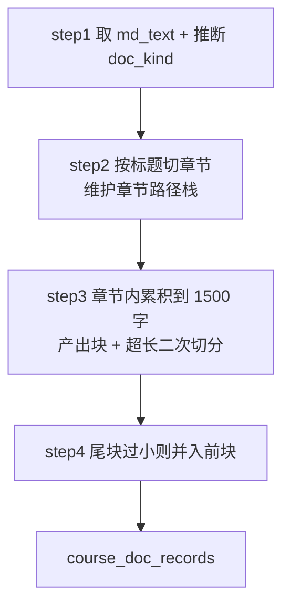

# 导入_06 node_course_doc_parser —— 课程文档分块

> 文件：`processor/import_processor/nodes/node_course_doc_parser.py`
> 职责：把一整本讲义切成"语义自洽、长度可控、带章节上下文"的块。

## 一、为什么不能整篇入库

`course_catalog`（课程目录）和 `question_bank`（题库）都是**天然结构化**的——`##` 就是一个系列，`###` 就是一道题。但 `course_doc` 是一份**连续的讲义**：

```
LangGraph 概述
  什么是 LangGraph
  LangGraph 的核心概念
    State
    Node
    Edge
  ...
```

如果整篇做一条记录向量化：

1. **向量被平均化**——300 页的内容压成一个 1024 维向量，任何具体问题的相似度都不高；
2. **检索粒度太粗**——命中之后返回整本讲义，用户还得自己找；
3. **塞不进字段**——Milvus 的 `VARCHAR(4096)` 装不下。

所以必须切块（chunking）。切块的三个参数决定了"切得好不好"：

```python
CHUNK_TARGET_SIZE = 1500   # 目标块大小（字符）：小于此值的相邻段落归入同块
CHUNK_MAX_SIZE = 3000      # 单块硬上限（字符）：超出强制二次切分
MIN_CHUNK_SIZE = 50        # 小于此值的尾块并入前块
```

| 参数 | 取值理由 |
|---|---|
| 1500 | BGE-M3 的有效上下文远大于此，但**检索精度**在 1000~2000 字段落最好：太短则语义不完整，太长则主题被稀释 |
| 3000 | 给 `VARCHAR(4096)` 留余量（含章节前缀），也是"再长就该拆"的经验阈值 |
| 50 | 小于 50 字的块（如孤零零一个 `注：`）没有检索价值，合并掉 |

## 二、整体流程



## 三、step1：`doc_kind` 怎么来的

```python
project_name = state.get("project_name", "")
doc_kind = "project" if project_name else "lecture"
return md_text, source_file, source_path, project_name, doc_kind
```

**没有让用户显式选 `doc_kind`**，而是用 `project_name` 的有无来推断：

- 上传接口的 `project_name` 是可选字段（PRD 4.1）；
- 有项目名 → 这是"某个项目的实战文档"（`project`）；
- 没有 → 这是"通用课程讲义"（`lecture`）。

zip 导入时 API 层会自动把压缩包名当 `project_name`：

```python
zip_project_name = project_name or zip_path.stem    # 如「掌柜智库」
```

所以"整个资料包导入"天然被标记成项目文档，这个推断在实际使用中是成立的。

## 四、step2：切章节（本章最精妙的部分）

### 4.1 目标产物

```python
sections = [
    ("LangGraph概述", ["段落1", "段落2", ...]),
    ("LangGraph概述\n什么是LangGraph", ["段落1", ...]),   # 两级路径用 \n 连接
    ...
]
```

**章节路径只保留前两级**。为什么？

- 一级（`#`）是"章"，二级（`##`）是"节"，这两级足以定位；
- 三级及以下往往是"小节标题"，数量多、区分度低，作为路径反而噪音；
- 而且三级标题作为正文保留在 `content` 里，检索时依然能看到。

### 4.2 三个状态量

```python
sections = []
chapter_stack = []          # 当前标题层级栈
current_paragraphs = []
in_code_block = False       # 代码块内的 # 不是标题
```

`chapter_stack` 是"路径栈"，`current_paragraphs` 是"当前节的内容缓冲区"，`in_code_block` 是代码块开关。

### 4.3 主循环逐行处理

```python
for line in md_text.splitlines():
    stripped = line.strip()
    # ① 代码块围栏切换
    if stripped.startswith("```"):
        in_code_block = not in_code_block
        if current_paragraphs:
            current_paragraphs.append(line)
        continue
    # ② 代码块内：所有行视为正文
    if in_code_block:
        if current_paragraphs:
            current_paragraphs.append(line)
        continue
    # ③ 转义过的行首 #（\#）：正文，非标题
    if stripped.startswith("\\#"):
        if current_paragraphs:
            current_paragraphs.append(line.replace("\\#", "#", 1))
        continue
    # ④ 标题行
    m = _HEADING_RE.match(line)
    if m:
        _flush_section()
        current_paragraphs = []
        level = len(m.group(1))
        title = m.group("text").strip()
        if level <= 2:
            chapter_stack = chapter_stack[: level - 1]
            chapter_stack.append(title)
        else:
            current_paragraphs.append(line)     # 三级及以下并入正文
    else:
        if stripped:
            current_paragraphs.append(line)
        elif current_paragraphs:
            current_paragraphs.append("")        # 段内空行
```

**四个分支的顺序不能变**，每一条都对应一个真实场景：

#### ① 代码块围栏优先

````markdown
```python
# 这是注释，不是标题
def f(): pass
```
````

如果先判断标题，`# 这是注释` 会被当成一级标题，章节路径变成注释文本——整章的内容都被挂到一个不存在的章节下。

所以**先切代码块状态**，块内一律当正文。注意 `stripped.startswith("```")` 同时匹配开和闭（靠 `not in_code_block` 翻转），也顺带匹配四个反引号的嵌套围栏（因为前三个字符依然是反引号）。

#### ② 代码块内直接 continue

块内的行不参与任何标题判断，但也要 `append` 进正文——否则代码内容就丢了。

#### ③ `\#` 还原

这是历史遗留的**兼容逻辑**：早期 docx 由本地 python-docx 解析，正文行首的 `#`（如代码注释）会被转义成 `\#` 防止误判为标题；现在 Word 走 MinerU，这条路径已移除，但手工整理的 MD 或历史资料里仍可能出现 `\#`，所以还原逻辑保留：

```python
line.replace("\\#", "#", 1)     # 只替换第一次出现
```

`replace` 的第三个参数 `1` 很重要：代码注释里可能有多个 `#`（`# # 嵌套注释`），只还原行首那个，后面的保持原样。

#### ④ 标题：先归档，再更新栈

```python
_flush_section()          # 用【旧】栈归档上一节
current_paragraphs = []   # 清空缓冲
...
chapter_stack = chapter_stack[: level - 1]   # 更新栈
chapter_stack.append(title)
```

**顺序是关键**：`_flush_section()` 必须在栈更新之前调用，否则上一节的内容会被挂到新标题下。这个 bug 很隐蔽——章节数不对、内容串位，但不会报错。

### 4.4 栈的截断逻辑

```python
chapter_stack = chapter_stack[: level - 1]
chapter_stack.append(title)
```

这一行实现了"同级替换、下级清空"：

| 当前栈 | 遇到 | 截断后 | 追加后 |
|---|---|---|---|
| `[]` | `# A`（level 1） | `[]` | `["A"]` |
| `["A"]` | `## B`（level 2） | `["A"]` | `["A", "B"]` |
| `["A","B"]` | `## C`（level 2） | `["A"]` | `["A", "C"]` |
| `["A","C"]` | `# D`（level 1） | `[]` | `["D"]` |
| `["A"]` | `### E`（level 3） | 栈不变 | 标题行作为正文 |

`[:level-1]` 的意思是"保留到目标的父级"。这是处理标题层级最简洁的写法，比维护"当前级别的字典"清晰得多。

注意：**`#` 标题的文本本身不会进正文**。`current_paragraphs` 在标题分支被清空后，只有"三级及以下"才把 `line` 塞回去。所以一级/二级标题的文字只存在于 `chapter_path` 里，最终通过 `_emit_chunk` 的章节前缀补回 `content`。这是有意的去重设计——否则 `【章节名】` 前缀和正文标题会重复两遍。

**三级标题也会触发 flush**（这点很容易看漏）：`_flush_section()` 写在 `if m:` 里、层级判断之前，所以**任何**标题行——包括 `###`——都会结束当前 section。结果是：

- 三级标题**不改变**章节路径（不进栈）；
- 但会在**同一个章节路径下切出多个 section**，进而产出多个块；
- 三级的标题行本身作为正文保留。

实测一段结构（`# 概述` → 正文 → `## 什么是` → 正文 → `### State` → 正文）会产出 **3 个块**，其中第 2、3 块的 `chapter_name` 完全相同：

```
块0  chapter_name="LangGraph 概述"
块1  chapter_name="LangGraph 概述 > 什么是 LangGraph"
块2  chapter_name="LangGraph 概述 > 什么是 LangGraph"   ← 与块1同路径
```

这个行为不是 bug，但**会显著影响块的大小**：如果一份讲义里三级标题密集（每个知识点下只有 1~2 段话），每段都会独立成块，实际块长可能远小于 `CHUNK_TARGET_SIZE=1500`。这是"按小节切分"的必然代价——粒度细了，检索更精准，但每个块的上下文变少。

### 4.5 归档与空行处理

```python
def _flush_section():
    if current_paragraphs:
        sections.append(("\n".join(chapter_stack), list(current_paragraphs)))
```

两个细节：

- **`if current_paragraphs`**：空章节（标题下面直接跟另一个标题）不产出 section，避免生成空块；
- **`list(current_paragraphs)`**：拷贝一份。如果不拷贝，后续 `current_paragraphs = []` 虽然重新绑定了名字，但已经 append 进 `sections` 的**同一个列表对象**在别处被修改时会出问题（虽然这里随后就重新绑定，属于防御性写法）。

空行的处理：

```python
else:
    if stripped:
        current_paragraphs.append(line)
    elif current_paragraphs:
        current_paragraphs.append("")
```

- 非空行：原样保留（**保留原缩进**，因为代码块的缩进有意义）；
- 空行：只有当节内已有内容时才保留。**开头的空行被丢弃**，避免块首出现空行。

## 五、step3：章节内累积成块

```python
for chapter_path, paragraphs in sections:
    buffer = ""
    for p in paragraphs:
        if len(buffer) + len(p) + 1 > CHUNK_TARGET_SIZE and buffer:
            _emit_chunk(records, buffer, chapter_path, ...)
            buffer = p
        else:
            buffer = buffer + "\n" + p if buffer else p
    if buffer:
        _emit_chunk(records, buffer, chapter_path, ...)
```

这是标准的**贪心累积**：

- 加上新段落会超 1500 → 先把当前 buffer 吐出去，新段落成为新 buffer 的起点；
- 否则追加（`"\n"` 连接，`+1` 就是那个换行符的长度）；
- 章节结束 → 吐出剩余。

**为什么以"段落"为最小单位而不是"句子"**：段落是作者天然划分的语义单元，在段落边界切分比在句中切断更保语义。代价是可能出现"一个 2000 字的段落单独成块"（超过 1500 但没超过 3000），这是可接受的——`CHUNK_MAX_SIZE` 会兜底。

**注意 `buffer` 按章节重置**：不同章节的段落绝不会混进同一个块，这是保证 `chapter_name` 字段正确的前提。

## 六、超长块二次切分

```python
def _split_long_chunk(content: str, max_size: int) -> list:
    if len(content) <= max_size:
        return [content]
    parts = []
    current = ""
    for line in content.split("\n"):
        if len(current) + len(line) + 1 > max_size and current:
            parts.append(current)
            current = line
        else:
            current = current + "\n" + line if current else line
    if current:
        parts.append(current)
    return parts
```

和上面的累积逻辑**结构完全一样**，只是阈值换成 3000、单位换成"行"。为什么不抽成一个函数？因为一个按"段落列表"累积、一个按"行列表"累积，强行抽象反而更绕。两段十来行的重复，换来可读性，是合理的取舍。

**极端情况**：如果单行就超过 3000 字（比如一整段没有换行的长文，或 base64 图片），这个函数切不开——`current` 为空时会走 `else` 分支，把超长行整个塞进去。这是已知限制，实际讲义里不会出现。

## 七、`_emit_chunk`：语义增强的关键一步

```python
def _emit_chunk(records, content, chapter_path, source_file, source_path, doc_kind, project_name):
    chapter_name = chapter_path.replace("\n", " > ") if chapter_path else ""
    for piece in _split_long_chunk(content.strip(), CHUNK_MAX_SIZE):
        if not piece.strip():
            continue
        enriched = f"【{chapter_name}】\n{piece}" if chapter_name else piece
        records.append({
            "doc_kind": doc_kind,
            "project_name": project_name or None,
            "chapter_name": chapter_name or None,
            "chunk_index": len(records),
            "content": enriched,
            "source_file": source_file,
            "source_path": source_path,
        })
```

### 7.1 章节前缀为什么必须加

注释里写得很清楚：

> 语义增强：块首拼章节路径前缀（公式/代码密集的块缺少自然语言语义，章节名前缀显著提升其向量可检索性，如"Sigmoid 函数"依赖章节上下文）

具体例子——一个块的内容是：

```
$$
\sigma(x) = \frac{1}{1 + e^{-x}}
$$
```

这段文本里没有任何"神经网络"、"激活函数"这类词。用户问"激活函数的公式"，**纯向量检索完全找不到它**。

加上章节前缀后：

```
【深度学习基础 > 激活函数】
$$
\sigma(x) = \frac{1}{1 + e^{-x}}
$$
```

`激活函数` 进入了向量空间，召回成功。**这是"用存储冗余换召回率"的典型操作**——每个块多存 10~30 个字，换来的命中率提升远超成本。

前缀用 `【】` 包裹而不是直接拼接，有两个作用：

1. 视觉上明确区分"这是上下文"和"这是正文"，方便人工核对；
2. 前缀与正文之间有换行，模型能感知到边界，不会把章节名当正文第一句。

### 7.2 `chunk_index` 是全局递增

```python
"chunk_index": len(records)
```

**不是章节内序号，是整篇文档内的序号**。因为同一章节可能被切成好几个块（超长切分），章节内序号会重复；全局序号才能唯一定位一个块。

配合 `source_path` 使用，可以还原出"这块在原文的哪个位置"。

### 7.3 `None` 而不是空字符串

```python
"project_name": project_name or None,
"chapter_name": chapter_name or None,
```

空字符串在 Milvus 里是一个"有值但无意义"的字符串，做过滤时会命中；`None` 会被 `_to_row` 整个跳过，字段保持"未设置"状态。**语义更准确**：这是"没有项目名"，不是"项目名是空字符串"。

### 7.4 章节名剥离自动编号（仅 MinerU 文档）

MinerU 会把 Word 的自动多级编号物化进标题文本，`chapter_name` 因此变成 `1 LangGraph概述 > 3 状态`。编号对**人阅读正文**有用，对**章节名这个标签**是噪音（过滤、引用展示、评估比对都要多带一层前缀）。所以在 `_emit_chunk` 里只清洗 `chapter_name`，正文标题原样保留：

```python
if strip_numbering:
    chapter_name = " > ".join(
        _strip_chapter_number(seg) for seg in chapter_path.split("\n") if seg.strip()
    ) if chapter_path else ""
else:
    chapter_name = chapter_path.replace("\n", " > ") if chapter_path else ""
```

`strip_numbering` 由 `state["file_format"]` 决定，**只有 `pdf` / `doc` / `docx` 才为真**：

```python
strip_numbering = state.get("file_format") in ("pdf", "doc", "docx")
```

这条边界很重要：手写 md 里的 `## 2. 核心概念扫盲` 编号是作者本意，必须保留；只有"Word 自动编号被转成文本"才需要剥。实测同一份内容按 `md` 处理保留 `知识库导入 > 2. 核心概念扫盲`，按 `docx` 处理得到 `知识库导入 > 核心概念扫盲`。

剥编号的规则收得很窄，避免误伤真标题：

```python
_CHAPTER_NUM_RE = re.compile(r"^\d+(?:[.、]\d+)*[.、]?\s+")
_NUM_UNIT_CHARS = ("年", "月", "日", "个", "种", "条", "大", "周", "次", "步")

def _strip_chapter_number(title: str) -> str:
    m = _CHAPTER_NUM_RE.match(title)
    if not m:
        return title
    rest = title[m.end():].strip()
    if not rest:
        return title
    num = title[:m.end()].strip().rstrip(".、")
    if _BARE_INT_RE.match(num):              # 只有纯整数才可能是真标题
        if rest[0] in _NUM_UNIT_CHARS:       # "5 个常见误区" 不动
            return title
        if int(num) > 99:                    # "2024 年展望" 不动
            return title
    return rest
```

**量词判断只在纯整数时生效**，这一点踩过一次坑：`5.2 条件边` 的"条"被当成了量词「条建议」，导致编号没剥掉（实测有 2 个块残留）。带点号的层级编号（`5.2`、`3.1.1`）几乎只可能来自自动编号，直接剥即可；纯整数才需要区分 `5 个常见误区` 和 `10 收官`。

| 输入 | 输出 | 说明 |
|---|---|---|
| `3.1.1 定义状态类` | `定义状态类` | MinerU 的层级编号 |
| `3.1. 状态的定义` | `状态的定义` | 尾部点号也吃掉 |
| `5.2 条件边` | `条件边` | 带点号直接剥，"条"不是量词 |
| `10 收官` | `收官` | 两位数纯整数仍视为编号 |
| `2024 年展望` | 原样 | 纯整数且 > 99，判为年份 |
| `5 个常见误区` | 原样 | 纯整数 + 后接量词 |
| `3 大原则` | 原样 | 同上 |

实测该讲义 44 个块、26 个章节数量不变，章节名从 `3 状态 > 3.1 状态的定义` 变为 `状态 > 状态的定义`，块首前缀同步变干净。

## 八、step4：尾块合并

```python
def step_4_merge_tail_chunk(records: list) -> list:
    if len(records) >= 2 and len(records[-1]["content"]) < MIN_CHUNK_SIZE \
            and records[-1]["chapter_name"] == records[-2]["chapter_name"]:
        records[-2]["content"] += "\n" + records[-1]["content"]
        records.pop()
    return records
```

三个条件同时满足才合并：

1. **至少两块**——只有一块时无可合并；
2. **末块 < 50 字**——太短没有独立检索价值；
3. **与前块同章节**——不同章节的内容绝不能混在一个块里（否则 `chapter_name` 就不对了）。

实现上是**直接改 `records[-2]["content"]`**，而不是新建记录。因为列表里存的是可变 dict，改完 `pop()` 掉最后一块即可。

**只合并一次**（没有 `while`）。如果末块前面还有多个小尾巴，这里不会持续合并——实际数据里很少出现连续多个 <50 字的块，一次合并不足以处理极端情况，但足够简单可预测。

## 九、产出形态示例

假设输入：

```markdown
# LangGraph 概述

LangGraph 是构建有状态多智能体应用的框架。

## 什么是 LangGraph

它是一种基于图的计算模型。

### State

State 是共享的数据结构。
```

产出（**实测结果**，与原假设不同，值得注意）：

```python
[
  {
    "doc_kind": "lecture",
    "project_name": None,
    "chapter_name": "LangGraph 概述",        # level 1
    "chunk_index": 0,
    "content": "【LangGraph 概述】\nLangGraph 是构建有状态多智能体应用的框架。",
    ...
  },
  {
    "doc_kind": "lecture",
    "project_name": None,
    "chapter_name": "LangGraph 概述 > 什么是 LangGraph",   # level 1 > level 2
    "chunk_index": 1,
    "content": "【LangGraph 概述 > 什么是 LangGraph】\n它是一种基于图的计算模型。",
    ...
  },
  {
    "doc_kind": "lecture",
    "project_name": None,
    "chapter_name": "LangGraph 概述 > 什么是 LangGraph",   # 与上一块同路径
    "chunk_index": 2,
    "content": "【LangGraph 概述 > 什么是 LangGraph】\n### State\n\nState 是共享的数据结构。",
    ...
  },
]
```

三块而不是两块，因为 `### State` 触发了 `_flush_section()`：

- `### State` **原样保留在正文里**，且成为第 3 块的首行；
- 但它同时**切断了**它与前一段的合并机会——前一段独立成块（块 1），`###` 之后的内容另起一块（块 2）；
- `## 什么是 LangGraph` 的标题文字只出现在 `chapter_name` 前缀里，不出现在正文。

这个例子很能说明：**"三级标题不入栈"不等于"三级标题不影响切分"**。它改的是 `chapter_name`，不改的是 section 边界。

### 实测基线（LangGraph 讲义 docx，经 MinerU 归一化）

```
归一化 MD：43391 字符
章节数：26
块数：44
块大小：min=42, max=1527, avg=994
<200 字的块：8
```

两个值得注意的数字：

- **max=1527**：略超 `CHUNK_TARGET_SIZE=1500`，因为阈值判断是"加上新段落会超才切"，单块可以略微越界（但不会超过 3000 的硬上限）；
- **min=42**：远小于 1500。这就是"任何标题都切块"的后果——某个小节下只有一句话，它就成了一个 42 字的块。`step_4_merge_tail_chunk` 只会合并**最后一块**，中间的短块保持原样。

对比历史基线（同一份文档走本地 python-docx 解析）是 17 章 / 37 块 / avg 1108。差异来自 MinerU 输出的标题层级更多（章节编号 + 多级列表），以及 `node_format_convert` 对深层编号标题做了降级（见 `导入_02` 6.2）——降级前是 49 章 / 65 块 / avg 680，其中 27 块不足 200 字。

块在章节上的分布也能说明切分粒度：

```
（示例）...
```

`状态` 和 `节点` 是重点章节，标题多、内容长，所以块多；`边` 内容少，块也少。这种"内容多的章节块多"的分布是符合预期的。

## 十、与 Milvus Schema 的对齐

`edu_course_doc` 的字段（见 `导入_08`）：

| 字段 | 本节点是否产出 | 说明 |
|---|---|---|
| `id` | ❌ | 入库时 `_to_row` 生成 uuid（无业务主键） |
| `doc_kind` | ✅ | `lecture` / `project` |
| `course_code` | ❌ | schema 里 nullable，本项目前留空 |
| `series_code` | ❌ | 同上 |
| `project_name` | ✅（可为 None） | zip 导入时为包名 |
| `chapter_name` | ✅（可为 None） | `A > B` 形式 |
| `chunk_index` | ✅ | 全局递增 |
| `content` | ✅ | 最长 3000 + 前缀，schema 是 4096 |
| `source_file` / `source_path` | ✅ | 溯源 |

**`content` 的长度余量必须守住**：`CHUNK_MAX_SIZE=3000` + 前缀（章节名 128 以内 + 3 个符号）≈ 3130，小于 4096。如果调大 `CHUNK_MAX_SIZE`，必须同步改 schema 的 `max_length`，否则插入时报长度超限。

## 十一、调试手册

| 现象 | 原因 | 排查 |
|---|---|---|
| 章节名全是代码注释 | 代码块围栏判断失效 | 检查文档围栏是 ``` 还是 ~~~（`stripped.startswith("```")` **不认 `~~~`**） |
| 章节内容串到下一节 | `_flush_section` 在更新栈之后调用 | 恢复"先 flush 后更新"的顺序 |
| 块数很少 | 章节内段落被合并太多 | 打印每块 `len(content)`，确认是否接近 1500 |
| 块数远多于预期、大量 100 字以内的块 | 三级标题密集，每个 `###` 都 flush 一次 | 正常行为；如需合并，要改 step2 的 flush 条件 |
| 块数爆炸（每块一两句） | 频繁触发 1500 阈值 | 检查是否有超长段落把 buffer 撑大 |
| 首块内容缺失 | 代码块围栏在节首被丢弃 | 见下方"已知边界" |
| `chapter_name` 里有 `###` | 三级标题被当成章节 | `level <= 2` 判断被改 |
| 尾块没合并 | 前块不同章节 | 正常行为 |

### 已知边界

1. **`~~~` 围栏不识别**：`stripped.startswith("```")` 只认反引号。如果输入用 `~~~` 写代码块，块内 `#` 会被当标题。MinerU 对 PDF 会输出反引号围栏，对 Word 目前不输出围栏（代码是普通段落），所以这条在 docx 链路上实际影响有限；
2. **节首代码块的开栅栏可能丢**：`if current_paragraphs` 守卫导致"章节第一行就是 ```"时不记录这一行。后续内容仍是代码，但少了开栅栏，Markdown 结构不完整（对向量化影响不大，因为纯文本被拼在一起）；
3. **单行超 3000 字切不开**：见第六节；
4. **三级标题强制切块**：`###` 会结束当前 section（见 4.4 节），小节密集的文档会产生很多短块。短块本身有利于精确召回，但若一条知识点只有一句话，上下文会偏薄；
5. **`course_code` / `series_code` 未填充**：schema 预留了字段，但分块节点不产出。如果将来要做"片段 → 课程"的关联，需要在 state 里传入并在这里写入。

## 十二、为什么这样切（横向对比）

| 切法 | 优点 | 缺点 | 本项目选择 |
|---|---|---|---|
| 固定字符数硬切 | 实现最简单 | 句子被截断，语义破碎 | ❌ |
| 按 token 切 | 贴合模型上下文 | 需要 tokenizer，且不保证语义边界 | ❌ |
| **按标题 + 段落累积** | 语义边界天然对齐，章节可追踪 | 依赖文档标题规范 | ✅ |
| 语义分块（LLM 判断） | 质量最高 | 成本高、慢、不确定 | ❌ |

选"标题 + 段落"是因为**教育资料的标题结构通常很规范**（讲义都是按知识点组织的），而这个方法零成本、结果可预测、可解释。章节路径还顺带产出了 `chapter_name` 字段，为检索过滤提供了维度——这是纯字符切分给不了的额外收益。
