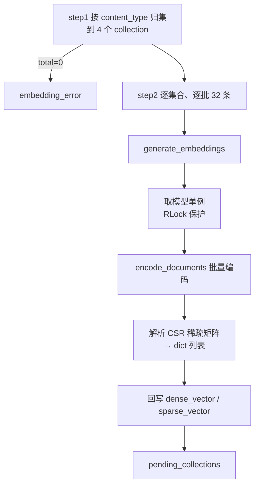

# 导入_07 node_bge_embedding —— BGE-M3 稠密+稀疏向量化

> 文件：`processor/import_processor/nodes/node_bge_embedding.py`（工具：`utils/lm/embedding_utils.py`）
> 职责：把解析出的记录按目标 Collection 分组，逐条生成 **dense + sparse** 双向量，回写到记录上。

## 一、为什么是"双向量"

Milvus 2.4+ 支持一个集合里同时存稠密和稀疏向量，并在检索时用 `WeightedRanker` 融合。本项目全量采用这个架构：

| 向量类型 | 维度 | 擅长什么 | 典型命中 |
|---|---|---|---|
| dense | 1024（BGE-M3） | **语义相似**：换个说法也能找到 | "怎么理解状态机" ↔ "State 是一个共享数据结构" |
| sparse | 词表大小（稀疏） | **字面精确**：专有名词、编号、代码符号 | `AOF`、`prog_intro_m01`、`lr=0.001` |

单用稠密：专有名词容易被"语义近似"的噪音盖掉；单用稀疏：同义改写完全失效。**两者互补**是本项目检索质量的基础。

所以这一步的产出不是"一个向量"，而是每条记录带两个字段：

```python
record["dense_vector"] = [...]              # list[float]，长度 1024
record["sparse_vector"] = {token_id: weight}  # dict[int, float]
```

## 二、整体流程



## 三、step1：分组（一个隐式约定）

```python
def step_1_group_records_by_collection(state: dict):
    pending = {}

    if state.get("course_series_records"):
        pending["edu_course_series"] = state["course_series_records"]
    if state.get("course_module_records"):
        pending["edu_course_module"] = state["course_module_records"]
    if state.get("question_records"):
        pending["edu_question"] = state["question_records"]
    if state.get("course_doc_records"):
        pending["edu_course_doc"] = state["course_doc_records"]

    total = sum(len(records) for records in pending.values())
    logger.info(f"向量化分组完成：{list(pending.keys())}，共 {total} 条记录")
    return pending, total
```

### 3.1 为什么用"字段名 → 集合名"的硬映射

`course_series_records` → `edu_course_series` 这个对应关系**写在代码里**，而不是从记录内容推断。原因：

- 一个任务的 `content_type` 只会走一个 parser 分支，所以正常情况下 `pending` 里**只有一个 key**；
- 但 `node_course_parser` 一次产出两类记录（series + module），所以需要支持多 key；
- 用硬映射最直白，且新增类型时改一处即可。

`if state.get(...)` 而不是 `if "..." in state`：初始状态里这些字段被初始化成 `[]`（见 `create_import_default_state`），空列表是 falsy，自然被跳过。

### 3.2 一个容易忽略的事实

`pending["edu_question"] = state["question_records"]` 存的是**引用**，不是拷贝。所以后面回写向量时，直接在原 dict 上改，`state` 里的记录也同步变了——但**图的返回值只包含 `pending_collections`**，并不返回 `question_records`。这是没问题的，因为下游 `node_import_milvus` 只读 `pending_collections`。

如果将来有节点需要读 `state["question_records"]` 并期望拿到向量，需要知道这个"引用共享"的行为（LangGraph 的状态合并是浅合并，同一个 list 对象会被保留下来）。

### 3.3 没有记录时

```python
if total == 0:
    logger.warning("无可向量化的记录（解析结果为空或已失败）")
    return {"pending_collections": pending, "embedding_error": "无可向量化的记录"}
```

注意这里**同时返回了 `pending_collections` 和 `embedding_error`**。返回空 dict 也一样能走到入库节点，但那样入库节点会报"无可入库记录"，错误信息就变成了"入库失败"而不是"向量化无数据"——**错误归因会跑偏**。所以在这里就把原因标清楚。

## 四、step2：分批编码

```python
def step_2_batch_generate_vectors(pending: dict, total: int):
    done_count = 0
    for collection_name, records in pending.items():
        texts = [r["content"] for r in records]
        for i in range(0, len(texts), EMBED_BATCH_SIZE):
            batch_texts = texts[i:i + EMBED_BATCH_SIZE]
            batch_records = records[i:i + EMBED_BATCH_SIZE]
            embeddings = generate_embeddings(batch_texts)
            for j, record in enumerate(batch_records):
                record["dense_vector"] = embeddings["dense"][j]
                record["sparse_vector"] = embeddings["sparse"][j]
            done_count += len(batch_texts)
            logger.info(f"向量化进度：{done_count}/{total}（当前集合 {collection_name}）")
```

### 4.1 批大小 32 的取舍

```python
EMBED_BATCH_SIZE = 32
```

| 更大（128/256） | 更小（8） |
|---|---|
| 吞吐高，GPU/MPS 利用率好 | 内存峰值低，单批失败影响小 |
| 内存峰值高（32×512token 的激活值） | 调用次数多，Python 循环开销占比大 |

32 是**在 CPU/MPS 上跑得动、又不至于批次太碎**的折中。注释里提到"2,628 条实体分批处理"，即 2628/32 ≈ 83 批。

### 4.2 逐集合而不是混合批

不同集合的记录被分开编码，即使它们的 `content` 形态相似。为什么？

- 避免跨集合的批次边界复杂化（最后一批可能只有 1 条，却要和另一个集合的前 31 条拼）；
- 进度日志能明确说"当前在编码哪个集合"，排查更方便。

代价是每个集合末尾会有一个不满的批次（最多浪费 31 条的批效率）。2628 条数据下这个损耗可以忽略。

### 4.3 回写：`j` 是批内下标

```python
for j, record in enumerate(batch_records):
    record["dense_vector"] = embeddings["dense"][j]
    record["sparse_vector"] = embeddings["sparse"][j]
```

`embeddings["dense"]` 是 `list[list[float]]`，顺序与 `batch_texts` **严格一一对应**（BGE-M3 保证输出顺序不因内部并行而改变）。所以 `j` 直接索引即可。

**这是最容易写错的地方**：如果误用 `records[i + j]` 之外的下标，或者把 `batch_records` 和 `batch_texts` 的长度搞错，向量就会错位——模型不报错，但每条记录的向量都对应了错误的文本，检索结果全乱。这种 bug 极难在检索效果上发现，只能靠代码审查。

## 五、`generate_embeddings` 内部做了什么

```python
def generate_embeddings(texts):
    if not isinstance(texts, list) or len(texts) == 0:
        raise ValueError("参数texts必须是包含文本的非空列表")
    with _bge_m3_lock:
        model = get_bge_m3_ef()
        embeddings = model.encode_documents(texts)
    result = _parse_bgem3_output(embeddings, len(texts))
    return result
```

### 5.1 模型单例 + 双重检查锁

```python
_bge_m3_ef = None
_bge_m3_lock = threading.RLock()

def get_bge_m3_ef():
    if _bge_m3_ef is not None:          # 快路径：无锁
        return _bge_m3_ef
    with _bge_m3_lock:                   # 慢路径：加锁
        if _bge_m3_ef is not None:       # 双重检查
            return _bge_m3_ef
        _bge_m3_ef = BGEM3EmbeddingFunction(
            model_name=model_name, device=device,
            use_fp16=use_fp16, normalize_embeddings=True,
        )
        _bge_m3_ef.encode_queries(["预热"])   # 预热推理
        return _bge_m3_ef
```

三层保护，每一层都有明确的原因：

1. **单例**：模型加载要 10+ 秒、占 GB 级内存，绝不能每个任务加载一次。API 层是多文件并发的（`BackgroundTasks`），必须进程内共享；
2. **`RLock` 而不是 `Lock`**：`generate_embeddings` 先拿到锁，内部再调 `get_bge_m3_ef()` 又要拿同一把锁——普通 `Lock` 会**自己把自己锁死**（死锁）。`RLock` 可重入，同一线程再进不阻塞；
3. **预热推理**：注释写的是"防止 meta tensor 竞态"。`sentence-transformers` 在某些设备上是懒加载权重的，如果第一次真实推理发生在并发场景，两个线程可能同时触发加载，拿到未初始化的 meta tensor 而崩溃。先跑一次 `encode_queries(["预热"])` 把权重真正落到设备上，后续并发就安全了。

### 5.2 `normalize_embeddings=True` 的意义

这个参数对**稠密向量做 L2 归一化**。归一化后：

$$\text{cosine}(a,b) = \frac{a \cdot b}{|a||b|} = a \cdot b \quad (\text{当 } |a|=|b|=1)$$

也就是说**内积等价于余弦相似度**，而内积计算更快、Milvus 的 `IP` 索引直接支持。这就是为什么索引建的是 `metric_type="IP"`（见 `导入_08`）而不是 `COSINE`。

稀疏向量由 BGE-M3 内部做 L2 归一化（注释："模型已做L2归一化"），所以同样适配 `IP`。

### 5.3 `encode_documents` vs `encode_queries`

这是 BGE-M3 的**非对称检索**特性：

```python
# 文档侧（入库）
embeddings = model.encode_documents(texts)

# 查询侧（检索）——在 utils/lm/embedding_utils.py 里
embeddings = model.encode_queries(texts)
```

两个方法的区别是查询侧会附加 instruction 前缀（"为这个句子生成表示以用于检索相关文章"之类的提示），让查询和文档的向量分布对齐。

**如果入库用了 `encode_queries`，或检索用了 `encode_documents`，召回率会明显下降**，但不会报任何错。这是"静默降级"型 bug，改代码时必须两边一起看。

## 六、稀疏向量的解析：CSR 矩阵拆解

BGE-M3 的稀疏输出是 **scipy CSR 矩阵**（`csr_matrix`），不是一个 per-text 的列表。CSR 用三个数组表示：

```
indptr  = [0, 3, 5, 8 ...]   # 第 i 个文本 = indices[indptr[i]:indptr[i+1]]
indices = [12, 57, 903, ...] # token id
data    = [0.31, 0.8, 0.12, ...] # 权重
```

解析代码：

```python
def _parse_bgem3_output(embeddings, text_count):
    processed_sparse = []
    for i in range(text_count):
        sparse_indices = embeddings["sparse"].indices[
            embeddings["sparse"].indptr[i]:embeddings["sparse"].indptr[i + 1]
        ].tolist()
        sparse_data = embeddings["sparse"].data[
            embeddings["sparse"].indptr[i]:embeddings["sparse"].indptr[i + 1]
        ].tolist()
        sparse_dict = {k: v for k, v in zip(sparse_indices, sparse_data)}
        processed_sparse.append(sparse_dict)

    return {
        "dense": [emb.tolist() for emb in embeddings["dense"]],
        "sparse": processed_sparse,
    }
```

### 6.1 为什么必须 `.tolist()`

NumPy 的 `np.int64` 和 `np.float32` 有两个问题：

1. **不能做 JSON 序列化**——`json.dumps(np.float32(0.5))` 直接报 `TypeError`。任务状态要落库/上报，必须可序列化；
2. **不能做 dict 的 key**——`np.int64` 虽然可哈希，但在某些 NumPy 版本里两个"相等"的 `np.int64` 哈希值不一致，导致 dict 行为诡异。

`.tolist()` 同时解决两者：`np.int64 → int`，`np.float32 → float`。

这是本项目的一段"注释比代码长"的典型——文件底部有一整段说明列举了 7 条设计要点，第 2、3 条专门讲这个坑。

### 6.2 为什么转成 dict 而不是保留 CSR

Milvus 的 `SPARSE_FLOAT_VECTOR` 字段接受的输入格式是 **`{token_id: weight}` 的字典**：

```python
{"indices": [...], "values": [...]}   # 也支持
{12: 0.31, 57: 0.8}                   # 更方便
```

转 dict 后直接塞进 `row["sparse_vector"]` 即可，不需要在入库节点再做格式转换。**格式适配放在"生产者"侧**，让下游只负责搬运。

## 七、异常处理与失败语义

```python
try:
    step_2_batch_generate_vectors(pending, total)
    logger.success(f"全量向量化完成：{total} 条记录")
    return {"pending_collections": pending}
except Exception as e:
    logger.exception("向量化节点执行失败")
    return {"pending_collections": pending, "embedding_error": str(e)}
```

### 7.1 整批失败 = 整个节点失败

**没有批级重试、没有跳过失败批**。任何一批抛错，整个节点的 `embedding_error` 被置上，任务标记 `failed`。

为什么这么"粗暴"？

- 向量化失败通常是**系统性问题**（模型没下载、设备 OOM、依赖缺失），重试大概率还是失败；
- 如果跳过失败批，那些记录没有向量，入库节点会 `continue` 跳过它们——**数据静默丢失**，比整体失败更糟；
- 整体失败至少能让用户知道"这批数据没导进去"，重跑一次就是完整的。

代价是 2628 条里如果第 80 批失败，前 79 批的算力白费。对这个数据量级来说可以接受。

### 7.2 注意 `pending_collections` 被返回了两次

成功和失败都返回 `pending_collections`。失败时里面是**部分记录已带向量、部分没有**的状态：

```python
if not record.get("dense_vector"):
    logger.warning(f"记录缺少向量，跳过：{record.get(pk_field)}")
    continue
```

入库节点有这道守卫，所以不会因为某条记录没向量而崩。但因为整个任务已经 `failed`，用户会重跑，这些半成品数据不会被当成最终结果。

## 八、性能画像

| 环节 | 量级 | 说明 |
|---|---|---|
| 模型加载 | 10~30s | 每个进程只发生一次（单例） |
| 单批 32 条 | CPU 上约 0.5~2s | 与文本长度强相关 |
| 2628 条 | 约 82 批 → 1~3 分钟 | CPU 环境；MPS/GPU 快 3~5 倍 |
| 内存峰值 | 模型 + 32×序列长度 | `use_fp16` 可减半 |

**配置项**（`common/config/embedding_config.py`）：

```python
model_name = embedding_config.bge_m3_path or "BAAI/bge-m3"
device = embedding_config.bge_device or "cpu"
use_fp16 = embedding_config.bge_fp16 or False
```

`bge_m3_path` 建议配置**本地模型路径**而不是 huggingface 仓库名——线上环境拉模型可能超时。

## 九、调试手册

| 现象 | 原因 | 排查 |
|---|---|---|
| `无可向量化的记录` | parser 全部失败 / `content` 为空 | 看 `parse_failed_entities` |
| 卡住很久无日志 | 模型首次加载中 | 正常，等 30s；或检查模型路径 |
| `KeyError: 'content'` | 记录缺 `content` 字段 | 三个 parser 都必须产出 `content` |
| OOM | 批太大 / 文本太长 | 调小 `EMBED_BATCH_SIZE`，或开 `use_fp16` |
| 死锁 | 把 `RLock` 改成了 `Lock` | 恢复 `RLock` |
| 检索效果差但入库成功 | `encode_documents` / `encode_queries` 用反了 | 核对两侧 |
| 稀疏向量报格式错 | 少了 `.tolist()`，传了 numpy 类型 | 检查 `_parse_bgem3_output` |
| 多任务并发时崩溃 | 预热被删 | 恢复 `encode_queries(["预热"])` |

## 十、设计取舍

| 决定 | 替代方案 | 为什么选现在这个 |
|---|---|---|
| 本地 BGE-M3 | 调云端 embedding API | 数据不出域、无调用成本、稀疏+稠密一次出 |
| 双向量 | 只用稠密 | 专有名词/编号的精确匹配必须靠稀疏 |
| 批 32 | 逐条 / 大批 | 批太小循环开销大，批太大内存高 |
| 整节点失败 | 批级重试 | 静默丢数据比整体失败更危险 |
| 原地回写 dict | 新建记录列表 | 少一次内存拷贝，且 `pending` 引用天然同步 |
| 分批而非全量 | 一次性 `encode_documents(all)` | 2628 条全量输入会 OOM |
