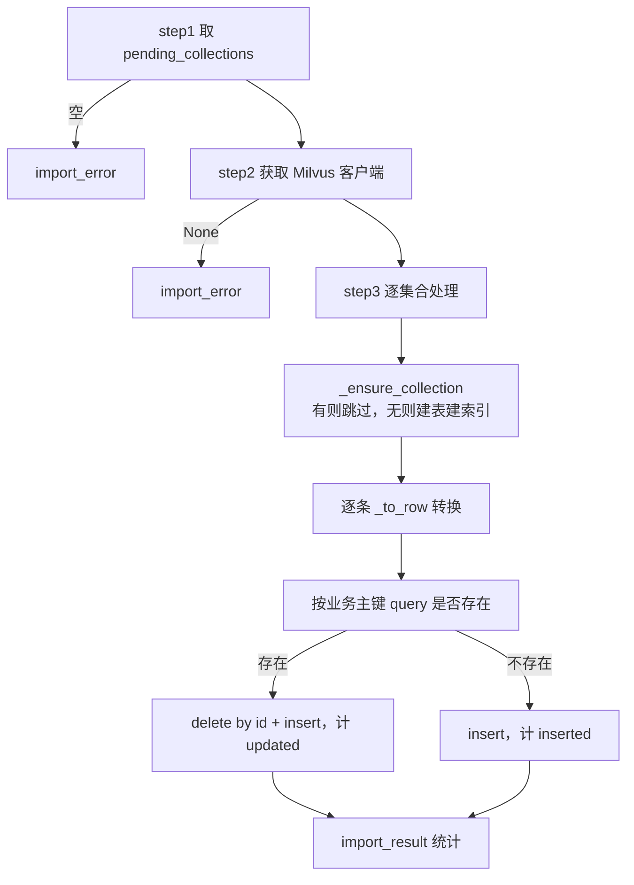

# 导入_08 node_import_milvus —— 建表与幂等入库

> 文件：`processor/import_processor/nodes/node_import_milvus.py`
> 职责：把带向量的记录写进 Milvus。**这是唯一有"持久化副作用"的一步**，所以幂等性和字段约束在这里最要命。

## 一、这一节要解决三个问题

| 问题 | 做法 |
|---|---|
| 集合还不存在怎么办 | `_ensure_collection` 幂等建表：有就不动，没有就按固定 Schema 创建 |
| 同一份资料重复导入怎么办 | **按业务主键 upsert**（先按主键删，再插），不按文件名批量删 |
| 记录字段比 Schema 多/少怎么办 | `_to_row` 白名单裁剪 + `None` 跳过 |

第二条是 PRD 明确要求（`3.2 幂等策略`）。为什么不能"按文件名先删后插"？因为一个文件名可能对应数据库里多批数据（同名的两份不同资料），批量删会误伤；而且删完到插完之间有个空窗期，检索可能查不到数据。

## 二、整体流程



## 三、四张 Collection 的主键与字段

### 3.1 业务主键映射

```python
COLLECTION_PRIMARY_KEYS = {
    "edu_course_series": "series_code",
    "edu_course_module": "course_code",
    "edu_course_doc": "id",
    "edu_question": "question_code",
}
```

前三者有**业务含义的主键**（课程系列编码、课程编码、题目编码），最后一个 `edu_course_doc` 只有自增的 `id`——这个差异直接导致了后面的幂等性缺口（见第八节）。

### 3.2 标量字段定义

字段用三元组声明：`(字段名, 数据类型, 最大长度或 None)`。

**`edu_course_series`**

| 字段 | 类型 | 长度 | 说明 |
|---|---|---|---|
| `id` | VARCHAR | 64 | 主键（uuid） |
| `series_code` | VARCHAR | 64 | 业务主键 |
| `series_name` | VARCHAR | 128 | |
| `description` | VARCHAR | 512 | |
| `course_category` | VARCHAR | 256 | 支持按分类过滤 |
| `target_audience` | VARCHAR | 256 | |
| `learning_goal` | VARCHAR | 256 | |
| `suitable_grade` | VARCHAR | 128 | |
| `content` | VARCHAR | 2048 | **向量化源文本** |
| `source_file` / `source_path` | VARCHAR | 256 / 512 | 溯源 |
| `created_at` | INT64 | — | 入库时间戳 |

**`edu_course_module`**

| 字段 | 类型 | 长度 | 说明 |
|---|---|---|---|
| `id` | VARCHAR | 64 | 主键 |
| `course_code` | VARCHAR | 64 | 业务主键 |
| `course_name` | VARCHAR | 128 | |
| `series_code` | VARCHAR | 64 | 外键（冗余，无 JOIN） |
| `series_name` | VARCHAR | 128 | |
| `duration` | INT32 | — | **可空**（课时） |
| `credit_hours` | FLOAT | — | **可空**（学时） |
| `description` | VARCHAR | 512 | |
| `content` | VARCHAR | 2048 | |
| `source_file` / `source_path` | VARCHAR | 256 / 512 | |
| `created_at` | INT64 | — | |

**`edu_course_doc`**

| 字段 | 类型 | 长度 | 说明 |
|---|---|---|---|
| `id` | VARCHAR | 64 | 主键（uuid，无业务主键） |
| `doc_kind` | VARCHAR | 16 | `lecture` / `project` |
| `course_code` | VARCHAR | 64 | **可空**，当前留空 |
| `series_code` | VARCHAR | 64 | **可空**，当前留空 |
| `project_name` | VARCHAR | 128 | **可空** |
| `chapter_name` | VARCHAR | 128 | **可空** |
| `chunk_index` | INT32 | — | **可空** |
| `content` | VARCHAR | **4096** | 比其它集合大（块最长 3000 + 前缀） |
| `source_file` / `source_path` | VARCHAR | 256 / 512 | |
| `created_at` | INT64 | — | |

**`edu_question`**

| 字段 | 类型 | 长度 | 说明 |
|---|---|---|---|
| `id` | VARCHAR | 64 | 主键 |
| `question_code` | VARCHAR | 64 | 业务主键 |
| `bank_code` | VARCHAR | 64 | |
| `bank_name` | VARCHAR | 128 | |
| `question_type` | VARCHAR | 32 | 英文枚举，**过滤主力** |
| `group_id` | VARCHAR | 64 | **可空**，V1 恒为 None |
| `content` | VARCHAR | **8192** | 题干 + 选项 |
| `options` | **JSON** | — | **可空**，`{A: ..., B: ...}` |
| `answer` | VARCHAR | 2048 | 归一化答案 |
| `answer_raw` | VARCHAR | 2048 | 原始答案 |
| `analysis` | VARCHAR | 4096 | **可空** |
| `source_file` / `source_path` | VARCHAR | 256 / 512 | |
| `created_at` | INT64 | — | |

`options` 用 `DataType.JSON` 而不是 VARCHAR——选项是 key-value 结构，存 JSON 后检索侧可以直接取 `options["A"]`，不用二次解析字符串。

## 四、`_ensure_collection`：幂等建表 + 三类索引

```python
def _ensure_collection(client, collection_name: str):
    if client.has_collection(collection_name):
        return True
    ...
```

**第一行就返回**是幂等的核心：已存在的集合**绝不 alter**。这意味着改 Schema 必须手工删表重建（Milvus 不支持随意改字段类型），这一点在迭代时要记住。

### 4.1 Schema 创建

```python
schema = MilvusClient.create_schema(api_version="V2", auto_id=False, enable_dynamic_field=False)
nullable_fields = set(_NULLABLE_FIELDS.get(collection_name, []))
for field_name, data_type, max_len in _SCALAR_FIELDS[collection_name]:
    kwargs = {
        "datatype": data_type,
        "is_primary": field_name == "id",
        "nullable": field_name in nullable_fields,
    }
    if max_len is not None:
        kwargs["max_length"] = max_len
    schema.add_field(field_name=field_name, **kwargs)
```

三个参数的用意：

- **`auto_id=False`**：主键由调用方提供（`_to_row` 生成 uuid）。设为 `True` 的话 Milvus 会自己生成 INT64 主键，与"VARCHAR id + 业务主键查询"的设计冲突；
- **`enable_dynamic_field=False`**：**禁止动态字段**。如果打开，插入时多出来的字段会被吞进一个隐藏的 JSON 字段而不报错——听起来宽容，实际会让"字段名打错"这种 bug 静默通过。关掉后，多余字段直接报错，问题暴露在导入阶段。这就是 `_to_row` 必须做白名单裁剪的原因；
- **`nullable`**：Milvus 的硬要求——**插入时省略的字段必须声明为 nullable（或有默认值）**。`_to_row` 会跳过 `None` 值，被跳过的字段就"没有值"，如果 schema 里不可空，插入直接失败。

`_NULLABLE_FIELDS` 就是为这个准备的：

```python
_NULLABLE_FIELDS = {
    "edu_course_series": [],
    "edu_course_module": ["duration", "credit_hours"],
    "edu_course_doc": ["course_code", "series_code", "project_name", "chapter_name", "chunk_index"],
    "edu_question": ["group_id", "options", "analysis"],
}
```

### 4.2 双向量字段

```python
schema.add_field(field_name="dense_vector", datatype=DataType.FLOAT_VECTOR, dim=1024)
schema.add_field(field_name="sparse_vector", datatype=DataType.SPARSE_FLOAT_VECTOR)
```

`dim=1024` 是 BGE-M3 的固定输出维度，**必须与模型一致**。如果换模型（比如 bge-large-zh 是 1024，bge-base 是 768），这里要同步改，且旧集合必须重建。

### 4.3 索引：一稠密 + 一稀疏 + 若干倒排

```python
index_params = client.prepare_index_params()

index_params.add_index(
    field_name="dense_vector",
    index_type="HNSW",
    metric_type="IP",
    params={"M": 16, "efConstruction": 200},
)
index_params.add_index(
    field_name="sparse_vector",
    index_type="SPARSE_INVERTED_INDEX",
    metric_type="IP",
)
for field_name in _INVERTED_INDEX_FIELDS[collection_name]:
    index_params.add_index(field_name=field_name, index_type="INVERTED")
```

逐个解释：

| 配置 | 含义 |
|---|---|
| `HNSW` | 分层可导航小世界图，召回率高、查询快，代价是内存占用大（图结构常驻） |
| `M=16` | 每个节点的最大出边数。越大召回越高、内存越大。16 是通用起点 |
| `efConstruction=200` | 建图时的候选队列长度。越大图质量越好、建图越慢。200 适合中小规模 |
| `metric_type="IP"` | 内积。因为 BGE-M3 已做 L2 归一化，IP 等价于余弦（见 `导入_07` 5.2） |
| `SPARSE_INVERTED_INDEX` | 稀疏向量的倒排索引，只对非零维度建表，天然适合关键词匹配 |
| 标量 `INVERTED` | 对 `question_type`、`bank_code` 这类字段建倒排，让 `filter` 表达式走索引而不是全扫 |

标量倒排索引的字段清单：

```python
_INVERTED_INDEX_FIELDS = {
    "edu_course_series": ["series_code", "series_name", "course_category", "target_audience", "suitable_grade"],
    "edu_course_module": ["course_code", "course_name", "series_code"],
    "edu_course_doc": ["doc_kind", "course_code", "series_code", "project_name", "chapter_name"],
    "edu_question": ["question_code", "bank_code", "bank_name", "question_type", "group_id"],
}
```

**为什么这些字段要建倒排**：检索时常见的过滤是"只在某题库里搜"、"只看单选题"、"只看某个项目的文档"。没有倒排，Milvus 要做标量全扫再与向量结果求交，数据量大时非常慢。

注意 `content` / `answer` / `analysis` **没有**建倒排——它们是长文本，倒排索引体积大且用处小（语义检索已经覆盖）。

## 五、`_to_row`：白名单裁剪

```python
def _to_row(record: dict, collection_name: str) -> dict:
    scalar_names = {f[0] for f in _SCALAR_FIELDS[collection_name]}
    row = {}
    for k, v in record.items():
        if k not in scalar_names:
            continue          # ← 白名单：不在 Schema 里的字段直接丢
        if v is None:
            continue          # ← 跳过 None
        row[k] = v
    row.setdefault("id", str(uuid.uuid4()))
    row["created_at"] = int(time.time())
    row["dense_vector"] = record.get("dense_vector")
    row["sparse_vector"] = record.get("sparse_vector")
    return row
```

### 5.1 被裁掉的字段

| 记录里的字段 | 是否进 Milvus | 原因 |
|---|---|---|
| `question_type_cn` | ❌ | Schema 没有。只用于调试，不需要存 |
| `data_anomaly` | ❌ | 异常说明走 `parse_failed_entities`，不进库 |
| `dense_vector` / `sparse_vector` | ✅（单独赋值） | 不在 `_SCALAR_FIELDS` 里，但末尾显式补上 |

**白名单而不是黑名单**是关键：parser 将来多产出任何字段，都不会因为"Schema 里没有"而插入失败（`enable_dynamic_field=False` 下多余字段会报错）。这是"生产者可以随意加字段、消费者只取自己认识的"的稳健设计。

### 5.2 为什么 `None` 要跳过而不是写空串

三个原因：

1. **VARCHAR 不接受显式 None**——注释里写了 `Milvus VARCHAR 不接受显式 None`；
2. **语义不同**：`group_id=None` 表示"没有分组"，写 `""` 表示"分组是空字符串"。检索时 `group_id == ""` 会命中，语义污染；
3. **`options=None` 对 JSON 字段**尤其重要——写 `{}` 会变成"有选项但是空"，而实际是"这题没有选项"。

配合 schema 的 `nullable=True`，省略即"未设置"，最干净。

### 5.3 `id` 与 `created_at`

```python
row.setdefault("id", str(uuid.uuid4()))
row["created_at"] = int(time.time())
```

- `setdefault` 而不是直接赋值：如果记录里已经有 `id`（比如将来做增量更新时传进来），保留原值；
- `created_at` 是**秒级时间戳**（INT64）。注意它在"更新"场景下也会被刷新——名字叫 `created_at` 但实际是 `last_import_at` 的语义。如果需要真正的创建时间，得先查旧记录再决定是否覆盖。

## 六、upsert 的核心：先删后插

```python
for record in records:
    if not record.get("dense_vector"):
        logger.warning(f"记录缺少向量，跳过：{record.get(pk_field)}")
        continue
    row = _to_row(record, collection_name)
    try:
        pk_value = row.get(pk_field)
        if pk_field == "id" or not pk_value:
            client.insert(collection_name=collection_name, data=[row])
            ins_cnt += 1
            continue
        expr = f'{pk_field} == "{pk_value}"'
        existing = client.query(collection_name=collection_name, filter=expr, output_fields=["id"])
        if existing:
            client.delete(collection_name=collection_name, ids=[e["id"] for e in existing])
            upd_cnt += 1
        else:
            ins_cnt += 1
        client.insert(collection_name=collection_name, data=[row])
    except Exception as e:
        logger.error(f"记录入库失败 [{collection_name}] {record.get(pk_field)}：{e}")
```

### 6.1 为什么是"删 + 插"而不是 Milvus 的 `upsert`

Milvus 有原生 `upsert`，但它的语义是**按主键（`id`）覆盖**——而这里的幂等键是**业务主键**（`series_code` / `course_code` / `question_code`），`id` 每次都是新 uuid。用原生 `upsert` 会变成"每次插入一条新记录"，旧记录永远留着。

所以必须：**先按业务主键查出旧记录的 `id` → 按 `id` 删除 → 插入新记录**。三步缺一不可。

`output_fields=["id"]` 只取主键，不取其他字段——`delete` 只需要 id，取多了浪费带宽。

### 6.2 为什么用 `query` 而不是 `get`

`client.get(ids=[...])` 是按**主键**查，而这里只有业务主键的值，没有 `id`。所以只能走 `query` + `filter` 表达式。

表达式是字符串拼接：

```python
expr = f'{pk_field} == "{pk_value}"'
```

`pk_value` 来自资料内容（如 `prog_intro_m01`）。**理论上存在表达式注入风险**——如果编码里含双引号，表达式会被破坏。实际编码是 `[A-Za-z0-9_-]` 格式，风险很低，但如果将来编码来源不可控，应做转义或改用参数化接口。

### 6.3 逐条处理而不是批量

`for record in records: ... query → delete → insert` 是**每条 3 次网络往返**。2628 条就是 ~8000 次调用。这是当前实现的性能瓶颈。

为什么不批量？因为 Milvus 的 `delete` 按 `ids` 批量删除、`insert` 也支持批量，但"每条记录是否需要删除"的判定结果不同（有的存在有的不存在），要先查出来再分组。这是可以优化的：

```python
# 伪代码：批量版
existing = client.query(filter=f'{pk} in ["a","b","c",...]', output_fields=["id", pk])
delete_ids = [...]
client.delete(ids=delete_ids)
client.insert(data=rows)     # 一次插所有
```

在 2000 条量级下，当前实现大约几分钟内能跑完，够用；上万条时应该改成批量。

### 6.4 `edu_course_doc` 走的是另一个分支

```python
if pk_field == "id" or not pk_value:
    client.insert(collection_name=collection_name, data=[row])
    ins_cnt += 1
    continue
```

`edu_course_doc` 的 `pk_field` 是 `"id"`，直接 `insert`，**不做任何查重**。

**这是一个真实的幂等缺口**：同一份讲义导入两次，`edu_course_doc` 里的分块会翻倍（每次都是新 uuid）。而其他三个集合因为业务主键相同，第二次是"更新"。

为什么没处理？因为分块没有天然的业务主键——`(source_path, chunk_index)` 组合可以唯一定位，但没有被用作主键。

**改进方案**（如果要做幂等重导）：

```python
# 在 _to_row 里把 id 变成确定性值
row["id"] = hashlib.md5(f"{record['source_path']}#{record['chunk_index']}".encode()).hexdigest()
```

这样同一份文档的同一块永远得到同一个 `id`，可以直接用 Milvus 原生 `upsert` 覆盖。代价是文档改版后块数变少时，多余的老块不会被自动清理（需要按 `source_path` 批量删）。

### 6.5 单条失败不影响其他

```python
except Exception as e:
    logger.error(f"记录入库失败 [{collection_name}] {record.get(pk_field)}：{e}")
```

`try` 在 **for 循环内部**，一条失败只记日志，继续下一条。这是对的——一条记录字段超长不该让 2600 条全部失败。

但要注意：**失败的记录不会进任何计数**（`ins_cnt` / `upd_cnt` 都不加），所以 `import_result` 的总数会小于 `pending` 的记录数。差值是失败条数，只能从日志里数。如果需要精确统计，应该加一个 `failed` 计数。

## 七、返回结构

```python
return {"import_result": {"inserted": inserted, "updated": updated, "collections": collection_stats}}
```

示例：

```json
{
  "inserted": 1800,
  "updated": 828,
  "collections": {
    "edu_course_series":   {"inserted": 219, "updated": 0},
    "edu_course_module":   {"inserted": 657, "updated": 0},
    "edu_question":        {"inserted": 924, "updated": 828}
  }
}
```

- **`inserted`**：业务主键不存在 → 新增；
- **`updated`**：业务主键已存在 → 删旧插新；
- **`collections`**：分集合明细，便于定位"哪个集合没写进去"。

API 层把它转成字符串上报：

```python
set_task_result(task_id, "import_result", str(import_result))
```

## 八、幂等性全景（重要）

| Collection | 幂等键 | 重复导入的行为 | 是否真正幂等 |
|---|---|---|---|
| `edu_course_series` | `series_code` | 删旧插新，条数不变 | ✅ |
| `edu_course_module` | `course_code` | 删旧插新，条数不变 | ✅ |
| `edu_question` | `question_code` | 删旧插新，条数不变 | ✅ |
| `edu_course_doc` | 无（uuid） | **每次追加**，条数翻倍 | ❌ |

这个差异必须在运维文档里写清楚：**重导讲义前需要手工清理 `edu_course_doc`**，否则检索结果里会出现重复片段。

清理方式（按来源文件删）：

```python
client.delete(
    collection_name="edu_course_doc",
    filter='source_path like "%课程文档/第一章.md%"',
)
```

或者按项目名删：`filter='project_name == "掌柜智库"'`。

## 九、几个容易踩的坑

### 9.1 `content` 长度上限

`VARCHAR` 的 `max_length` 在 Milvus 中按 **UTF-8 字节**计数，中文一般 3 字节/字。所以：

- `content` 标称 2048 → 中文约 **680 字**；
- `edu_question.content` 标称 8192 → 中文约 **2700 字**。

**题干 + 选项超过 2700 字**（长材料分析题、带大段代码的编程题）会插入失败。而 `_parse_question_block` 对 `content` 长度**没有任何截断**，所以这是一条现实的失败路径。

遇到时的表现：日志里 `记录入库失败 [edu_question] xxx：length exceeds max length`，该题静默丢失（不进 `import_result`）。

### 9.2 字段为 `None` 但 schema 不可空

比如给 `series_code` 传了 `None`，`_to_row` 会跳过它 → 字段缺失 → schema 里 `series_code` 不可空 → 插入报错。

当前 parser 有主键校验兜底（缺 `series_code` 的记录根本不会产出），所以不会触发。但**新增字段时要同步更新 `_NULLABLE_FIELDS`**，否则"偶尔有值、偶尔没有"的字段一定会在某条数据上炸。

### 9.3 删除后的可见性

`delete` 之后立刻 `insert`，如果检索侧的一致性级别是 `Strong`，可能在新数据落到可查询状态前短暂查不到（取决于 Milvus 的实现与配置）。导入是离线任务，这个窗口无影响；但**导入过程中不要跑检索压测**，否则会看到"数据抽风"。

### 9.4 `_ensure_collection` 永远返回 True

函数签名声明 `-> bool`，注释说"False=创建失败"，但实际实现里创建失败会**抛异常**（`create_collection` 不吞错），不会返回 False。所以调用处的 `if not _ensure_collection(...)` 分支是死代码。

不影响正确性，但读代码时不要以为"创建失败会优雅降级"——它会直接冒泡到 `node_import_milvus` 外层（那里没有 try），导致整个节点异常、任务失败。

## 十、调试手册

| 现象 | 原因 | 排查 |
|---|---|---|
| `Milvus 客户端不可用` | `MILVUS_URL` 未配置 / 服务未启动 | 检查 `.env` 与端口 |
| `无可入库记录` | 上游 `pending_collections` 为空 | 看向量化节点的日志 |
| 插入报 `field xxx not exist` | 记录里有 Schema 外字段 | `_to_row` 白名单是否被绕过 |
| 插入报 `length exceeds max length` | 中文字节数超限 | 缩短 `content` 或调大 `max_length` 后重建集合 |
| 插入报 `nullable` 相关错误 | 省略了不可空字段 | 补 `_NULLABLE_FIELDS` |
| 检索结果有重复片段 | `edu_course_doc` 重复导入 | 按 `source_path` 清理后重导 |
| 集合已存在但字段少了 | 改了 Schema 但没重建 | 删表重建（`_ensure_collection` 不会 alter） |
| `updated` 一直是 0 | 业务主键每次都不同 | 检查 parser 是否把时间戳/id 拼进了编码 |

## 十一、设计取舍

| 决定 | 替代方案 | 为什么选现在这个 |
|---|---|---|
| 按业务主键"删+插" | 原生 `upsert` | 原生按 `id` 覆盖，业务主键变了就不生效 |
| `enable_dynamic_field=False` | 开启动态字段 | 关掉能让字段错误暴露在导入阶段 |
| 白名单裁剪 | 透传所有字段 | Schema 是契约，多余字段不应进库 |
| `None` 省略 + nullable | 写空串 | 区分"没有值"和"值是空" |
| 逐条 upsert | 批量 | 实现简单；2000 条量级够用，上万条需改批量 |
| 单条失败只记日志 | 整体回滚 | 一条坏数据不该废掉 2600 条 |
| 稠密 HNSW + 稀疏倒排 | 只用 HNSW | 稀疏负责关键词精确匹配，稠密负责语义 |

## 十二、从这条链路回看整体

走完这一步，一份资料就完成了从"文件"到"可检索知识"的转化：

```
文件 → 校验 → 归一到 MD → 图片语义化 → 按类型抽取实体
     → 拼 content → 双向量 → 建表 + 幂等入库
```

每一次设计上的"额外一步"都能对应到一个具体的检索需求：

| 设计 | 服务的检索需求 |
|---|---|
| 系列/模块系列名冗余 | "这个模块属于哪个系列"无需 JOIN |
| `chapter_name` 前缀进 content | 公式/代码块也能被语义命中 |
| 图片摘要进 alt | 图片内容可检索 |
| `question_type` 英文枚举 + 倒排 | "只搜单选题"这类过滤 |
| `answer_raw` 保留 | 答案争议可回溯 |
| `options` 存 JSON | 前端直接渲染选项 |
| 双向量 | 语义 + 关键词双路召回 |
