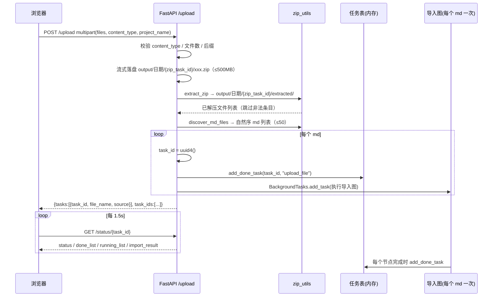

# 导入_09 ZIP 资料包导入流程

> 相关文件：`api/file_import_service.py`、`utils/zip_utils.py`、`utils/md_image_utils.py`、`utils/task_utils.py`、`page/import.html`
> 职责：把"一堆 md + 一个 images/ 目录"的资料包一次性变成多条导入任务，**每个 md 独立走一遍标准导入图**。

## 一、为什么需要 zip 通道

单文件上传只解决"一份文档"的场景。实际的教育资料通常是这样交付的：

```
掌柜智库/
├── 01_项目背景.md
├── 02_整体架构.md
├── ...
├── 19_总结.md
└── images/
    ├── arch.png
    └── ...
```

19 篇 md + 123 张图，图在 md 里用 `` 相对引用。如果只能一个个上传：

1. 用户要传 19 次；
2. **图片引用的相对位置丢了**——单独传 `02_整体架构.md` 时，它的 `images/` 目录不在服务器上，图片全部无法定位；
3. 19 个文档的 `project_name` 要手工填 19 次，容易漏。

zip 通道的价值不只是"省 19 次点击"，而是**保留包内的目录结构**：解压后 md 与 images/ 的相对关系还原，图片定位逻辑（`node_md_img` 的 `search_root`）才能工作。

## 二、端到端时序



关键点先说清楚：

- **zip 本身不是一次导入**，它只是"拆任务"的入口。拆出来的每个任务与"用户直接上传一个 .md"完全等价；
- **多个 md 是串行执行的**（见第七节），不是并行；
- **每个任务独立成败**：第 3 篇失败不影响其余 18 篇。

## 三、第一段：上传与校验

```python
UPLOAD_EXTENSIONS = VALID_EXTENSIONS | {".zip"}       # .md/.pdf/.docx/.zip
MAX_ZIP_SIZE = 500 * 1024 * 1024                      # 500MB，图片多时体积大
```

`/upload` 的三层前置校验（在落盘之前）：

```python
valid_types = {"course_catalog", "question_bank", "course_doc"}
if content_type not in valid_types:
    raise HTTPException(status_code=400, detail=...)
if len(files) > 20:
    raise HTTPException(status_code=400, detail="单次批量上限 20 个文件")

for file in files:
    ext = Path(file.filename or "").suffix.lower()
    if ext not in UPLOAD_EXTENSIONS:
        raise HTTPException(status_code=400, detail=f"文件 {file.filename} 类型 {ext} 不在白名单")
```

三层各有分工：

| 校验 | 位置 | 目的 |
|---|---|---|
| `content_type` 枚举 | 入口 | 后面整包所有 md 都用这个类型解析，传错等于全错，必须最先拦 |
| 文件数 ≤20 | 入口 | 单次请求的资源上限（20 个 zip × 50 md 已经有 1000 个任务了） |
| 后缀白名单 | 逐文件 | `.zip` 与三种格式共用同一入口，靠后缀分流 |

**注意 20 与 50 是两道不同的闸门**：20 是"单次请求最多几个文件"，50 是"一个 zip 里最多几个 md"。极端情况 20 个 zip → 1000 个任务，实际使用中不会这么传，但代码没有在总量上再拦一次。

### 3.1 落盘目录

```python
today_str = datetime.now().strftime("%Y%m%d")
task_id = str(uuid.uuid4())
task_local_dir = PROJECT_ROOT / "output" / today_str / task_id
task_local_dir.mkdir(parents=True, exist_ok=True)
local_file_path = task_local_dir / (file.filename or f"upload{ext}")
```

落地结构：

```
output/20261019/{zip_task_id}/
├── 掌柜智库.zip
└── extracted/                 ← 解压根目录，也是每个 md 任务的 local_dir
    ├── 01_项目背景.md
    ├── ...
    └── images/
```

**zip 的 `task_id` 只用来建目录，不用于任务追踪**——真正的任务 id 是下面每个 md 各自新生成的。所以这个 uuid 不会出现在 `/status` 里。

### 3.2 流式落盘 `_save_upload`

```python
async def _save_upload(file: UploadFile, dest: Path, max_size: int) -> int:
    size = 0
    with open(dest, "wb") as out:
        while True:
            chunk = await file.read(1024 * 1024)      # 1MB 一块
            if not chunk:
                break
            size += len(chunk)
            if size > max_size:
                out.close()
                dest.unlink(missing_ok=True)          # 删半成品
                raise HTTPException(status_code=400, detail=f"文件 {file.filename} 超过 ...")
            out.write(chunk)
    return size
```

为什么不 `await file.read()` 一次读完？

- **内存**：500MB 的 zip 全读进内存会直接把进程撑爆（尤其并发上传时）；
- **提前失败**：边写边计数，超限立刻停并删掉半成品，不用等传完 500MB 才发现超了；
- **`dest.unlink(missing_ok=True)`**：`missing_ok` 保证即使文件已被删掉（重复调用）也不抛错。

`1024 * 1024`（1MB）是 IO 大小与系统调用次数的折中：块太小则系统调用过多，太大则内存峰值升高。

## 四、第二段：安全解压 `extract_zip`

zip 是最危险的上传格式——一个精心构造的压缩包可以写到任意路径（zip-slip）、解压出 100GB（zip 炸弹）、或者用软链接逃逸。`extract_zip` 逐条拦截：

```python
def extract_zip(zip_path, target_dir, max_total_size=MAX_UNZIP_TOTAL_SIZE) -> list[str]:
    target_dir_obj.mkdir(parents=True, exist_ok=True)
    root_resolved = Path(os.path.realpath(target_dir_obj))

    try:
        zf = zipfile.ZipFile(zip_path_obj)
    except zipfile.BadZipFile as e:
        raise ZipExtractError(f"不是有效的 zip 压缩包：{e}") from e

    extracted, total_size, skipped = [], 0, 0
    with zf:
        infos = zf.infolist()
        if len(infos) > MAX_ZIP_ENTRIES:
            raise ZipExtractError(f"压缩包条目数超限（{len(infos)} > {MAX_ZIP_ENTRIES}）")
```

### 4.1 六道关卡

| # | 拦截 | 代码 | 防的是什么 |
|---|---|---|---|
| 1 | 非法压缩包 | `except BadZipFile` | 用户把 .rar 改名成 .zip |
| 2 | 条目数 > 20000 | `len(infos) > MAX_ZIP_ENTRIES` | 百万小文件的 zip 炸弹 |
| 3 | 目录 / 软链接 | `info.is_dir() or _is_symlink(info)` | 软链接指向 `/etc/passwd`，解压后写文件会穿透到包外 |
| 4 | 非法路径 | 绝对路径 / `..` / 空段 | zip-slip：`../../../../tmp/evil.sh` |
| 5 | 垃圾文件 | `__MACOSX`、`.DS_Store`、任意隐藏目录 | macOS 打包必带，不拦会污染目录也浪费 IO |
| 6 | 解压总量 > 2GB | `total_size > max_total_size` | 1MB 压成 10GB 的 zip 炸弹 |

逐个看实现细节。

### 4.2 软链接识别

```python
def _is_symlink(info: zipfile.ZipInfo) -> bool:
    """Unix 模式高位为 symlink 的条目直接跳过（防解压到包外）"""
    return (info.external_attr >> 16) & 0o170000 == 0o120000
```

zip 格式里每个条目有 `external_attr` 字段，Unix 打包器会把 `st_mode` 放在高 16 位。`0o120000` 是 `S_IFLNK`（软链接）的文件类型位，`0o170000` 是类型掩码。

为什么必须拦：软链接文件的内容是"目标路径"，解压后如果后续代码 `open(link).write()`，实际写的是链接指向的位置——可能是包外的任意文件。

### 4.3 中文文件名修复（很实用的一处）

```python
def _decode_name(info: zipfile.ZipInfo) -> str:
    if info.flag_bits & 0x800:          # 有 UTF-8 标记，zipfile 已正确解码
        return info.filename
    raw = info.filename.encode("cp437", errors="ignore")
    for encoding in ("utf-8", "gb18030"):
        try:
            return raw.decode(encoding)
        except UnicodeDecodeError:
            continue
    return info.filename
```

背景：zip 规范里文件名编码没有强制规定。带 `0x800` 标志位的按 UTF-8 存；**Windows 自带压缩 / 老版 WinRAR 打的包通常不带这个标志，且用的是本地代码页（GBK）**。Python 的 `zipfile` 对没有标志的条目一律按 `cp437` 解码，于是 `项目背景.md` 会变成 `��Ŀ����.md`。

修复思路是"**还原原始字节，再按正确编码重解**"：

```
cp437 解码后的字符串 --encode("cp437")--> 原始字节 --decode("utf-8"/"gb18030")--> 正确文件名
```

`errors="ignore"` 是因为 cp437 只有 256 个码位，某些字节可能无法映射，忽略比抛错更稳。先试 UTF-8 再试 GB18030——UTF-8 的中文是 3 字节且校验严格，误判概率极低；GB18030 覆盖面广，作为兜底。

这条逻辑在解压后立刻生效，所以后续 md 发现、图片定位、日志里的路径都是正确中文。

> 顺带一提：GB18030 是 GBK 的超集，所以"Windows 中文包"和"GBK 包"都能覆盖，不需要单独试 GBK。

### 4.4 路径安全校验

```python
name = _decode_name(info).replace("\\", "/")     # Windows 反斜杠统一
pure = PurePosixPath(name)
parts = pure.parts
if not parts or pure.is_absolute() or any(p in ("..", "") for p in parts):
    logger.warning(f"跳过非法路径条目：{name}")
    skipped += 1
    continue
```

三个条件：

- `not parts`：空路径（理论上不会有，防御性）；
- `pure.is_absolute()`：`/etc/passwd`、`C:/Windows/...` 这类绝对路径；
- `any(p in ("..", "") for p in parts)`：任意一段是 `..` 就整条拒绝。

**为什么整条拒绝而不是"尽力修正"**：一个正常打包的资料包不会出现 `..`，出现了就说明压缩包有问题（恶意或打包工具异常），静默修正可能掩盖攻击。

然后还有一道 **realpath 复核**：

```python
dest = target_dir_obj / Path(*parts)
if not _is_within(root_resolved, dest):
    logger.warning(f"跳过越权路径条目：{name}")
    skipped += 1
    continue
```

```python
def _is_within(root: Path, target: Path) -> bool:
    target_real = Path(os.path.realpath(target))
    return target_real == root or root in target_real.parents
```

这一步看似与 `..` 检查重复，但它防的是**前一层检查覆盖不到的情况**：如果 `target_dir` 内部已经存在一个指向包外的软链接（比如上一次解压留下的），那么 `dest` 字符串上完全合法，`realpath` 展开后却在包外。**字符串校验 + 真实路径校验**双层，是路径穿越防护的标准做法。

### 4.5 垃圾文件过滤

```python
if parts[0] in _IGNORED_DIR_NAMES:          # __MACOSX
    continue
filename = parts[-1]
if filename in _SKIP_FILE_NAMES or filename.startswith("."):   # .DS_Store / Thumbs.db / .xxx
    continue
if any(p.startswith(".") for p in parts[:-1]):                 # 任意层级隐藏目录 .git/.idea
    continue
```

`__MACOSX` 里存的是 macOS 的资源分支（`._xxx.md` 这种），如果被解出来，`discover_md_files` 虽然不会把它当 md（后缀是 `.md` 但文件名以 `._` 开头——注意**它后缀确实也是 .md**），会有误判风险，所以在解压阶段就拦掉最干净。

### 4.6 体积累计与拷贝

```python
total_size += info.file_size
if total_size > max_total_size:
    raise ZipExtractError(f"解压后体积超过上限（>{max_total_size / 1024 / 1024:.0f}MB）")

dest.parent.mkdir(parents=True, exist_ok=True)
with zf.open(info) as src, open(dest, "wb") as out:
    shutil.copyfileobj(src, out)
extracted.append(pure.as_posix())
```

- **用 `info.file_size`（zip 头里声明的解压后大小）而不是实际写入字节**：能在写之前就判断，避免"边写边超"。理论上 zip 头可以撒谎，但配合 2GB 上限，风险可控；
- **`copyfileobj` 流式拷贝**：不整块读入内存，和上传落盘同理；
- **`pure.as_posix()`**：统一用 `/` 分隔返回，后续跨平台处理路径不用再转换。

### 4.7 实测验证

用一个手工构造的包（含中文名、子目录、`__MACOSX`、`.DS_Store`、`_new.md`、`../evil.txt`）：

```
EXTRACTED: ['01_入门.md', '01_入门_new.md', '10_收官.md', '2_进阶.md',
            'docs/02_子目录.md', 'images/a.png']

跳过非法路径条目：../evil.txt
zip 解压完成：资料包.zip → 6 个文件（跳过 1 个非法条目）
```

两个结论：

1. `../evil.txt` 被拦截，包外没有生成文件；
2. `_new.md` **会**被解压出来（`extract_zip` 不过滤它），是在下一步 `discover_md_files` 里才排除的——两层职责不同，别搞混。

## 五、第三段：发现 md `discover_md_files`

```python
MD_SUFFIXES = {".md", ".markdown"}     # .markdown 兼容 Obsidian / 语雀导出
MAX_MD_PER_ZIP = 50
```

```python
def discover_md_files(root) -> list[Path]:
    md_files = []
    for path in root_obj.rglob("*"):
        if not path.is_file() or path.suffix.lower() not in MD_SUFFIXES:
            continue
        rel_parts = path.relative_to(root_obj).parts
        if any(part.startswith(".") for part in rel_parts):
            continue
        if path.name in _SKIP_FILE_NAMES or path.stem.endswith("_new"):
            continue
        md_files.append(path)

    md_files.sort(key=lambda p: _natural_key(p.relative_to(root_obj).as_posix()))
    return md_files
```

### 5.1 为什么递归 + 过滤隐藏目录

资料包常有层级：

```
extracted/
├── 第一章/
│   ├── 01_xxx.md
│   └── images/
└── 第二章/
    └── 02_xxx.md
```

`rglob("*")` 全递归能覆盖这种结构。但同时会扫到 `.git/`、`.obsidian/` 里的 md（笔记软件的元数据），所以要把**路径中任意一段以 `.` 开头**的都排除。

### 5.2 `_new.md` 为什么必须排除

`node_md_img` 处理完图片后会在 md 旁边写一个 `xxx_new.md` 备份（见 `导入_03`）。如果这个目录被重新扫描：

- 原 `01_xxx.md` → 任务 A
- `01_xxx_new.md` → 任务 B

同一个文档被导入两次，而任务 B 的图片引用已经指向 MinIO（不再有本地图），`source_file` 还多了一个 `_new` 后缀。所以 `path.stem.endswith("_new")` 是硬性过滤。

当前流程里，解压和发现发生在 `node_md_img` 之前，正常情况下不会扫到 `_new.md`；这行是**防止将来把"重新导入已有目录"做成功能时踩坑**。

### 5.3 自然序排序（关键细节）

```python
_DIGIT_RE = re.compile(r"(\d+)")

def _natural_key(text: str):
    """自然序键：01_x < 2_x < 10_x（避免字符串排序把 10 排在 2 前面）"""
    return [int(part) if part.isdigit() else part for part in _DIGIT_RE.split(text)]
```

字符串排序下 `["01_x.md", "10_x.md", "2_x.md"]` —— `"10" < "2"` 因为逐字符比较 `"1" < "2"`。资料包按章节编号命名时，这会让导入顺序全乱（虽然导入顺序不影响入库结果，但影响日志排查和 `chunk_index` 的直觉一致性）。

做法是把路径按数字段切开、数字段转 int：

```
"10_收官.md" → ['', 10, '_收官.md']
"2_进阶.md"  → ['', 2, '_进阶.md']
"01_入门.md" → ['', 1, '_入门.md']
```

比较时先比 `''`（相等），再比 `1 < 2 < 10`，顺序正确。

实测结果：

```
MD ORDER: ['01_入门.md', '2_进阶.md', '10_收官.md', 'docs/02_子目录.md']
```

注意 **`docs/02_子目录.md` 排在最后**——排序键是**包内相对路径**（不是文件名），`"docs/..."` 的第一个字符 `d` 大于数字切分后的空串前缀，所以目录内容整体排在根目录文件之后。这符合"先按目录分组、再按编号"的直觉。

## 六、第四段：拆任务 `_expand_zip`

```python
def _expand_zip(zip_path, task_local_dir, upload_name, content_type, project_name, background_tasks):
    extract_dir = task_local_dir / "extracted"
    try:
        extract_zip(zip_path, extract_dir)
    except ZipExtractError as e:
        raise HTTPException(status_code=400, detail=f"资料包 {upload_name} 解析失败：{e}")

    md_files = discover_md_files(extract_dir)
    if not md_files:
        raise HTTPException(status_code=400, detail=f"资料包 {upload_name} 中未找到 .md/.markdown 文档")
    if len(md_files) > MAX_MD_PER_ZIP:
        raise HTTPException(status_code=400,
                            detail=f"资料包 {upload_name} 含 {len(md_files)} 个文档，超过单次 {MAX_MD_PER_ZIP} 个上限")

    zip_project_name = project_name or zip_path.stem

    tasks = []
    for md_path in md_files:
        task_id = str(uuid.uuid4())
        rel_name = md_path.relative_to(extract_dir).as_posix()
        add_done_task(task_id, "upload_file")
        background_tasks.add_task(
            _run_graph_with_progress, task_id, str(extract_dir), str(md_path),
            content_type, zip_project_name, rel_name,
        )
        tasks.append({"task_id": task_id, "file_name": rel_name, "source": upload_name})
    return tasks
```

### 6.1 空包与超量的处理时机

两个 `HTTPException` 都在**同步阶段**抛出，也就是在 `/upload` 返回之前：

- 空包（没 md）→ 400，用户当场知道"包传错了"；
- 超过 50 个 md → 400，避免排 500 个任务把进程拖死。

**注意"包里有 PDF/Word 但没有 md"也走"未找到 md"这条错误**——`discover_md_files` 只找 md，zip 里的 `.pdf` / `.docx` 会被完全忽略，不会转成 md 再导入。这是当前实现的明确边界（见第十节）。

### 6.2 `project_name` 的缺省规则

```python
zip_project_name = project_name or zip_path.stem
```

- 用户在页面填了项目名 → 用它（整包所有 md 共用）；
- 没填 → **用压缩包文件名**（`掌柜智库.zip` → `掌柜智库`）。

这个值会一路传到 `node_course_doc_parser`，决定 `doc_kind`：

```python
doc_kind = "project" if project_name else "lecture"
```

所以**zip 导入的 course_doc 一定是 `project`**（因为 zip 名兜底永远非空）。这条设计是合理的：一个资料包本身就是一个项目。但它带来一个副作用——**如果你只是想导入一批零散讲义（非项目），不要打成 zip**，否则 `doc_kind` 会被标成 `project`。

### 6.3 三个关键字段的赋值

```python
_run_graph_with_progress(
    task_id,
    str(extract_dir),    # local_dir  → 图片兜底的 search_root
    str(md_path),        # local_file_path
    content_type,
    zip_project_name,    # project_name
    rel_name,            # source_file  → 包内相对路径
)
```

对应到初始状态：

| 参数 | state 字段 | 值示例 | 作用 |
|---|---|---|---|
| `local_dir` | `local_dir` | `output/.../extracted` | `node_md_img` 的 `search_root`，图片在包根时靠它兜底 |
| `local_file_path` | `local_file_path` | `extracted/docs/02_x.md` | 实际读取的文件 |
| `source_file` | `source_file` | `docs/02_x.md` | **入库溯源**：能看出这份文档在包里的位置 |
| `source_path` | `source_path`（默认=local_file_path） | 绝对路径 | 同上，用于定位 |

`source_file` 用**包内相对路径**而不是文件名，是为了解决"不同子目录下同名文件"的溯源歧义：

```
extracted/第一章/介绍.md   → source_file = 第一章/介绍.md
extracted/第二章/介绍.md   → source_file = 第二章/介绍.md
```

如果只用 `path.name`，两条记录在 Milvus 里看起来一模一样，出问题无法区分是哪个。API 层注释里也写明了这一点："zip 导入时为包内相对路径，便于溯源"。

### 6.4 `add_done_task(task_id, "upload_file")` 的作用

```python
add_done_task(task_id, "upload_file")
```

这一步是**为了让进度面板好看**。`upload_file` 不是 LangGraph 节点，而是 `task_utils` 里的中文名映射：

```python
_NODE_NAME_TO_CN = {
    "upload_file": "开始上传文件",
    "node_entry": "检查文件",
    ...
}
```

预置一条"已完成"，用户刚拿到 task_id 去轮询时，看到的第一个勾就是"开始上传文件 ✓"，而不是一片空白。纯展示用，不影响流程。

### 6.5 返回结构

```python
return {
    "code": 200,
    "message": f"已接收 {len(files)} 个文件，共 {len(tasks)} 个导入任务",
    "task_ids": [t["task_id"] for t in tasks],
    "tasks": [{"task_id": ..., "file_name": "docs/02_x.md", "source": "掌柜智库.zip"}],
}
```

`task_ids` 是**扁平数组**（兼容旧的单文件前端），`tasks` 带文件名（新前端用）。页面里的兼容写法：

```javascript
(data.tasks || (data.task_ids || []).map(id => ({task_id: id}))).forEach(t => addTask(t.task_id, t.file_name));
```

## 七、第五段：每个 md 走标准导入图

`_run_graph_with_progress` 与单文件上传完全共用：

```python
init_state = create_import_default_state(
    task_id=task_id, local_dir=local_dir,
    local_file_path=local_file_path, content_type=content_type,
    project_name=project_name, source_file=source_file,
)

for event in kb_import_app.stream(init_state, stream_mode="updates"):
    for node_name, node_result in event.items():
        add_done_task(task_id, node_name)
        if isinstance(node_result, dict):
            final_state.update(node_result)
```

也就是说 zip 里的 md **走的是同一条图**：`node_entry → node_format_convert（跳过）→ node_md_img → parser → embedding → milvus`。zip 的特殊性只体现在三个入参上（`local_dir` / `source_file` / `project_name`），图的形状没有任何变化。

### 7.1 图片是怎么找到的

这是 zip 通道最关键的一环。以 `docs/02_子目录.md` 里写 `` 为例：

```
md_dir      = extracted/docs
search_root = extracted          ← local_dir 传进来的
src         = ../images/a.png
```

`resolve_image_path` 的候选顺序（见 `导入_03` 第四节）：

1. 绝对路径 → 不适用；
2. `md_dir / src` = `extracted/docs/../images/a.png` → **命中**（`Path` 不解析 `..`，但操作系统在 `is_file()` 时会正确处理）；
3. 后面 3 级候选（`search_root/src`、`md_dir/name`、`rglob` 兜底）不会执行——命中即返回。

再看"图片集中在包根、md 写相对路径错了"的情况：``，而文件实际在 `extracted/images/a.png`：

1. `md_dir/src` = `extracted/docs/images/a.png` → 不存在；
2. `search_root/src` = `extracted/images/a.png` → **命中**。

这就是 `local_dir = extract_dir` 的意义：**它是包根，是图片定位的第二落点**。如果这里传了 `md_dir`，第二种情况就会失败。

### 7.2 MinIO 上的存放路径

```
{MINIO_IMG_DIR}/{md_stem}/{图片相对路径压平}.png
例：upload-images/doc/02_子目录/images__a.png
```

`md_stem` 来自 `md_path_obj.stem`，即**文件名去后缀**，不带目录。这里有一个真实风险，见第十节第 2 条。

### 7.3 串行执行（性能上的重要事实）

`BackgroundTasks.add_task` 注册的任务在响应返回后**依次执行**（Starlette 内部是 `for task in self.tasks: await task()`，同步函数走线程池）。所以：

- 19 篇 md × 每篇 5~20s（含 VL 图片识别 + 向量化 + 入库）→ 总耗时是**累加**的，可能是 5~10 分钟；
- 用户看到的是"19 个任务同时处于处理中"，但实际只有一个在跑，其余在排队。

如果要对齐"并发"的直觉，需要改成 `asyncio.gather` + 线程池（注意 BGE-M3 有全局锁、VL 有限速器，并发收益有限但能重叠 IO 等待）。

## 八、状态追踪与前端轮询

`task_utils` 是**纯内存**的任务表（单进程）：

```python
_tasks_running_list: Dict[str, List[str]] = {}
_tasks_done_list: Dict[str, List[str]] = {}
_tasks_status: Dict[str, str] = {}
_tasks_result: Dict[str, Dict[str, str]] = {}
```

| 函数 | 调用点 | 作用 |
|---|---|---|
| `clear_task` | 任务开始 | 清空同名残留（重跑时不留旧状态） |
| `update_task_status(processing)` | 任务开始 | 状态置为处理中 |
| `add_done_task(node_name)` | 每个节点完成 | 追加完成节点（自动从 running 移除同名） |
| `update_task_status(completed/failed)` | 任务结束 | 终态 |
| `set_task_result` | 任务结束 | 写 `import_result` / `failed_entities_count` / `error` |

`/status/{task_id}` 把它们组装成响应：

```python
TaskStatusResponse(
    task_id=...,
    status=get_task_status(task_id) or "unknown",
    done_list=get_done_task_list(task_id),      # 已转中文
    running_list=get_running_task_list(task_id),
    error=get_task_result(task_id, "error"),
    import_result=get_task_result(task_id, "import_result"),
    failed_entities_count=get_task_result(task_id, "failed_entities_count"),
)
```

前端每 1.5 秒轮询一次，`completed` / `failed` 时停止：

```javascript
const timer = setInterval(async () => {
  const d = await (await fetch(`/status/${taskId}`)).json();
  statusEl.textContent = {processing:'处理中', completed:'已完成', failed:'失败', unknown:'未知'}[d.status];
  el.querySelector('.steps').innerHTML = (d.done_list||[]).map(s => `<span class="step">✓ ${s}</span>`).join('')
    + (d.running_list||[]).map(s => `<span class="step running">⏳ ${s}</span>`).join('');
  if (d.status === 'completed' || d.status === 'failed') clearInterval(timer);
}, 1500);
```

**内存态的代价**（zip 场景下更容易被感知）：

1. **重启即丢**：服务重启后所有 task_id 查不到，`status` 变成 `unknown`，前端会一直轮询（因为没有终态）；
2. **多 worker 不共享**：`uvicorn --workers 4` 时，轮询请求可能落到另一个进程，看到的永远是 `unknown`。当前用 `uvicorn.run(app, ...)` 单进程启动，所以没问题——**部署时不能加 workers**；
3. **无过期清理**：任务结果永久驻留内存，长期运行会缓慢增长（zip 一次 50 个任务，积累可观）。

## 九、推荐的包结构

### 9.1 最稳的形态

```
资料包.zip
├── 01_项目背景.md
├── 02_整体架构.md
├── 03_核心流程.md
├── ...
├── images/
│   ├── arch.png
│   └── flow.png
└── docs/                    ← 可选：子目录也支持
    └── 04_附录.md
```

对应写法：``，或子目录中文档用 ``。两种都能定位。

### 9.2 常见问题包

| 包结构 | 结果 | 原因 |
|---|---|---|
| 只有 PDF，没有 md | ❌ 400「未找到 .md/.markdown 文档」 | `discover_md_files` 只找 md |
| md 里图片用绝对路径 `/Users/xx/a.png` | ⚠️ 未定位，warn 后跳过 | 服务器上没有该路径 |
| 图片是 `http://` 外链 | ✅ 跳过处理，保留原 URL | `is_remote_src` 判断 |
| 图片名带 `%20` 等编码 | ✅ 能定位 | `unquote` 解码 |
| 包内嵌套另一个 zip | ❌ 内层 zip 被忽略 | 只解一层 |
| 目录名全中文、无编号 | ✅ 按字符串序导入 | 排序仅影响顺序，不影响结果 |

## 十、已知边界与风险

### 10.1 zip 内只有 md 会被导入

`discover_md_files` 的后缀白名单是 `{.md, .markdown}`。包里的 PDF / DOCX **不会**被转换：

```
资料包/
├── 01_讲义.pdf      ← 被忽略
└── 02_习题.md       ← 只有这个变成任务
```

用户以为"传了 zip 就都导了"，实际只导了 md。页面上的提示语写的是"包内多个 .md 与 images/ 目录会一起导入"，算是明确说明，但错误提示"未找到 .md 文档"只会在**一个 md 都没有**时出现，混装包会静默漏掉 PDF。

如果要做，正确做法是在 `_expand_zip` 里对非 md 文件也生成任务（它们走 `node_format_convert` 的 pdf/docx 分支）——图的形状天然支持，只是当前 `discover_md_files` 不返回它们。

### 10.2 同名不同目录的 md 会互相覆盖图片（真实风险）

`node_md_img` 的 MinIO 前缀是 **`{minio_img_dir}/{md_stem}`**，只含文件名、不含目录。而 `step_4` 上传前会**按这个前缀清理旧对象**：

```python
prefix = f"{minio_config.minio_img_dir.lstrip('/')}/{stem}"
# 清理 prefix 下所有旧对象
```

于是：

```
extracted/第一章/介绍.md  → 前缀 .../介绍
extracted/第二章/介绍.md  → 前缀 .../介绍
```

第二个任务清理时会把第一个任务的图片全删掉，导致文档 1 的图片 404。

更隐蔽的是**前缀是字符串匹配**：`介绍` 和 `介绍2` 也会命中同一前缀（`.../介绍` 是 `.../介绍2/...` 的前缀），所以 `介绍.md` 重导时会连带删掉 `介绍2.md` 的图片。

**规避方式**：

- 打包时保证 md 文件名全局唯一（最实用）；
- 或改代码，把 `stem` 换成 `source_file` 的路径压平（如 `第一章__介绍`），并给前缀加结尾 `/`。

### 10.3 单个 md 仍受 50MB 限制

`MAX_ZIP_SIZE`（500MB）只约束 zip 本身；解压出的每个 md 进入 `node_entry` 时还要过 `MAX_FILE_SIZE`（50MB）。超限的那个任务 `failed`，其余任务不受影响——**这体现了"每个 md 独立任务"的容错价值**。

### 10.4 `content_type` 是整包统一的

`/upload` 的 `content_type` 作用在这个 zip 的**所有** md 上。所以：

```
题库.zip  + content_type=question_bank  ✅
课程介绍.zip + content_type=course_catalog  ✅
混合.zip（题库 + 课程介绍）+ 任意类型  ❌
```

混合包会在解析阶段产生大量 `parse_failed_entities`（题库 parser 找不到 `## 题库` 标题，系列 parser 找不到 `## 系列` 结构）。**一个 zip 只能装一类资料**。

### 10.5 `doc_kind` 必然为 `project`

见 6.2：`zip_project_name = project_name or zip_path.stem` 永远非空 → `doc_kind` 恒为 `project`。想标成 `lecture` 只能走单文件上传。

### 10.6 解压目录不会被清理

`output/{日期}/{task_id}/extracted/` 会一直留在磁盘上，包含原始 md、`_new.md` 备份、以及所有图片。一个 500MB 的 zip 解压后可能占 1GB+。

目前没有清理策略（`node_md_img` 只清理 MinIO 的旧对象，不清理本地）。长期运行需要定期清理 `output/` 下的历史日期目录。

## 十一、离线自测

`test/test_zip_import.py` 覆盖了整条链路中不依赖外部服务的部分：

```bash
.venv/bin/python test/test_zip_import.py "<资料目录>" [--keep]
```

它做的事：

1. 把资料目录打成 zip（含中文名）；
2. `extract_zip` 解压；
3. `discover_md_files` 断言**自然序**（`md_files[0].name.startswith("01_")`）；
4. 逐个 md 抽取图片引用 → 定位本地文件 → 断言 `total_miss == 0`；
5. 用假的 URL/摘要做替换，断言**替换后不再残留本地图片引用**。

```
① 压缩包：掌柜智库.zip
② 解压 N 个文件（含中文名）
③ 发现 19 个 md（自然序前 3）：['01_...', '02_...', '03_...']
   ✓ 01_xxx.md   引用   3 处 → 本地图片   2 张，替换后残留 0
④ 图片引用统计：本地 123 处（命中 123，未定位 0），远程 0 处
✅ zip 导入链路离线自测通过
```

这个脚本的价值在于**不碰 VL / MinIO / Milvus**，几秒内就能验证"解压 + 找图 + 替换"这条最容易出错的链路。

## 十二、排错手册

| 现象 | 原因 | 排查 |
|---|---|---|
| 400「不是有效的 zip 压缩包」 | 文件损坏 / 改了后缀 | `unzip -t xxx.zip` 验证 |
| 400「未找到 .md/.markdown 文档」 | 包里只有 PDF/Word，或 md 都在隐藏目录 | 解压看结构 |
| 400「超过单次 50 个上限」 | md 太多 | 拆包 |
| 400「解压后体积超过上限」 | 图片过多（>2GB） | 压缩图片或拆包 |
| 任务一直 `unknown` | 服务重启 / 多 worker | 单进程启动；重启后需重新导入 |
| 中文文件名乱码 | `_decode_name` 未覆盖该编码 | 打印 `flag_bits` 与 `raw` 十六进制 |
| 图片全部 404 | 同 stem 覆盖（10.2） | 查 MinIO 前缀下对象数；改文件名 |
| 部分任务 failed | 单个 md 超 50MB / 解析失败 | 看该 task 的 `error` 与日志 |
| 进度长时间不动 | BackgroundTasks 串行排队 | 看日志当前在跑第几个任务 |
| `import_result` 为空 | 任务还没结束 | 只在 `completed` 时展示 |

## 十三、一图总结

```
zip 上传
  ├─ 校验（类型/个数/后缀）          ← 同步，失败立刻 400
  ├─ 流式落盘（≤500MB）
  ├─ 安全解压（6 道关卡）             ← 失败立刻 400
  │    └─ extracted/ 保留目录结构
  ├─ 发现 md（递归 + 过滤 + 自然序，≤50）
  └─ 拆分任务（每个 md 一个 task_id）
       ├─ local_dir   = extracted/    → 图片 search_root
       ├─ source_file = 包内相对路径   → 入库溯源
       └─ project_name = 项目名/包名   → doc_kind=project
            ↓
       每个任务独立跑：entry → convert → md_img → parser → embedding → milvus
            ↓
       前端每 1.5s 轮询 /status/{task_id}
```

**一句话概括**：zip 通道不改变导入图，它只做三件事——**安全解压保住目录结构、按 md 拆成独立任务、把包根作为图片定位的第二落点**。
