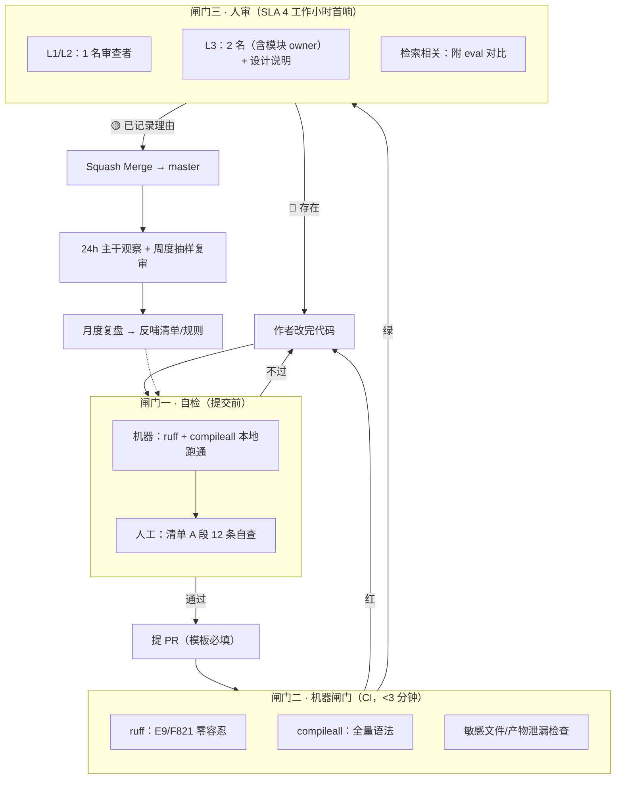

# 代码审查标准与流程

> 适用仓库：`zdyDarius/17zuoye_brain`（education-brain 教育知识库系统）
> 生效日期：2026-10-19　修订人：研发负责人　复审周期：每季度
> 配套文件：`代码审查_01_检查清单.md`（审查者逐条过）、`代码审查_02_试点问题清单.md`（真实样本，用于校准尺度）

---

## 0. 这套文档怎么用

| 文档 | 谁看 | 什么时候看 |
|---|---|---|
| **00 标准与流程**（本文） | 全员 | 入职、制定/修订规则时通读一遍 |
| **01 检查清单** | 作者 + 审查者 | 每次提 PR 前自检、审查时逐条过 |
| **02 试点问题清单** | 全员 | 第一次做审查时对照，知道"什么算 Blocker" |

三份文档的关系：00 定"谁在什么节点做什么、什么必须拦"，01 定"具体看哪些点"，02 定"拦到什么程度不算吹毛求疵"。

配套的机器文件（已就位，无需手工执行）：

| 文件 | 作用 |
|---|---|
| `ruff.toml` | 静态检查规则集（当前为 Phase A：语法错误 + 未定义名） |
| `.github/workflows/code-review.yml` | 闸门二：ruff + 全量语法编译 + 敏感文件/产物泄漏检查 |
| `.github/pull_request_template.md` | 强制作者填写「影响面 / 验证证据 / 回滚方式」 |
| `.github/CODEOWNERS` | owner 路径的自动指派，让第 4 节的硬门槛具备强制力 |

---

## 1. 现状基线：问题不是水平，是没有拦截点

2026-10-19 对仓库做的实测扫描：

| 维度 | 现状 | 判断 |
|---|---|---|
| 代码规模 | 业务代码 6,536 行 / 55 个模块（api 2、common 10、processor 24、utils 19），叠加 eval/test 684 行；最大单文件 396 行 | 结构清晰，分层（api / processor / utils / common）执行得不错 |
| 静态检查 | 无 `ruff`/`flake8` 配置，无 `pre-commit` | ❌ 机器闸门缺失 |
| CI | 无 `.github/workflows` | ❌ 合并前无任何自动校验 |
| 测试 | 无 `pytest` 依赖；`test/` 下两个脚本靠 `print` 输出，硬编码 `/Users/zdy/...` 与本机外接盘路径 | ❌ 无法在他人机器/CI 上运行 |
| 提交流程 | 全部提交直落 `master`，无分支、无 PR 记录 | ❌ 审查在流程上"不存在" |
| 静态问题基线 | `E9/F821`（语法/未定义名）= **0 条**；`F/B` 类 = 28 条（未使用导入 9、重复定义 2、未使用变量 1、`zip` 无 `strict` 3、`raise ... from` 缺失 3、默认值内函数调用 2 等） | ⚠️ 骨架干净，属于"可低成本清零"的量级 |
| 提交信息 | 已统一使用 `feat/fix/perf/test/docs/refactor` 前缀 | ✅ 这点做得比多数团队好，直接沿用并写入标准 |

**结论**：这套代码的"参差"不体现在骨架，而体现在**没有拦截点**——缺陷只能靠人肉发现和线上反馈。所以本次建设的重点不是写一份更长的 checklist，而是建立三道闸门。

---

## 2. 三道闸门



要点：

- **闸门一不能省**。审查者的时间应该花在设计和边界上，而不是替作者找未使用导入。
- **闸门二是硬的**，红就是红，不讨论。CI 里不放需要 Milvus/LLM 的用例（会拖到十分钟且不稳定），重活放闸门三的"验证证据"里。
- **闸门三看分级**（见第 3 节）。所有改动都要求两人审会导致审查疲劳——那比不审更糟。

---

## 3. 变更分级与审查要求

| 级别 | 判定标准 | 审查人数 | 首响 SLA | 额外要求 |
|---|---|---|---|---|
| **L1 热修** | 线上阻断/数据错误，必须立刻修 | 1 人（值班或 owner） | 30 分钟 | 允许先合后审，但 24h 内必须补审；PR 必须写复现步骤 + 回滚方式 |
| **L2 常规** | 单节点逻辑、bug 修复、字段增删、页面调整 | 1 人 | 4 工作小时 | 净变更 ≤400 行；触碰接口需给请求/响应示例 |
| **L3 架构级** | 跨链路改动、图拓扑、state 契约、Milvus schema、prompt 语义、检索/分块策略、评估基线 | 2 人（含模块 owner） | 1 工作日 | 必须附「设计说明」（改什么/为什么不用原方案/失败怎么降级）+ eval 指标对比 |

净变更 >400 行必须拆分；>600 行直接打回，除非是纯文件移动、依赖锁文件或代码生成产物（PR 描述里注明）。

**判定口诀**：改的是"一个函数怎么算"→L2；改的是"两个模块怎么对接"或"系统怎么表现"→L3。

---

## 4. 硬门槛（不可协商）

以下任一条不满足，PR 不予合并：

1. **禁止直推 master**。分支命名 `feat/xxx`、`fix/xxx`、`hotfix/xxx`、`docs/xxx`、`chore/xxx`。`master` 开分支保护，至少 1 个 approve。
2. **以下路径的改动必须有模块 owner 参与审查**（在 PR 里 @ 对应人）：

   | 路径 | 为什么是 owner 级 |
   |---|---|
   | `processor/import_processor/state.py`、`processor/query_processor/state.py` | 图的数据契约，加字段等于改所有节点的隐式接口 |
   | `processor/*/main_graph.py` | 节点拓扑与条件路由，改错是"静默走错分支" |
   | `processor/import_processor/nodes/node_import_milvus.py` | Milvus schema、索引、幂等策略，改错是数据损坏 |
   | `common/prompt/*.prompt` | 提示词是行为代码，不是文案 |
   | `eval/golden_dataset.json`、`eval/eval_keys.py` | 评测基线，动了历史指标就不可比 |
   | `api/*.py` | 对外契约（字段、状态码、SSE 事件） |

   > 上述映射已写入 `.github/CODEOWNERS`，GitHub 会在 PR 上自动指派对应 reviewer。
3. **触碰 schema / state / prompt / 检索或分块策略**，PR 描述里必须有 eval 证据：至少跑 `test/test_query_graph.py` 的 12 条；涉及检索质量的跑 `eval/run_retrieval.py`，并贴出改动前后的 Hit@5 / MRR 对照。
4. **新增外部调用（LLM/API/DB/对象存储）必须写明降级行为**。本项目的降级矩阵（PRD 3.8）是核心资产，破坏它的改动等同 Blocker。
5. **新增 `except Exception` 必须写明降级语义**：是"跳过该实体继续"、"返回空让上层兜底"，还是"终止任务"。没写清楚的按 🔴 处理。
6. **`.env`、`output/`、`logs/`、模型权重不进版本库**。CI 会检查（当前 `.env` 未被跟踪，保持这个状态）。
7. **改了行为就要改文档**。`README.md` 与 `文档/` 里的描述属于交付物的一部分，与代码同 PR 提交。

---

## 5. 审查流程（8 步）

| 步 | 动作 | 责任 | 产物 |
|---|---|---|---|
| 1 | 开工前用 3 句话写清：改什么 / 为什么这么改 / 怎么验证 | 作者 | Issue 或 PR 描述草稿 |
| 2 | 本地跑闸门一（`ruff check .` + `python -m compileall`），过一遍清单 A 段 | 作者 | 自查结论 |
| 3 | 提 PR，按模板填「变更类型 / 影响面 / 验证方式 / 回滚方式」 | 作者 | PR |
| 4 | CI 自动跑，红了作者自己修，不 @ 审查者 | CI | 绿灯 |
| 5 | 审查者按分级审查，**先给结论再给细节**；4 工作小时内首响 | 审查者 | Review |
| 6 | 作者逐条回复：接受就改并 resolve；不接受要给依据（文档、实测、约束） | 作者 | 讨论闭环 |
| 7 | Approve + Squash merge（提交信息沿用现有 `type(scope): 摘要` 规范） | 审查者 | 合并记录 |
| 8 | 合并后 24h 观察日志/指标；7 天内暴露的问题计为「逃逸缺陷」，进月度复盘 | 作者 + 全员 | 复盘条目 |

**第 8 步容易被跳过，但它才是这套机制能自我进化的原因**。没有逃逸统计，规则永远停留在纸面。

---

## 6. 角色与职责

| 角色 | 职责 | 不该做的事 |
|---|---|---|
| **作者** | 自检、把 PR 描述写清楚、逐条回复、合并后观察 | 把未完成的草稿丢给审查者"先看看" |
| **审查者** | 判断正确性/边界/契约，给出可执行的建议，明确 🔴/🟡/💭 | 替作者重写代码；把个人偏好当规范；只说"这里不太对" |
| **模块 owner** | 对 state/schema/prompt/评估基线负最终责任；为 🔴 的延期签字 | 长期挂名不审 |
| **值班人**（可选） | L1 热修的快速通道审查，维护热修补审队列 | 用热修通道夹带功能改动 |

单人项目也要走流程：作者提 PR → 隔 20 分钟自审（换个视角读 diff）→ 合并。这听起来滑稽，但"强制产生 diff 视图 + 填模板"本身就能拦下相当一部分问题。

---

## 7. 严重度定义与合并规则

| 标记 | 含义 | 合并规则 |
|---|---|---|
| 🔴 **Blocker** | 会造成数据损坏/丢失、安全问题、契约破坏、静默错误、线上不可用 | 必须修，或降级为「已登记 Issue + owner 签字 + 明确修复时间」，否则不合 |
| 🟡 **Suggestion** | 影响可维护性/性能/可观测性，但不阻断 | 可合并，作者需在 PR 里记录「本次不改的理由」 |
| 💭 **Nit** | 命名、注释、风格 | 不阻塞。能自动化的一律交给 ruff/格式化，禁止人肉争论 |

**什么是 🔴（本项目语境，附真实例子）**：

- 先删后插且无补偿 → 插入失败即丢数据（见 02 文档 P0-1）
- 用户输入拼进查询表达式/命令/路径 → 注入或解析崩溃（P0-2）
- 新增节点改了 state 字段但没改下游 → 下游 `.get()` 拿 None 静默降级
- 检索/分块策略变更未跑 eval → 指标倒退无人知
- 分块或实体解析失败只记 `logger.error` 不汇总 → 静默丢数据（历史上真实踩过：`_clip_varchar` 之前的静默丢块）
- 并发共享可变状态无保护（全局 dict 自增、单例初始化）

**什么不是 🔴**（避免误伤）：

- 命名不够好、函数偏长（<100 行且职责单一就放过）
- 没用某个更"优雅"的库
- 日志措辞、注释语气
- 单文件 300~400 行的节点实现——本项目的节点天然偏长（解析规则多），不因此要求拆分

---

## 8. 怎么写一条有用的评论

**公式**：`严重度 + 位置` → `结论` → `为什么（后果/机制）` → `建议（可执行）` → `依据等级（实测/文档/经验）`

✅ 好例子：

```
🔴 数据丢失：先删后插不是原子操作
node_import_milvus.py:283-290
`client.delete()` 成功但 `client.insert()` 抛异常时，except 只记日志并继续下一条，
该业务主键的记录已经被删掉且不会被补回 → 重导一次就静默少一条。
建议：改用 `client.upsert(collection_name=..., data=[row])`（auto_id=False 且 PK 显式提供时可用），
或改为「先插入新记录 → 成功后再删旧记录」。
依据：pymilvus 2.6 MilvusClient.upsert；本地未实测，需在测试集合验证一次。
```

❌ 反例（以及它为什么无用）：

- `这里不太对` —— 作者不知道改哪里、为什么
- `建议重构一下` —— 没有边界，等于没提
- `用 XXX 更好` —— 没说清在什么约束下更好
- `LGTM 👍`（40 行新增、动了降级分支）—— 空白背书比不审更危险
- 逐行挑缩进和引号 —— 这是 ruff 的活

**审查者的三条自律**：

1. 一次给全。不要分五轮挤牙膏式评论，作者会疲于奔命。
2. 不确定就问。"这里为什么用 `_rrf_score` 而不是原始 distance？是有意为之吗？"比"这里错了"有价值得多。
3. 表扬好的部分。`_clip_varchar` 里那句"中文 3 字节/字 → 3000 字会被算成 9000 字节"的注释，就是应该被点名的好实践——它把一次事故变成了团队的共同知识。

---

## 9. 各层必查项（摘要）

完整版见 `代码审查_01_检查清单.md`，这里是审查时的"五分钟速览"：

| 层 | 一眼要看的三个点 |
|---|---|
| **API**（`api/`） | 入参校验与长度上限；异常是否泄漏内部细节；SSE/后台任务的并发与生命周期 |
| **节点**（`processor/*/nodes/`） | state 读写契约（写的键下游读不读得到）；失败是"跳过/降级/终止"哪一种；外部调用有无超时与降级 |
| **数据**（`utils/clients/`） | 幂等键；Milvus 字段字节长度；表达式是否拼接用户输入；批量操作是否 N+1 |
| **LLM/Prompt**（`common/prompt/`） | prompt 与代码的兜底逻辑是否一致（历史上真实出过偏差）；输出是否结构化校验；失败降级话术 |
| **前端**（`page/`） | 渲染答案用的是 `innerHTML` 还是 `textContent`（引用和答案来自 LLM/文档，属不可信输入） |
| **测试/评估** | 新行为有没有可运行的用例；黄金集变更有没有重跑基线 |

---

## 10. 热修通道（L1）

**准入**：线上阻断、数据错误、安全事件。功能改动一律不准走。

1. `hotfix/xxx` 分支 → 最小改动 → 1 人审 → 合并 → 部署。
2. PR 里必须写：现象、复现步骤、影响范围、回滚方式（`git revert <sha>` 即可回滚是最理想的状态）。
3. **24 小时内补审**：由 owner 做一次完整审查，发现问题另开 `fix/` PR。
4. 必须补一条回归用例（进 `test/`）；补不出用例说明根因还没定位清楚。

---

## 11. 度量：用数据判断机制是否有效

| 指标 | 定义 | 目标 | 采集方式 |
|---|---|---|---|
| 首轮通过率 | 首次审查无 🔴 的 PR 占比 | ≥ 60% | PR 标签 `review:blocked` |
| 审查响应时长 | PR 提交 → 首次 review 的中位时长 | ≤ 4 工作小时 | GitHub PR 时间戳 |
| 逃逸缺陷率 | 合并后 7 天内发现的缺陷 / 同期总缺陷 | ≤ 15% 且逐季下降 | Issue 标签 `escaped` |
| 返工率 | 同一问题被要求修改 ≥2 轮的 PR 占比 | ≤ 20% | 人工记录 |
| 检索质量守门 | 触碰检索链路的 PR 中，附了 eval 对比的比例 | 100% | PR 模板勾选 |

指标只用来改进流程，**不用于考核个人**。一旦挂上 KPI，审查就会变成互相放水。

---

## 12. 四周落地路线

| 周次 | 动作 | 产出 | 判定标准 |
|---|---|---|---|
| **W1** | 上机器闸门：`ruff.toml` + CI + PR 模板；清理 28 条 lint 基线（11 条可 `--fix`） | 红灯能拦住问题 | CI 在真实 PR 上拦下至少 1 个问题 |
| **W2** | 试点：挑 5 个真实改动按本流程走一遍（建议从 import 链路挑，规则密度最高）；校准清单，删掉不适用的条目 | 修订版清单 | 审查者反馈"清单没有明显废话" |
| **W3** | 分级与 owner 制落地：确定 5 个 owner 路径的责任人；`master` 开分支保护 | owner 名单 | 出现第一例 L3 双人审 |
| **W4** | 度量与复盘：跑一次月度复盘，统计首轮通过率与逃逸缺陷；把 02 文档里的 🔴 项排期修复 | 首份复盘报告 | 至少 1 条规则因数据被修改 |

第 1 周不做任何"标准宣讲"，先让红灯亮起来——人只会被流程改变，不会被文档改变。

---

## 13. 本项目高频反模式 Top 8（从试点清单归纳）

1. **静默降级成习惯**：`except Exception: return []` / `logger.warning` 后继续，调用方无从判断"真的没有"还是"出错了"。→ 降级必须带标记（`degraded=True`）或错误字段。
2. **先删后插**：幂等 upsert 写成 delete+insert，中间失败即丢数据。→ 用 `upsert` 或"先插后删"。
3. **字符串拼查询表达式**：`f'bank_name like "%{entities["bank_name"]}%"'`。→ 转义引号，或改用参数化/白名单校验。
4. **全局可变状态**：`_session_stream` / `_session_next_id` 多线程读写无锁。→ 加锁或改单线程事件循环内维护。
5. **魔法数字散落**：`300`、`2000`、`1536`、`k=60` 混在函数体里。→ 提为模块级常量并写含义。
6. **注释与代码漂移**：README 写 docx 走 python-docx，代码已全量走 MinerU。→ 行为变更与文档同 PR。
7. **测试靠 print**：断言弱、路径硬编码，无法在 CI 跑。→ 脚本改 pytest，路径走 `tmp_path` / 环境变量。
8. **docstring 当契约**：写了 `:return: (a, b)` 但实际可能返回 `None`。→ 返回 `Optional` 时在 docstring 明确写出 None 的语义。

---

## 附：一页速查

```
分支 → 自检(ruff+清单A) → PR(模板) → CI绿 → 人审(分级) → 逐条回复 → squash merge → 24h观察
                                        ↑                    ↓
                                     红了回改             🔴 必须消灭 / 🟡 记录理由
```

审查的底线只有一句：**合进去的每个 diff，都要有一个人能说清它在失败时会怎么表现。**
