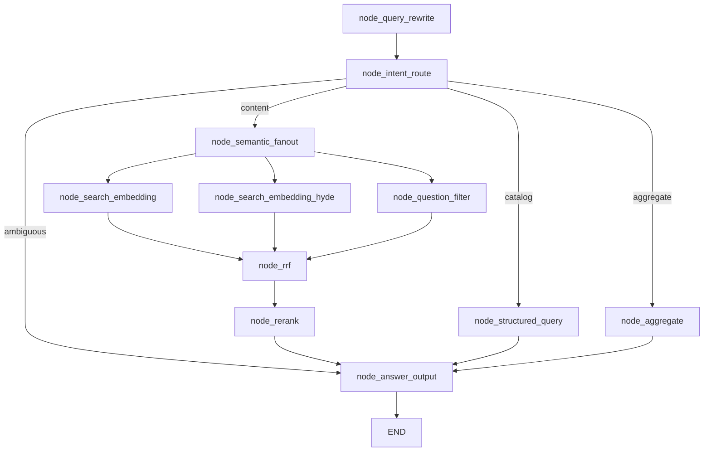

# 查询流程总览

> 本文是问答链路的地图。读完它再看各节点单篇，能知道"这个问题为什么要走这条路、每一步在缩小什么范围"。

## 一、这条链路要解决什么问题

用户用自然语言问一个问题，系统要在四类数据（课程系列 / 课程模块 / 题目 / 课程文档）里找到答案。难点不是"检索"，而是**先判断该用哪种检索**：

| 用户问法 | 正确做法 | 错误做法的后果 |
|---|---|---|
| "有哪些适合在校生的课程系列" | 标量过滤（可穷举） | 走向量检索 → 召回 5 条，答不全 |
| "通用程序设计题库有多少道单选题" | count(*) 精确计数 | 走向量检索 → 数出"5 道"（Top-K 上限） |
| "判断题的答案分布" | 分组统计 | 走向量检索 → 编造分布 |
| "函数参数传递相关的选择题" | 语义召回 + 题型过滤 | 走标量过滤 → 只能匹配字面 |
| "填空题有哪些" | 澄清（库里没有该题型） | 误映射成"完形填空题" → 答非所问 |

所以设计的核心是**意图分流**：先判意图，再选通道。这就是 PRD 3.6 的"双通道 + 聚合通道"。

## 二、图的形状

`processor/query_processor/main_graph.py` 编译出的图（实测节点清单）：

```
__start__ → node_query_rewrite → node_intent_route
                                      │
      ┌───────────────┬───────────────┼──────────────────┐
      │               │               │                  │
  ambiguous       catalog         aggregate          content
      │               │               │                  │
      │      node_structured_query  node_aggregate  node_semantic_fanout
      │               │               │                  │
      │               │               │        ┌─────────┼─────────┐
      │               │               │   search_emb  hyde   question_filter
      │               │               │        └─────────┼─────────┘
      │               │               │              node_rrf
      │               │               │                  │
      │               │               │             node_rerank
      └───────────────┴───────────────┴──────────────────┘
                              ↓
                      node_answer_output → __end__
```



### 2.1 `node_semantic_fanout` 为什么必须存在

LangGraph 的**条件边只能返回一个目标**：

```python
def route_after_intent(state):
    ...
    return "node_semantic_fanout"      # 只能返回一个字符串
```

如果想让 content 同时进入三路召回，只能：

1. 先路由到一个空节点（扇出点）；
2. 从这个节点连三条**静态边**到三路召回；
3. 三路召回再用**多源 `add_edge`** 汇聚到 RRF。

```python
workflow.add_node("node_semantic_fanout", node_semantic_fanout)   # 返回 {}

for _semantic_node in ("node_search_embedding", "node_search_embedding_hyde", "node_question_filter"):
    workflow.add_edge("node_semantic_fanout", _semantic_node)

# 多源汇聚：node_rrf 必须等三路全部完成后再执行
workflow.add_edge(["node_search_embedding", "node_search_embedding_hyde", "node_question_filter"], "node_rrf")
```

**这一段的教训写在图文件的注释里**：

> 若只给 hyde/filter 配出边而没有入边，节点将永远不会被调度。

之前就踩过这个坑：`hyde` / `question_filter` 有出边没入边，成了孤岛，三路召回实际只跑一路（`eval/eval_runs/results.json` 里 32 条 `hyde_hits` 全空就是证据）。改图时如果发现某个节点的产出永远是空的，先看它有没有入边。

### 2.2 三路是并行的，不是顺序的

从扇出节点出发的三条边同时激活，LangGraph 在同一 superstep 内并行执行三个节点，RRF 等待三条边**全部**到达才执行。实际耗时约等于 `max(三路)` 而不是 `sum(三路)`。

代价是**三个节点各自编码一次 query**（HyDE 编码的是假设答案，另外两路编码原 query）。这是有意的：并行的收益大于一次 BGE-M3 前向。

## 三、状态（State）流转

`QueryGraphState` 是 `TypedDict`，节点返回的 dict 浅合并进全局状态。

| 字段 | 写入节点 | 读取节点 | 说明 |
|---|---|---|---|
| `session_id` / `original_query` / `history` | API 层 | rewrite / intent / rerank / answer | 多轮上下文 |
| `rewritten_query` | `node_query_rewrite` | intent / 三路召回 / rerank / answer | **检索与作答都用它** |
| `intent` | `node_intent_route` | 条件路由 / answer | `catalog` / `aggregate` / `content` / `ambiguous` |
| `entities` | `node_intent_route` | structured / aggregate / question_filter | 实体白名单见 `导入_02` |
| `route_reason` | `node_intent_route` | 日志 | 调试用 |
| `search_collections` | `node_intent_route`（默认 4 个） | 三路召回 | 含题型/题库实体时收窄为 `["edu_question"]` |
| `structured_results` / `structured_total` / `structured_truncated` | `node_structured_query` | answer | catalog 通道 |
| `aggregate_result` / `aggregate_field` | `node_aggregate` | answer | aggregate 通道 |
| `embedding_hits` / `hyde_hits` / `question_filter_hits` | 三路召回 | `node_rrf` | 每路最多 4×5=20 条 |
| `fused_results` | `node_rrf` | `node_rerank` | 带 `_rrf_score` |
| `reranked_results` | `node_rerank` | answer | 带 `rerank_score` |
| `answer` / `references` | intent（澄清）/ aggregate（白名单反问）/ answer | API | 直通场景会提前写 |
| `degraded` / `error` | 各节点的降级分支 | answer | 见第四节 |

**一个容易忽略的点**：`rewritten_query` 从一进入图就等于 `original_query`（`create_query_default_state` 里设了初值），所以任何节点用 `rewritten_query or original_query` 都能拿到值——即使改写节点被跳过。

## 四、降级矩阵（这张表比流程图更重要）

链路上有 6 处降级，每一处都决定了"用户看到什么"：

| 故障点 | 降级行为 | 用户感知 | 实现位置 |
|---|---|---|---|
| 历史拉取失败（Mongo 挂了） | `history=[]`，退化为单轮 | 正常回答，但指代词无法消解 | `query_service.query` |
| 改写失败 / 结果异常膨胀 | 透传原问题 | 正常回答 | `step_3_rewrite_by_llm` |
| 意图识别 LLM 失败 | `intent=ambiguous` + 反问话术 | "抱歉，我暂时无法理解您的问题" | `node_intent_route` except |
| HyDE 生成失败 | 用**原查询**做向量检索 | 无感（少一路增强） | `step_2_generate_hyde_answer` |
| 重排模型失败 | 直接用 RRF 融合序取 Top-5 + `degraded=True` | 正常回答，排序略差 | `node_rerank` |
| 答案生成 LLM 失败 | 模板化输出 `context[:2000]` + `degraded=True` | "智能生成暂不可用，以下为检索到的原始结果…" | `step_4_generate_answer` |
| **Milvus 不可用** | 明确"检索服务暂时不可用" + `degraded=True` | **不是**"未找到" | `step_1_check_passthrough` |

最后一条是修过的一个 bug：早期 `error` 字段没有被 `node_answer_output` 判断，Milvus 挂了用户看到的是"未在知识库中找到相关内容"——**把系统故障伪装成了知识库没有**。现在 `step_1_check_passthrough` 先判 `error and not has_any_result`，短路成"检索服务暂时不可用"。

## 五、四条通道的产出形态

| 通道 | 核心节点 | 产出 | 条数控制 |
|---|---|---|---|
| `catalog` | `node_structured_query` | `structured_results` 原始记录 | `RESULT_LIMIT=100` + `count(*)` 报真实总数 |
| `aggregate` | `node_aggregate` | `{value, groups, group_total, truncated}` | 分组展示 `GROUP_LIMIT=100`，拉取 `GROUP_FETCH_LIMIT=16384` |
| `content` | 三路召回 → rrf → rerank | `reranked_results` Top-5 | 每集合 Top-5，RRF 后取 30 进重排，最终 5 条 |
| `ambiguous` | `node_intent_route` | `answer`（澄清话术） | — |

## 六、性能参考

历史评测（本机，含 LLM 调用）的量级：

| 通道 | 耗时 | 主要成本 |
|---|---|---|
| `content` 热态 | ~6.9s | HyDE LLM ~2s（与另两路并行）+ rerank + 答案 LLM |
| `catalog` | ~3.3s | 意图 LLM + 标量查询 + 答案 LLM |
| `aggregate` | ~1.6s | 意图 LLM + count/分组 + 答案 LLM |

三路并行后，`content` 的检索段耗时 ≈ `max(hyde 生成+编码, 编码+检索, 编码+过滤检索)`，不是三者之和。

## 七、单篇文档索引

| 顺序 | 文档 | 内容 |
|---|---|---|
| 1 | `查询_01_node_query_rewrite.md` | 多轮指代消解：何时改写、怎么改、怎么防跑偏 |
| 2 | `查询_02_node_intent_route.md` | 意图识别与实体抽取：LLM 输出 + 6 层代码兜底 |
| 3 | `查询_03_node_structured_query.md` | 目录型：实体→集合路由、like 转义、总数与截断 |
| 4 | `查询_04_node_aggregate.md` | 聚合型：count / group-by / 分布的应用层实现 |
| 5 | `查询_05_node_search_embedding.md` | 语义通道：扇出 + 三路召回的实现细节 |
| 6 | `查询_06_node_rrf.md` | RRF 融合：公式、去重键、为什么 doc 容易吃亏 |
| 7 | `查询_07_node_rerank.md` | 精排：候选截断、打分、失败降级 |
| 8 | `查询_08_node_answer_output.md` | 上下文组装、引用、三条直通/降级路径 |
| 9 | `查询_09_API与SSE.md` | `/query` 双模式、SSE 事件与断线重连、历史落库 |

## 八、和导入链路的关系

两条链路共享三样东西，改任一处都要两边看：

| 共享物 | 导入侧 | 查询侧 |
|---|---|---|
| `QUESTION_TYPE_MAP` | `node_question_parser` 写库用（中文→英文） | intent 校验、filter 构造、答案里英文→中文 |
| Collection 字段 | `node_import_milvus` 定义 Schema | `_OUTPUT_FIELDS` 决定查哪些字段（**漏字段会导致 RRF 塌陷**，见 `查询_06`） |
| 向量编码 | `encode_documents`（入库） | `encode_queries`（检索）——两者不可混用 |
