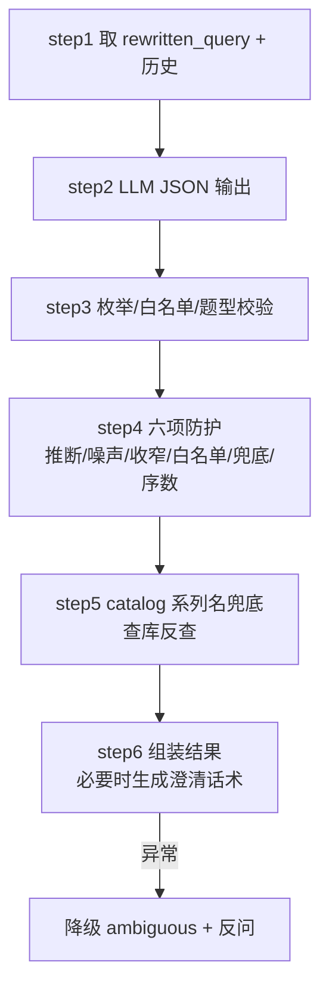

# 查询_02 node_intent_route —— 意图识别与实体抽取

> 文件：`processor/query_processor/nodes/node_intent_route.py`（Prompt：`common/prompt/intent_route.prompt`）
> 职责：决定"这个问题走哪条通道、带哪些过滤条件"。**整个查询链路唯一的分叉点。**

## 一、它输出的两个东西决定了后面全部行为

```python
return {"intent": intent, "entities": entities, "route_reason": route_reason,
        "search_collections": search_collections}
```

| 输出 | 决定什么 |
|---|---|
| `intent` | 走哪条通道（catalog / aggregate / content / ambiguous） |
| `entities` | 通道内的过滤条件（题型、题库、系列名、聚合字段…） |
| `search_collections` | 语义通道检索哪几个 Collection |

**一个错误的实体比不填更糟**：不填 → 全库检索 → 可能命中；填错 → `series_name like "%不存在%"` → 必然 0 条。所以这个节点的代码里有一半是"防 LLM 过度抽取"的兜底。

## 二、六步流水线



节点主体是纯编排：

```python
query, original_query, history_text = step_1_validate_and_get_data(state)
try:
    parsed = step_2_call_llm_intent(query, history_text)
    intent, entities = step_3_clean_entities(parsed)
    intent, entities, search_collections = step_4_guard_entities(intent, entities, original_query, query)
    step_5_fallback_series_entity(intent, entities, query)
    route_reason = parsed.get("route_reason", "")
    return step_6_build_route_result(intent, entities, route_reason, search_collections, original_query)
except Exception as e:
    ... 降级
```

注意 `step_5` 的返回值被**忽略**了——它直接修改传入的 `entities` 字典（Python 传引用）。这是一个隐式副作用，读代码时要留意：`entities` 是同一个对象，被就地改了。

## 三、step1：输入选择

```python
original_query = state.get("original_query", "")
# 意图识别必须基于**改写后**的问题：多轮里"第一个系列里有几门课"这类序数指代
# 只有在改写为具体名称后才能正确抽实体；改写未生效时才回退原问题。
query = state.get("rewritten_query") or original_query
```

历史给的是 `history[-4:]`（最近 2 轮），每条截断 100 字：

```python
recent = history[-4:]
history_text = "\n".join(
    f"{'用户' if m.get('role') == 'user' else '助手'}: {m.get('text', '')[:100]}"
    for m in recent
)
```

比改写节点短（那边 6 条 / 300 字）——意图识别只需要"上文在聊什么"的模糊印象，不需要细节。

## 四、step2：LLM 结构化输出

```python
prompt = load_prompt("intent_route", query=query, history=history_text)
llm = get_llm_client(json_mode=True)      # response_format={"type":"json_object"}
response = llm.invoke(prompt)
raw_content = response.content if hasattr(response, "content") else str(response)

json_match = re.search(r"\{[\s\S]*\}", raw_content)
if not json_match:
    raise ValueError(f"LLM 输出无法解析为 JSON：{raw_content[:200]}")
parsed = json.loads(json_match.group())
```

三层容错，对应三类真实故障：

1. **`json_mode=True`** —— 通过 `response_format={"type": "json_object"}` 强制模型返回 JSON。但国产模型（千问等）支持程度不一，这只是"最好情况下有效"；
2. **正则提取 `{...}`** —— 模型可能仍包一层 ```` ```json ````，正则把花括号内容抠出来；
3. **抛 `ValueError`** —— 连花括号都没有，说明输出完全跑偏，交给外层降级。

**一个已知隐患**：`r"\{[\s\S]*\}"` 是**贪婪**匹配。如果模型输出了两个 JSON 对象或尾部有多余的 `}`，会从第一个 `{` 匹配到最后一个 `}`，拼出非法 JSON 导致 `json.loads` 失败。目前的缓解手段是 `json_mode` + prompt 结尾强调"严格 JSON，无其他内容"。

## 五、step3：枚举与白名单清洗

```python
intent = parsed.get("intent", "ambiguous")
if intent not in {"catalog", "aggregate", "content", "ambiguous"}:
    logger.warning(f"非法意图枚举 {intent}，降级为 ambiguous")
    intent = "ambiguous"

entities = parsed.get("entities") or {}
entities = {k: v for k, v in entities.items() if k in VALID_ENTITY_KEYS and v}
```

两层过滤：

- **intent 枚举**：模型可能输出 `"query"` / `"search"` 这类自创值，直接降级 ambiguous；
- **实体白名单**：`VALID_ENTITY_KEYS` 只允许 13 个键，且 `and v` 过滤空值（`""`、`None`、`0`）。**空字符串必须丢**，否则会拼出 `bank_name like "%%"` 这种全匹配条件。

```python
VALID_ENTITY_KEYS = {
    "question_type_cn", "bank_name", "bank_code", "question_code", "course_code",
    "series_name", "course_name", "course_category", "target_audience",
    "suitable_grade", "learning_goal", "aggregate_field", "aggregate_op",
}
```

题型还要单独过枚举：

```python
if "question_type_cn" in entities and entities["question_type_cn"] not in VALID_QUESTION_TYPES_CN:
    invalid_type = entities.pop("question_type_cn")
    entities["_invalid_question_type"] = invalid_type    # 保留原值供澄清话术使用
```

**为什么"保留原值"而不是直接丢掉**：用户确实问了"填空题"，只是库里没有。丢掉就变成"没听懂"，保留才能给出针对性的澄清——"知识库中没有「填空题」这种题型哦…您是想查相近的「完形填空题」吗？"

`VALID_QUESTION_TYPES_CN` 必须与 `node_question_parser.QUESTION_TYPE_MAP` 的中文键完全一致，否则会出现"能把题写进库、但查不出来"的情况。这是一条跨链路的隐式契约。

## 六、step4：六项防护（本节点的核心）

LLM 的典型毛病是"过度推断"。这一节就是逐个打补丁。

### 6.1 自纠偏防护：不许把"填空题"映射成"完形填空题"

```python
if "question_type_cn" in entities:
    asked_type = entities["question_type_cn"]
    if asked_type not in original_query and "填空" in original_query:
        entities.pop("question_type_cn")
        entities["_invalid_question_type"] = "填空题"
```

场景：用户问"有没有填空题"，库里 15 种题型没有"填空题"，最接近的是"完形填空题"。LLM 出于"帮忙"的心态会输出 `question_type_cn="完形填空题"`。

结果：用户问填空题，系统给完形填空题，**答非所问且用户不知道**。这比反问糟糕得多。

判据是"用户原话里有没有这个题型词"：`asked_type="完形填空题"` 不在 `"有没有填空题"` 里，且原话含"填空" → 判定为 LLM 擅自映射 → 转澄清。

### 6.2 题型推断防护：概念题不许带题型

这是**最重要**的一条，注释写了完整的原因：

```python
# 题型推断防护：LLM 倾向把「有什么假设 / 什么是张量 / 哪个概念体现…」这类概念类问题
# 推断成「简答题」，一旦带上非法推断的题型，content 会被错误收窄到 edu_question 并加
# 错误的 question_type 过滤，直接丢掉课程文档召回。
_TYPE_ALIASES = {
    "单选题": ("单选题", "选择题", "单选"),
    "多选题": ("多选题", "选择题", "多选"),
    "判断题": ("判断题", "判断"),
    "完形填空题": ("完形填空题", "完形填空"),
}
if "question_type_cn" in entities:
    asked_type = entities["question_type_cn"]
    aliases = _TYPE_ALIASES.get(asked_type, (asked_type,))
    said = f"{original_query}\n{query}"
    if not any(a in said for a in aliases):
        logger.info(f"题型推断防护：问题未提及「{asked_type}」，丢弃该实体（避免错误收窄召回路）")
        entities.pop("question_type_cn")
```

**这个 bug 的连锁反应值得记住**：

```
用户："LangGraph 的状态管理是怎么做的？"
LLM：intent=content, entities={question_type_cn: "简答题"}   ← 擅自推断
     ↓
search_collections 被收窄成 ["edu_question"]               ← 只剩题目库
     ↓
question_filter 通道加 question_type == "short_answer"      ← 进一步过滤
     ↓
课程文档（edu_course_doc）完全没被检索                    ← 正确答案就在里面
```

一个推断出来的实体，同时污染了**集合范围**和**过滤条件**，双重收窄。

防护规则：题型必须由用户明说（原名或口语泛称），否则丢弃。`_TYPE_ALIASES` 处理泛称——用户说"选择题"，LLM 填"单选题"是合理的，因为"选择题"确实出现在原话里。

`said` 把原问题和改写后问题拼起来判断，是为了兼容"换成多选题呢"这种改写补全的题型。

### 6.3 content 通道丢弃课程维度噪声

```python
if intent == "content":
    for noise_key in ("course_category", "series_name", "course_name", "target_audience",
                      "suitable_grade", "learning_goal", "course_code"):
        entities.pop(noise_key, None)
```

content 是"按知识点找内容"，课程维度实体（分类/人群/年级/目标）在语义检索里没有对应的标量过滤，留着也没用；更重要的是**避免它们影响集合收窄判断**。content 只保留三个题目类实体：题型、题库名、题码。

### 6.4 检索集合定向

```python
search_collections = ["edu_course_series", "edu_course_module", "edu_question", "edu_course_doc"]
if intent == "content" and (entities.get("question_type_cn") or entities.get("bank_name")):
    search_collections = ["edu_question"]
```

默认全库查。但如果用户明确说了题型或题库（"函数相关的选择题"），就**只查题目库**：

- 好处：4 个集合 × 5 条 = 20 条候选，收窄到 5 条后，RRF 的位置分更集中，题目更容易进 Top-5；
- 代价：如果用户其实想要"课程文档里关于选择题的说明"，会被漏掉。这个代价是可接受的——带题型词的问题，99% 是要找题。

注意这里**只影响语义通道**，不影响 `node_structured_query`（后者有自己的集合路由）。

### 6.5 `aggregate_field` 白名单

```python
if entities.get("aggregate_field") and entities["aggregate_field"] not in {
    "question_type", "bank_code", "answer", "course_category",
    "suitable_grade", "target_audience", "learning_goal",
}:
    entities.pop("aggregate_field")
```

Prompt 里已经写了"禁止填题目编码/课程编码"，但代码再兜一层。因为 `aggregate_field` 会被 `node_aggregate` 用来查 `_AGG_TARGET[agg_field]`——**不在映射表里会直接 `KeyError`**。虽然 aggregate 节点也有白名单校验，但这里先删掉能让它退化成"纯计数"，比抛错好。

### 6.6 答案分布兜底

```python
if intent == "aggregate" and "答案" in query and any(
        w in query for w in ("分布", "占比", "比例", "各多少", "分别", "正确率")):
    entities["aggregate_field"] = "answer"
    entities["aggregate_op"] = "distribution"
    if not entities.get("question_type_cn"):
        entities["question_type_cn"] = "判断题"
```

为什么需要这层：

1. **业务确定性**：答案分布只有判断题有意义（`answer` 是 true/false），单选/多选的答案是字母，统计出来没有意义；
2. **LLM 经常漏**：用户说"判断题答案分布"，模型可能只给 `question_type_cn=判断题` 而漏了 `aggregate_field`，结果退化成"有多少道判断题"，答案阶段就开始编造分布明细；
3. 所以用**问题文本里的确定性特征**（"答案"+"分布/占比/正确率"）来兜底，不依赖 LLM。

### 6.7 序数指代实体丢弃

```python
for key in ("series_name", "course_name", "bank_name"):
    val = entities.get(key, "")
    if val and any(w in val for w in ("第一", "第二", "第三", "这个", "那个", "它")):
        logger.info(f"实体 {key}={val} 为未消解的序数指代，已丢弃")
        entities.pop(key)
```

改写应该把"第一个系列"替换成真实名称。如果实体值里仍然是"第一个系列"，说明改写没生效（模型偷懒或历史没拉到）。

**为什么丢弃而不是保留**：留着会拼成 `series_name like "%第一个系列%"` → 0 条 → 用户得到"未找到"。丢掉的后果是"没有过滤条件"→ 全库查 → 可能命中一个相近的答案，至少不会直接空。

## 七、step5：catalog 的系列名兜底

```python
if intent != "catalog" or entities.get("series_name") or entities.get("course_name"):
    return

client = get_milvus_client()
candidates = client.query(
    collection_name="edu_course_series",
    filter='series_code != ""',
    output_fields=["series_name", "course_category"],
    limit=300,
)
for c in candidates:
    name = c.get("series_name") or ""
    if name and len(name) >= 4 and name in query:
        entities["series_name"] = name
        break
```

逻辑：catalog 意图但没抽到系列名 → **把库里的系列名全部拉出来（最多 300 个），看哪个出现在问题里**。

三个约束：

- **`len(name) >= 4`**：太短的系列名容易误命中（比如有个系列叫"Java"，用户问"JavaScript 相关课程"就会误中）；
- **`name in query`**：子串精确匹配，不是模糊匹配；
- **`break`**：命中第一个就用，不做歧义消解（多个系列名同时出现时取库里的顺序）。

失败静默：

```python
except Exception as e:
    logger.debug(f"实体兜底查询失败（忽略）：{e}")
```

用 `debug` 级别，因为这是增强项——Milvus 查不了的话，后面结构化查询也会失败并报错，不需要在这里刷两条 warning。

**性能代价**：每次 catalog 未抽到系列名时多一次 `query(limit=300)`。300 条记录、两个字段，量级很小（毫秒级）。

## 八、step6：组装与澄清话术

### 8.1 ambiguous：两种话术

```python
if intent == "ambiguous":
    invalid_type = entities.get("_invalid_question_type")
    # 兜底：用户问句含题型字样但知识库无该题型（LLM 可能直接判 ambiguous 而不标 invalid）
    if not invalid_type and "填空" in original_query and "完形" not in original_query:
        invalid_type = "填空题"

    if invalid_type:
        answer = (f"知识库中没有「{invalid_type}」这种题型哦。现有题型包括：单选题、多选题、判断题、"
                  f"简答题、计算题、编程题等 15 种。您是想查某一类的题目吗？比如相近的「完形填空题」？")
    else:
        answer = ("抱歉，我不太确定您想查询什么。您可以：\n"
                  "1. 查课程：如「有哪些适合在校生的课程系列」\n"
                  "2. 查题目：如「通用程序设计题库有哪些单选题」\n"
                  "3. 按知识点搜题：如「函数参数传递相关的练习题」")
    return {"intent": intent, "entities": entities, "route_reason": route_reason, "answer": answer}
```

**注意返回值里没有 `search_collections`**——ambiguous 走 `node_answer_output` 直通，不需要检索，少写一个字段没影响。

那个"兜底"判断是处理 LLM 的另一种偷懒方式：直接判 ambiguous 而不标 `_invalid_question_type`。用"原话含填空 + 不含完形"来识别，给出针对性澄清而不是通用引导。

### 8.2 意图明确但题型非法 → 也走澄清

```python
if entities.get("_invalid_question_type"):
    ...
    return {"intent": "ambiguous", "entities": entities,
            "route_reason": f"题型不存在：{invalid_type}", "answer": answer}
```

比如 LLM 判了 `catalog` + 用户问"填空题"，step3 把题型移进 `_invalid_question_type`。这时如果继续走 catalog，会用"没有题型过滤"去查题库 → 返回一堆不相关的题。所以**把 intent 改写成 ambiguous**，触发 answer_output 的直通分支。

### 8.3 正常路径

```python
return {"intent": intent, "entities": entities, "route_reason": route_reason,
        "search_collections": search_collections}
```

## 九、异常降级

```python
except Exception as e:
    logger.exception("意图路由节点执行失败")
    return {
        "intent": "ambiguous",
        "entities": {},
        "route_reason": f"意图识别失败，降级为反问：{e}",
        "answer": "抱歉，我暂时无法理解您的问题，请换个说法再试一次。",
    }
```

LLM 挂了 → 反问。为什么不降级成 content 全库检索？因为**没有意图就无法选择通道**，强行走语义通道会给出一个"看起来有答案但可能完全无关"的结果。反问是诚实的失败。

这里用 `logger.exception`（带堆栈），因为 LLM 失败需要排查（超时？额度？prompt 太长？）。

## 十、Prompt 与代码的分工

`intent_route.prompt` 有 75 行，写得很细（意图定义、15 种题型、每个实体的填写条件、判定规则、JSON 格式）。但代码里仍然写了六层兜底。这不是重复劳动，是**明确分工**：

| 层 | 负责 | 特点 |
|---|---|---|
| Prompt | 语义理解、灰度判断、"哪些词暗示哪种意图" | 灵活但不确定，模型会漂移 |
| 代码 | 确定性规则（枚举、白名单、业务唯一映射） | 死板但可靠 |

几条经验（都写进了 prompt 的迭代记录）：

1. **不要在 prompt 里放真实取值当示例**——写"如『通用程序设计题库』"会让模型在所有问题上都填这个题库名；
2. **必须显式写"只输出有值字段"**——否则模型会把 13 个字段全列出来，值填 `""`；
3. **业务唯一确定的映射交代码**——"答案分布 → 判断题"这种不需要模型判断；
4. **prompt 改动必须 A/B + 全量指标验证**——只跑冒烟拦不住实体级错误。

## 十一、调试手册

| 现象 | 原因 | 排查 |
|---|---|---|
| 所有问题都走 content | 意图枚举非法被降级 / prompt 失效 | 看日志"LLM 意图原始输出" |
| 计数类问题答成"5 道" | 判成了 content 而不是 aggregate | 看 prompt 的 aggregate 例子是否被覆盖 |
| catalog 查询 0 条 | 系列名抽错 / 没抽到且兜底失败 | 看 `entities` 与"实体兜底命中"日志 |
| 概念题只返回题目 | 题型被推断出来且收窄了集合 | 看是否有"题型推断防护"日志 |
| 问填空题却返回完形填空 | 6.1 防护失效 | 检查 `original_query` 是否传对 |
| `_invalid_question_type` 泄漏到实体 | 正常（供澄清用），但别拼进 filter | `node_structured_query` 不读该键 |
| 分类/人群过滤没生效 | content 通道主动丢弃了课程维度实体 | 正常设计；要过滤请走 catalog |
| 聚合报 `KeyError` | `aggregate_field` 不在 `_AGG_TARGET` | 6.5 白名单是否被绕过 |
