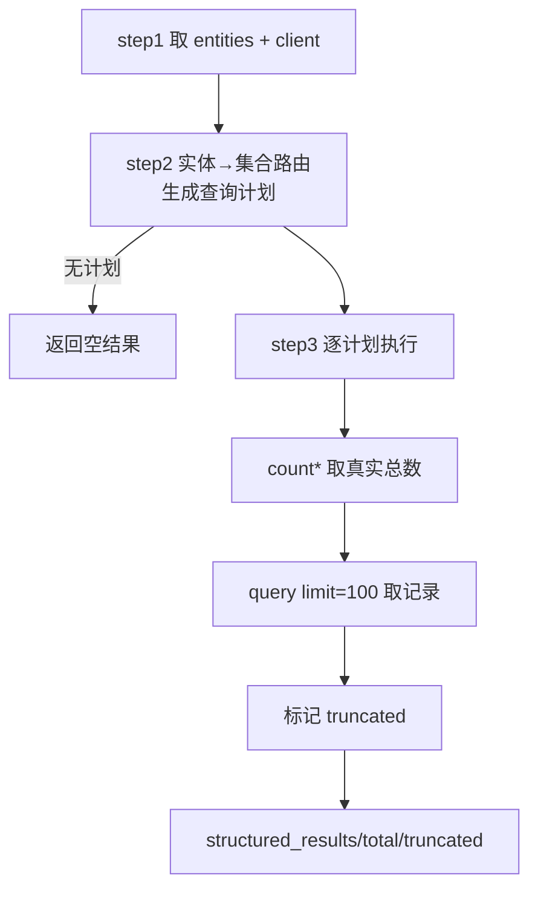

# 查询_03 node_structured_query —— 目录型标量查询

> 文件：`processor/query_processor/nodes/node_structured_query.py`
> 职责：catalog 意图的"精确查库"。**不走向量**，纯 Milvus 标量过滤 + count(*)。

## 一、什么时候走这条通道

`intent == "catalog"`，典型问题：

```
"有哪些计算机方向的课程系列"        → series 集合 course_category like 计算机
"推荐适合在校生的入门课程"          → series 集合 target_audience like 在校生
"通用程序设计题库有哪些单选题"       → question 集合 bank_name like + question_type ==
"给我 3 道情境分析题"               → question 集合 question_type ==
"xx_m2 的详情"                     → module 集合 course_code ==
"通用编程入门班包含哪些模块"         → series + module 两个集合
```

这些问题的共同点：**答案可以穷举**。用向量检索只能拿 Top-5，永远答不全；用标量过滤能拿全部（受 100 条展示上限约束）。

## 二、流程



## 三、step2：三个分支的路由

```python
query_entity = entities.get("question_code") or entities.get("question_type_cn") or entities.get("bank_name")
module_entity = entities.get("course_code") or entities.get("course_name")
series_entity = entities.get("series_name") or entities.get("course_category") \
    or entities.get("target_audience") or entities.get("suitable_grade") or entities.get("learning_goal")

plans = []
if query_entity:
    plans.append(("edu_question", _build_question_filter(entities)))
if module_entity:
    plans.append(("edu_course_module", _build_module_filter(entities)))
if series_entity and not query_entity and not module_entity:
    plans.append(("edu_course_series", _build_series_filter(entities)))
    if entities.get("series_name"):
        plans.append(("edu_course_module", _build_module_filter(entities)))
```

### 3.1 判断顺序即优先级

三个 `if` 是**累积**的（不是 elif），所以一个问题可以同时查多个集合：

| 实体组合 | 查询计划 |
|---|---|
| 只有题型 | `[question]` |
| 只有课程名 | `[module]` |
| 只有系列名 | `[series, module]` |
| 系列名 + 题型 | `[question, series, module]` ⚠️ |
| 课程分类 | `[series]` |
| 课程分类 + 系列名 | `[series, module]` |

注意第三行：**系列查询会自动附带模块列表**（`if entities.get("series_name")`）。这是为"系列详情"场景——用户问"通用编程入门班有什么"，答案既要系列本身，也要它下面的模块清单。

### 3.2 `series_entity and not query_entity and not module_entity` 这个条件

为什么查系列时要排除"已命中题目/模块"的情况？

因为 `series_name` 是**很多实体的公共维度**：`edu_course_module` 里也有 `series_name` 字段。如果用户问"通用编程入门班有哪些单选题"，同时抽到了 `series_name` 和 `question_type_cn`：

- 有 `query_entity` → 查 question（正确，题目是主体）；
- 如果同时查 series → 返回该系列的信息（冗余，但不致命）；
- 代码选择**不查 series**，避免把"系列介绍"混进"题目列表"的答案里。

代价是：如果用户问"这个系列里的题 AND 系列介绍"，系列信息会缺失。实际问法里很少这样。

### 3.3 过滤表达式构造

**题库集合**：

```python
def _build_question_filter(entities: dict) -> str:
    conds = []
    if entities.get("question_type_cn"):
        type_en = QUESTION_TYPE_MAP.get(entities["question_type_cn"])
        if type_en:
            conds.append(f'question_type == "{type_en}"')
    if entities.get("bank_name"):
        conds.append(f'bank_name like "%{_escape_like(entities["bank_name"])}%"')
    if entities.get("bank_code"):
        conds.append(f'bank_code == "{_escape_like(entities["bank_code"])}"')
    if entities.get("question_code"):
        conds.append(f'question_code == "{entities["question_code"]}"')
    return " and ".join(conds)
```

四个条件都是 `and`。三种运算符的选择有讲究：

| 字段 | 运算符 | 理由 |
|---|---|---|
| `question_type` | `==` | 存的是英文枚举，精确匹配 |
| `bank_name` | `like "%...%"` | 用户可能只说"通用程序设计"（题库全名是"通用程序设计题库"），必须模糊 |
| `bank_code` | `==` | 编码是精确标识 |
| `question_code` | `==` | 同上 |

**题型先转英文**：`QUESTION_TYPE_MAP` 是中文→英文，而库里存的是 `single_choice`。如果直接拼中文，永远 0 条。

**`if type_en` 的守卫**：题型不在映射表里就不加条件（而不是加一个必然为空的错误条件）。注意 int 阶段已经校验过题型枚举，这里是双保险。

**系列集合**：

```python
def _build_series_filter(entities: dict) -> str:
    conds = []
    if entities.get("series_name"):
        conds.append(f'series_name like "%{...}%"')
    if entities.get("course_category"):
        conds.append(f'course_category like "%{...}%"')
    if entities.get("target_audience"):
        conds.append(f'target_audience like "%{...}%"')
    if entities.get("suitable_grade"):
        conds.append(f'suitable_grade like "%{...}%"')
    if entities.get("learning_goal"):
        conds.append(f'learning_goal like "%{...}%"')
```

全部用 `like`，因为这几个字段都是**多值逗号串**：

```
target_audience: "在校生, 职场人, 求职者"
suitable_grade:  "专科, 本科"
course_category: "计算机 / 编程语言 / 通用程序设计"
```

用户说"在校生"，必须用 `like "%在校生%"` 才能命中；用 `==` 只能匹配整串。

**模块集合**：`course_name` 用 like，`course_code` 用 `==`，`series_name` 用 like。

### 3.4 `like` 必须转义（安全 + 正确性）

```python
from utils.escape_milvus_string_utils import escape_like_term
```

```python
def escape_like_term(term: str) -> str:
    if term is None:
        return ""
    return escape_milvus_string(term).replace("%", "\\%").replace("_", "\\_")
```

两层转义：

1. `escape_milvus_string`：反斜杠、双引号、换行/回车/制表符（防表达式断裂）；
2. 再转 `%` 和 `_`（`like` 的通配符）。

实测：

```python
escape_like_term('100%_真题"A')
# → '100\\%\\_真题\\"A'
```

不做第二层会怎样？用户输入的 `%` 会被当成通配符，`bank_name like "%%%"` 直接匹配全库（相当于没有过滤）。这既是**正确性问题**，也是**注入风险**（表达式语义被用户输入改变）。

## 四、step3：执行计划

```python
for collection, expr in plans:
    if not expr:
        continue
    try:
        plan_total = _count_hits(client, collection, expr)
        rows = client.query(
            collection_name=collection,
            filter=expr,
            output_fields=_OUTPUT_FIELDS[collection],
            limit=RESULT_LIMIT,          # 100
        )
        if plan_total is None:
            plan_total = len(rows)       # 回退口径
        total_count += plan_total
        plan_truncated = plan_total > RESULT_LIMIT
        truncated = truncated or plan_truncated
        for r in rows:
            r["_collection"] = collection
        results.extend(rows)
    except Exception as e:
        logger.error(f"结构化查询失败[{collection}]：{e}")
```

### 4.1 为什么先 count(*) 再 query

`client.query(limit=100)` 拿不到"总共多少条"。如果用户问"有多少道单选题"，只看返回的 100 条会答"100 道"（实际可能有 200 道）。

所以先调 `count_rows`：

```python
def count_rows(client, collection_name, expr=None):
    rows = client.query(
        collection_name=collection_name,
        filter=expr or None,
        output_fields=["count(*)"],
    )
    return int(rows[0].get("count(*)", 0)) if rows else 0
```

`count(*)` 是 Milvus 的聚合查询，**O(1)**（走元数据/索引），不受 `limit` 影响。

### 4.2 `plan_total is None` 的回退

`count_rows` 在失败时返回 `None`（不抛异常）：

```python
except Exception as e:
    logger.warning(f"Milvus count(*) 统计失败[{collection_name}]：{str(e)}")
    return None
```

这时用 `len(rows)` 估算。**两种口径的差异要理解**：

- `count(*)` 成功：`plan_total` 是真实总数（可能 200），`rows` 只有 100 条 → `truncated=True`；
- `count(*)` 失败：`plan_total = 100`（拉到的行数）→ `truncated=False`，但**实际可能被截断了**。

也就是说回退路径下"截断标记"不可靠。这是有意的取舍：没有总数就无法判断是否截断，宁可不标（少提示）也不要误标（每次都说"结果太多"）。

### 4.3 多计划的总数相加

```python
total_count += plan_total
```

同一个问题查了两个集合时，总数是**相加**的。语义上是"共找到 N 条相关记录"，不是"某个集合有 N 条"。答案生成时用这个数字描述"共 N 条"。

### 4.4 单计划失败不影响其他

`try` 在循环内，一个集合查询失败只记 error，继续下一个。返回的结果是"部分成功"。

注意：`error` 字段**没有**被设置——所以 `node_answer_output` 不会走"服务异常"短路。如果所有计划都失败（比如 Milvus 全挂），`structured_results` 为空、`error` 也为空 → 走到"未找到相关内容"。

这是一个不一致：`step_1` 里 Milvus 客户端不可用会返回 `{"error": ...}`，但查询过程失败不会。排查时要看日志而不是 `error` 字段。

## 五、`_OUTPUT_FIELDS`：查哪些字段

```python
_OUTPUT_FIELDS = {
    "edu_question": ["question_code", "bank_name", "bank_code", "question_type",
                     "content", "answer", "answer_raw", "analysis", "source_file"],
    "edu_course_series": ["series_code", "series_name", "course_category", "description",
                          "target_audience", "learning_goal", "suitable_grade", "content", "source_file"],
    "edu_course_module": ["course_code", "course_name", "series_code", "series_name",
                          "duration", "credit_hours", "description", "content", "source_file"],
}
```

和语义通道的 `_OUTPUT_FIELDS` 有细微差异，这里是有意的：

| 字段 | structured | semantic | 原因 |
|---|---|---|---|
| `answer_raw` | ✅ | ❌ | 列表浏览时需要原始答案（归一化后的 `true` 不如原文直观） |
| `description` | ✅ | ❌ | 系列/模块详情要展示描述 |
| `analysis` | ✅ | ✅ | 都用于答案生成 |
| `id`（doc） | — | ✅ | structured 不查 doc 集合 |

**如果要在答案里展示某个字段，必须加进这里**。漏掉的字段在 `_format_record` 里取到 `None`，答案里就是"描述:None"。

## 六、结果规模保护

```python
RESULT_LIMIT = 100
```

三层配合：

1. **`query(limit=100)`**：最多拉 100 条，防止"全库课程"把内存和 LLM 上下文撑爆；
2. **`plan_total > RESULT_LIMIT` → `truncated=True`**：告诉调用方"还有更多"；
3. **`node_answer_output` 只把前 20 条拼进上下文**，并标注"（共 N 条，其余略）"。

为什么展示 100 但只喂 20？因为 LLM 上下文有限，100 条记录拼起来可能上万字，既贵又容易让模型抓不住重点。20 条足够回答"有哪些"这类问题（用户真要看全部应该有列表页，而不是聊天答案）。

## 七、一个典型例子的完整推演

问："通用程序设计题库有哪些单选题"

```
step1: entities = {bank_name: "通用程序设计题库", question_type_cn: "单选题"}

step2: query_entity = None or "单选题" → truthy
       → plans = [("edu_question", 'question_type == "single_choice" and bank_name like "%通用程序设计题库%"')]

step3: count(*) → 假设 213 条
       query(limit=100) → 100 条记录
       plan_total=213 > 100 → truncated=True
       total_count=213

返回: structured_results=100 条, structured_total=213, structured_truncated=True
```

`node_answer_output` 收到后：

```
【结构化查询结果】（结果较多，已截断）
1. [题目] 编码:... 题库:通用程序设计题库 题型:单选题 答案:B 解析:...
...
20. ...
（共 100 条，其余略）
```

注意"共 100 条"——这里用的是 `len(structured)` 而不是 `structured_total`。**这是一个小瑕疵**：答案里说"共 100 条"而实际 213 条。`structured_total` 有值但 `step_2_build_context` 没用它。如果要修，应该改成读 `structured_total`。

## 八、调试手册

| 现象 | 原因 | 排查 |
|---|---|---|
| 返回空但库里明明有 | 实体抽错（多了限定词） | 看日志 `结构化查询计划` 里的 filter |
| 题型过滤无效 | 中文题型没转英文 / 映射表缺项 | 检查 `QUESTION_TYPE_MAP` |
| 系列名查不到 | 用了 `==` 而不是 `like` | 见 `_build_series_filter` |
| 总数是 100 但实际更多 | `count(*)` 失败退回 `len(rows)` | 看 warning "count(*) 统计失败" |
| 多值字段（人群/年级）匹配不到 | like 被转义过度 / 字段值无空格 | 打印实际字段值对比 |
| 答案里出现"None" | `_OUTPUT_FIELDS` 少了字段 | 补字段 |
| 用户输入 `%` 后返回全库 | `escape_like_term` 未生效 | 确认走的是 `_escape_like` |
| 系列问题缺少模块列表 | `series_entity` 条件被 query/module 短路 | 见 3.2 |

## 九、设计取舍

| 决定 | 替代方案 | 为什么选现在这个 |
|---|---|---|
| 标量过滤而非向量 | 全部走向量 | catalog 要穷举，向量只能 Top-K |
| `like` 而非全文检索 | 上 ES | Milvus 的 like 对 2000 条量级足够，少一个组件 |
| 先 count 再 query | 只 query | 需要真实总数回答"有多少" |
| 展示 100 / 喂 20 | 全量喂 LLM | 上下文成本与模型注意力 |
| 多计划相加 | 只查一个集合 | "系列 + 模块"是常见详情场景 |
| 单计划失败继续 | 整体失败 | 部分结果比没有结果好 |
