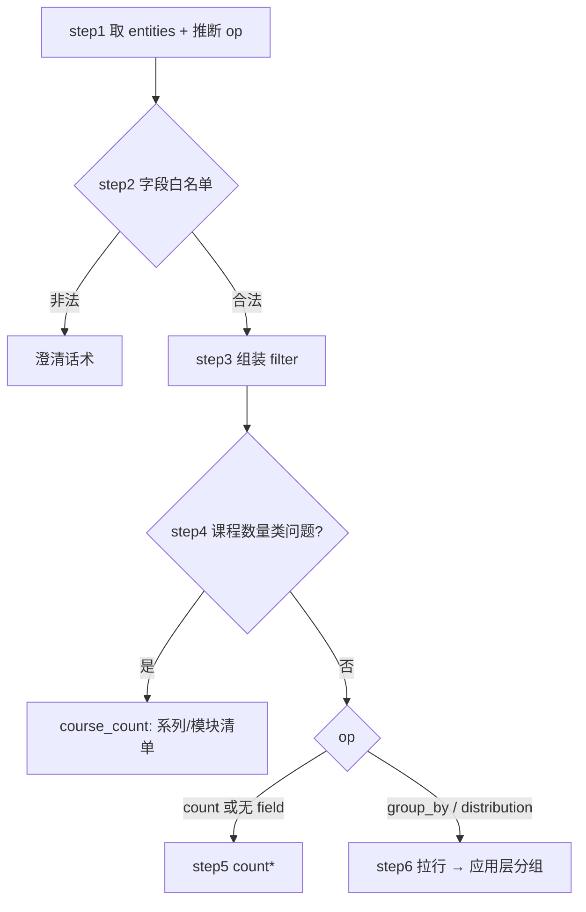

# 查询_04 node_aggregate —— 聚合统计（count / group-by / 分布）

> 文件：`processor/query_processor/nodes/node_aggregate.py`
> 职责：回答"多少道 / 怎么分布 / 各占多少"。**不依赖 Milvus 原生聚合**，走"拉 filtered 行 + 应用层统计"。

## 一、为什么不能让向量检索来数数

用户问"通用程序设计题库有多少道单选题"。

向量检索的答案永远是"Top-5 里我看到 5 道"——因为 `TOP_K_PER_COLLECTION=5`。之前就出过这个 bug：用户问数量，模型煞有介事地回答"共 5 道"，而实际有 213 道。

聚合通道解决两件事：

1. **精确计数**：`count(*)` 是 O(1) 的聚合查询，得到真实总数；
2. **分布统计**：按某个维度分组，得到"各多少"，而不是"看到几条"。

## 二、两条执行路径



`count` 走聚合查询，`group_by` 必须拉行——因为 Milvus 的 `count(*)` 不支持 `group by`。

## 三、可聚合字段白名单

```python
AGGREGATABLE_FIELDS = {
    "question_type", "bank_code", "course_category", "suitable_grade",
    "target_audience", "learning_goal", "answer",
}
```

**为什么要有白名单**：`aggregate_field` 直接用于查 `_AGG_TARGET[agg_field]`，不在映射表里会 `KeyError`；而且用户问"按题目编码统计"这种需求没有业务意义（每个编码都是 1）。

```python
_AGG_TARGET = {
    "question_type":    ("edu_question",      "question_type",    "question_type"),
    "bank_code":        ("edu_question",      "bank_code",        "bank_name"),
    "answer":           ("edu_question",      "answer",           "answer"),
    "course_category":  ("edu_course_series", "course_category",  "series_name"),
    "suitable_grade":   ("edu_course_series", "suitable_grade",   "series_name"),
    "target_audience":  ("edu_course_series", "target_audience",  "series_name"),
    "learning_goal":    ("edu_course_series", "learning_goal",    "series_name"),
}
```

三元组的含义：`(目标集合, 分组字段, 附带标签字段)`。第三个字段只用于 `output_fields`（比如按 `bank_code` 分组时顺便把 `bank_name` 取出来，便于展示）。

## 四、step1：`agg_op` 的缺省推断（关键）

```python
agg_field = entities.get("aggregate_field")
# 缺省操作推断：给了 aggregate_field 说明用户要按维度看，应走分组；
# 只有"有多少/几道"这类纯计数才默认 count。否则 LLM 漏填 aggregate_op 时
# 会退化成只回一个总数，答案生成阶段容易编造分布明细。
agg_op = (entities.get("aggregate_op") or ("group_by" if agg_field else "count")).lower()
```

这个推断修的是一个"看起来小、后果很坏"的 bug：

```
用户："题库的题量分布"
LLM：intent=aggregate, aggregate_field=bank_code, aggregate_op=（漏填）
旧逻辑：默认 count → 只返回"共 1752 道"
答案阶段：用户问分布，只拿到一个总数 → 模型开始编造"通用程序设计题库 500 道…"
```

现在的推断规则：

| `aggregate_field` | `aggregate_op` | 推断结果 |
|---|---|---|
| 有 | 无 | `group_by` |
| 有 | `distribution` | `distribution` |
| 无 | 无 | `count` |
| 无 | `count` | `count` |

**原则**：有维度就去分组，没维度才计数。因为"给了维度"本身就是"想看分维度结果"的强信号。

## 五、step2：白名单校验 → 澄清

```python
if agg_field and agg_field not in AGGREGATABLE_FIELDS:
    return {
        "aggregate_field": agg_field,
        "answer": (f"暂不支持按「{agg_field}」统计。可统计的维度包括："
                   f"题型、题库、课程分类、适合年级、适合人群、学习目标"
                   f"（判断题还可统计答案分布）。您想按哪个维度统计？"),
    }
```

返回里带 `answer`，触发 `node_answer_output` 的直通分支（`intent=aggregate and answer` → 直接透传，不走 LLM）。

同时把非法的 `agg_field` 写回状态——便于日志排查"用户到底想按什么统计"。

## 六、step3：过滤条件

```python
conds = []
if entities.get("question_type_cn"):
    type_en = QUESTION_TYPE_MAP.get(entities["question_type_cn"])
    if type_en:
        conds.append(f'question_type == "{type_en}"')
if entities.get("bank_name"):
    conds.append(f'bank_name like "%{escape_like_term(entities["bank_name"])}%"')
if entities.get("question_code"):
    conds.append(f'question_code == "{entities["question_code"]}"')
# 答案分布只对判断题有业务意义
if agg_field == "answer" and not entities.get("question_type_cn"):
    conds.append('question_type == "true_false"')
```

比 `node_structured_query` 少一个 `bank_code ==`，因为"按题库编码过滤"在实际问法里极少见（用户说题库名，不说编码）。

**最后一条是业务规则，不是技术规则**：

```python
if agg_field == "answer" and not entities.get("question_type_cn"):
    conds.append('question_type == "true_false"')
```

`answer` 字段的取值分布：

```
判断题：  true / false
单选题：  A / B / C / D
多选题：  A,C / B,D
简答题：  一段文字
```

如果不过滤题型就按 `answer` 分组，会把 `A`（单选）、`true`（判断）、长文本（简答）混在一张表里，结果毫无意义。所以**没指定题型时强制限定判断题**。

题型的指定优先级：用户显式指定 > 代码兜底判断题。`node_intent_route` 的 6.6 兜底也会补 `question_type_cn=判断题`，两处一致。

## 七、step4：课程数量类问题的纠正

这是本节点最"业务"的一段。

```python
original_query = state.get("rewritten_query") or state.get("original_query", "")
question_words = any(w in original_query for w in ("系列", "课程", "门课", "模块"))
has_question_entity = bool(entities.get("question_type_cn") or entities.get("bank_name")
                           or entities.get("question_code"))
if not question_words or has_question_entity:
    return None
```

场景：用户问"通用编程入门班有几门课"，LLM 判成 `aggregate` + `count`。但"几门课"本质是**列举模块清单**，只回一个数字信息量不够。所以：

```python
if entities.get("series_name"):
    course_filter = f'series_name like "%{escape_like_term(entities["series_name"])}%"'
    course_total = count_rows(client, "edu_course_module", course_filter)
    rows = client.query("edu_course_module", filter=course_filter,
                        output_fields=["course_code", "course_name", "series_name"], limit=50)
else:
    course_filter = _build_series_filter(entities) or 'series_code != ""'
    course_total = count_rows(client, "edu_course_series", course_filter)
    rows = client.query("edu_course_series", filter=course_filter,
                        output_fields=["series_code", "series_name"], limit=50)
```

产出：

```python
{
    "aggregate_field": "course_count",
    "aggregate_result": {
        "value": course_total,            # 精确数量
        "course_rows": [...],             # 前 50 条清单
        "entities": entities,
    },
}
```

**两条判断的意义**：

- `question_words`：问题里必须有课程类词（系列/课程/门课/模块）。没有就说明是真正的题目统计，不该走这个分支；
- `has_question_entity`：有题型/题库/题码时说明问的是题目，不是课程。防止"通用程序设计题库有几门课"这种误判（虽然语义上不通，但 LLM 可能抽到题库名）。

失败静默（`return None` 继续走原聚合逻辑），因为这是纠偏而不是主路径。

**`limit=50` 的取舍**：清单只是"顺带展示"，50 条足够；精确数字由 `count_rows` 给。

## 八、step5：纯计数

```python
count_filter = filter_expr or 'question_code != ""'     # 空过滤时用恒真条件
total = count_rows(client, "edu_question", count_filter)
if total is None:
    rows = client.query("edu_question", filter=count_filter,
                        output_fields=["question_code"], limit=GROUP_FETCH_LIMIT)
    total = len(rows)
return {
    "aggregate_field": "count",
    "aggregate_result": {"value": total, "filter": filter_expr or "全部题目", "entities": entities},
}
```

三个细节：

1. **`filter_expr or 'question_code != ""'`** —— Milvus 的 `count(*)` 允许 `filter=None`（统计全部），但这里用一个恒真条件保持接口一致；
2. **回退路径** —— `count_rows` 失败时拉行数，上限 16384。注意：**回退得到的数字可能是被截断的**（如果真超过 16384），但至少不是 0；
3. **`filter` 字段** —— 把过滤条件写进结果，答案生成时可以复述"（筛选条件：题型=单选题）"，让用户知道数字的口径。

注意这个分支**只统计 edu_question**。统计"有多少个课程系列"这种问题会走 `step4`（因为含"系列"）或者直接 count 题目（如果不含课程词）——**这是一个边界**：纯"课程系列总数"的统计，`step4` 的 `question_words` 会命中"系列"，然后走 `course_count` 分支，反而正确。

## 九、step6：分组 / 分布

```python
collection, group_field, label_field = _AGG_TARGET[agg_field]
if collection == "edu_question":
    expr = filter_expr or 'question_code != ""'
else:
    entity_filter = _build_series_filter(entities)
    expr = f'{entity_filter} and {group_field} != ""' if entity_filter else f'{group_field} != ""'

rows = client.query(
    collection_name=collection,
    filter=expr,
    output_fields=[group_field, label_field],
    limit=GROUP_FETCH_LIMIT,        # 16384
)
```

### 9.1 为什么不用 `count(*)` + group by

Milvus 的聚合查询只支持 `count(*)`（整表或 filter 后），**不支持 group by**。所以只能把需要的两个字段拉回来，在 Python 里 `Counter`。

### 9.2 过滤条件不能丢（修过的 bug）

注释写得很直白：

> 分组必须逐行取字段值，但过滤条件不能丢：question 复用题类实体过滤，course_series 复用系列/分类/人群/年级/目标实体过滤（**此前只写 field != "" 会统计全库**）

老实现只写了 `group_field != ""`，结果用户问"计算机方向的课程分类分布"，统计的是**全库**的分类分布，范围错了但数字看起来很正常——这种 bug 最难发现。

现在：

- question：复用 `filter_expr`（题型/题库/题码）；
- series：复用 `_build_series_filter(entities)`（系列名/分类/人群/年级/目标）+ `group_field != ""`（排除空值分组）。

### 9.3 应用层分组 + 多值拆分

```python
counter = Counter()
for r in rows:
    val = (r.get(group_field) or "").strip()
    if not val:
        continue
    # 多值字段（适合人群/学习目标/适合年级/课程分类为逗号分隔多值）
    for part in [p.strip() for p in val.replace("，", ",").split(",") if p.strip()]:
        counter[part] += 1
```

关键在**多值拆分**：

```
target_audience = "在校生, 职场人, 求职者"
```

不拆的话，分组结果会是 `"在校生, 职场人, 求职者": 1`，完全没有统计意义。拆开后三个组各 +1。

`.` 替换是兼容中文逗号——数据里两种逗号都可能出现（导入时来自人工录入）。

**副作用：分组合计 ≠ 总行数**。一行多值会贡献多个计数，所以 `sum(group.count) >= value`。答案里如果同时说"共 N 个系列"和列出分组，数字对不上是正常的（N 是行数，分组是人次）。这是一个容易被当成 bug 的正常现象。

### 9.4 排序与截断

```python
groups = [{"key": k, "count": v} for k, v in counter.most_common()]
truncated = len(groups) > GROUP_LIMIT
return {
    "aggregate_field": agg_field,
    "aggregate_result": {
        "value": len(rows),                 # 命中行数
        "groups": groups[:GROUP_LIMIT],     # 前 100 组
        "group_total": len(groups),         # 真实组数
        "truncated": truncated,
        "entities": entities,
    },
}
```

`most_common()` 按计数降序，所以截断掉的是**长尾小组**——符合"先看大头"的直觉。

`value` 用 `len(rows)`（拉取行数）而不是 `sum(count)`，语义是"参与统计的记录数"。

**`GROUP_FETCH_LIMIT=16384` 的隐患**：如果过滤后超过 16384 行，`value` 和分组都会偏小，而且**没有任何截断标记**（`truncated` 只反映分组数 > 100）。当前数据量（1752 题）离 16384 很远，但这个上限是硬编码的，数据涨上来会静默出错。

## 十、答案里的呈现

`node_answer_output` 的 `step_2_build_context` 对聚合结果有三种渲染：

```python
if "value" in agg and "groups" not in agg:
    lines.append(f"统计值：{agg['value']}")
if agg.get("course_rows"):
    lines.append(f"清单（共 {len(agg['course_rows'])} 条）：")
    for r in agg["course_rows"][:20]: lines.append(f"  {r}")
if "groups" in agg:
    lines.append(f"总数：{agg.get('value', 0)}，分组数：{agg.get('group_total', len(agg['groups']))}")
    for g in agg["groups"][:20]: lines.append(f"  {g['key']}: {g['count']}")
```

喂给 LLM 后，答案里就是"维度: 数量"的逐行列表。

## 十一、一个完整推演

问："判断题的答案分布"

```
intent_route:
  intent=aggregate
  entities={question_type_cn: "判断题", aggregate_field: "answer", aggregate_op: "distribution"}

node_aggregate:
  step1: agg_field="answer", op="distribution"
  step2: 白名单通过
  step3: filter = 'question_type == "true_false"'
         （agg_field=answer 但已有题型 → 不再追加 true_false，避免重复）
  step4: question_words=False（"判断题的答案分布" 无系列/课程/门课/模块）→ None
  step5: 跳过（op 不是 count）
  step6: collection=edu_question, group_field=answer
         expr = 'question_type == "true_false"'（filter_expr 非空）
         query → 235 行
         Counter → {"true": 145, "false": 90}
  → {value: 235, groups: [{true,145},{false,90}], group_total: 2, truncated: False}
```

答案："判断题共 235 道，其中答案为正确的 145 道，错误的 90 道。"

## 十二、调试手册

| 现象 | 原因 | 排查 |
|---|---|---|
| 问分布却只回总数 | `aggregate_op` 漏填且 `aggregate_field` 也没有 | 看 `query_processor` 日志的 "聚合统计入参" |
| 分组统计了全库 | 过滤条件丢失（9.2） | 看日志"聚合过滤表达式" |
| 分组结果每行都是"在校生, 职场人" | 多值拆分失效 | 检查 `replace("，", ",")` |
| 分组合计对不上总数 | 多值字段多计（正常） | 见 9.3 |
| `KeyError: 'xxx'` | `aggregate_field` 不在 `_AGG_TARGET` | 白名单被绕过 |
| 答案分布混进单选题 | `question_type == "true_false"` 条件丢失 | 见第六节 |
| 数字比实际少 | 超过 `GROUP_FETCH_LIMIT=16384` | 数据量增长后需要改成分批 |
| 课程数量问题只回数字 | `step4` 未触发（无课程词） | 看 `question_words` 判断 |

## 十三、设计取舍

| 决定 | 替代方案 | 为什么选现在这个 |
|---|---|---|
| 应用层 group-by | Milvus 原生聚合 | Milvus 不支持 group by |
| `count(*)` 计数 | `len(query())` | 精确且 O(1)，不受 limit 影响 |
| 拉 16384 行上限 | 分批拉全部 | 当前量级远小于上限，简单优先 |
| 白名单校验 | 任意字段 | 避免 KeyError 与无意义统计 |
| 有维度默认 group_by | 默认 count | 漏填 op 时不会退化成"只回总数" |
| 答案分布强制判断题 | 按题型自然分布 | 混合分布无业务意义 |
