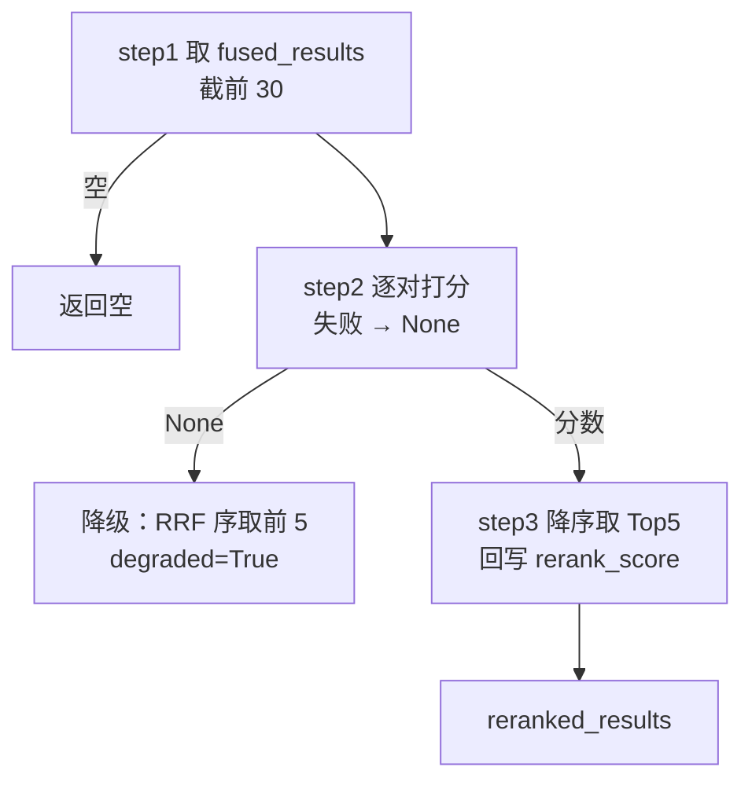

# 查询_07 node_rerank —— BGE-Reranker 精排

> 文件：`processor/query_processor/nodes/node_rerank.py`（模型：`utils/lm/reranker_utils.py`）
> 职责：对 RRF 融合后的候选做**逐条相关性打分**，取 Top-5 交给答案生成。

## 一、RRF 之后为什么还要重排

RRF 解决的是"多路结果怎么合并"，它的信息只有**名次**。它不知道：

- 候选 A 的正文到底和问题有多相关；
- 候选 B 虽然三路都排第 3，但正文其实是同义改写（相关），而候选 C 只是词面撞了（不相关）。

重排模型（Cross-Encoder）把 `(query, document)` **拼在一起**送进模型，让注意力在两者之间交互，输出一个相关性分数。这比"分别编码再算余弦"（Bi-Encoder）精确得多，代价是**不能预计算**——每个 query 都要对每条候选跑一次前向。

所以架构是经典的两阶段：

```
召回（Bi-Encoder，快，粗）→ 30~40 条候选
   ↓
重排（Cross-Encoder，慢，准）→ Top-5
```

## 二、流程



## 三、step1：候选截断

```python
RERANK_INPUT_LIMIT = 30
FINAL_TOP_K = 5
```

```python
query = state.get("rewritten_query") or state.get("original_query", "")
fused = state.get("fused_results") or []

if not fused:
    logger.info("无融合结果需要重排")
    return None

candidates = fused[:RERANK_INPUT_LIMIT]
```

### 3.1 为什么是 30 而不是 20

代码注释把这个数字的来历写清楚了：

```python
# 三路召回融合后候选池约 30~40 条（4 集合 × 2~3 路），20 会截掉 RRF 排名 21+ 的记录，
# 文档类 golden 块常落在 25~35 名（RRF 对"多路共识"加权，doc 只有 2 路命中），故放宽到 30。
```

两个原因叠加：

1. **候选池本来就 30~40 条**（4 集合 × 5 条 × 2~3 路，去重后）；
2. **文档类在 RRF 阶段系统性靠后**——集合顺序导致的（详见 `查询_06` 第五节），golden 块常落在 25~35 名。

如果限制在 20，这些文档块**连被重排的机会都没有**。放宽到 30 后，实测文档类 Hit@5 从 0.75 提到 0.875。

**这是一个"用重排算力换召回"的典型决策**：多跑 10 对打分（约 0.1~0.3 秒），换回 12.5 个百分点的命中率。

### 3.2 截断位置的含义

`fused` 是按 `_rrf_score` 降序的，所以 `[:30]` 就是"RRF 认为最相关的 30 条"。RRF 排名 31+ 的记录直接淘汰——**这是链路上唯一"没有第二次机会"的地方**。

## 四、step2：逐对打分

```python
try:
    reranker = get_reranker_model()
    pairs = [[query, c.get("content", "") or ""] for c in candidates]
    scores = reranker.compute_score(pairs, normalize=True)
    if not isinstance(scores, list):
        scores = [scores]

    scored = list(zip(candidates, scores))
    scored.sort(key=lambda x: -(x[1] if x[1] is not None else -1e9))
    return scored
except Exception as e:
    logger.warning(f"重排打分失败：{e}")
    return None
```

### 4.1 `pairs` 的构造

```python
[[query, content], ...]
```

`content` 是**入库时向量化的那个字段**，不同集合形态不同：

| 集合 | `content` 内容 |
|---|---|
| `edu_question` | 题干 + 空行 + `A. xxx` 选项列表 |
| `edu_course_series` | `课程系列：X\n系列编码：Y\n描述：...` |
| `edu_course_module` | `课程模块：X\n编码：...\n所属系列：...` |
| `edu_course_doc` | `【章节路径】\n正文块` |

注意 `c.get("content", "")` 取不到时用空串——然后 `or ""` 再兜一次（`content` 可能是 `None`）。空串会得到一个很低的分，但不会崩。

### 4.2 `normalize=True`

```python
scores = reranker.compute_score(pairs, normalize=True)
```

`FlagReranker.compute_score` 默认返回**原始 logits**（可能在 -10 ~ +10 之间）。`normalize=True` 用 sigmoid 映射到 `(0, 1)`：

$$s = \frac{1}{1 + e^{-\text{logit}}}$$

意义在于**分数可读**：日志里"最高分 0.87"比"最高分 6.3"更有解释力，也便于设阈值。排序结果不受影响（sigmoid 单调）。

### 4.3 单条时返回标量

```python
if not isinstance(scores, list):
    scores = [scores]
```

`FlagReranker.compute_score` 在输入只有一对时返回 `float`，多对时返回 `list`。这个行为不一致是库的遗留设计。如果不包成列表，`zip(candidates, scores)` 会把 `float` 当可迭代对象——直接 `TypeError: 'float' object is not iterable`。

### 4.4 `None` 分数的处理

```python
scored.sort(key=lambda x: -(x[1] if x[1] is not None else -1e9))
```

理论上 `normalize=True` 不会返回 `None`，但库在某些边界（空文本？）可能返回。用一个极小值兜住，避免 `TypeError: '>' not supported between float and NoneType`。

`sorted` 的 key 取负号实现降序——比 `reverse=True` 稍微少见，但等价。

## 五、step3：Top-K 与分数回写

```python
for record, score in scored:
    record["rerank_score"] = None if score is None else round(float(score), 6)
return [c for c, s in scored[:FINAL_TOP_K]]
```

**注意 `for record, score in scored` 遍历的是全部候选**，不只是 Top-5。所以：

- 30 条候选**都**被打上 `rerank_score`；
- 但只有前 5 条被返回。

为什么给落选的也打分？因为 `record` 是**同一个 dict 对象**（`fused_results` 里的引用），打分后如果别处还引用着这些记录（比如评估脚本、日志），能看到它们的重排分。这是"副作用式"的信息暴露，不影响主流程。

`round(float(score), 6)` 同时做了两件事：`np.float32 → float`（可序列化）+ 保留 6 位小数（日志可读）。

## 六、降级：模型不可用

```python
scored = step_2_score_candidates(query, candidates)
if scored is None:
    logger.warning("重排失败，降级使用 RRF 融合序")
    return {"reranked_results": candidates[:FINAL_TOP_K], "degraded": True}
```

降级行为是"**直接用 RRF 顺序取前 5**"：

- 不报错、不中断——用户还是能得到答案；
- 但 `degraded=True` 会一路传到 API 响应（前端目前不展示，但接口里有）。

### 6.1 什么时候会走到这里

| 故障 | 触发点 |
|---|---|
| 模型文件没下载 / 路径错 | `FlagReranker(...)` 构造抛异常 |
| 显存/内存不足 | 构造或 `compute_score` 抛异常 |
| 依赖缺失（FlagEmbedding 未装） | import 时就失败——但这个 import 在模块顶层，会导致整个查询服务起不来 |

最后一条要特别注意：`from FlagEmbedding import FlagReranker` 在 `reranker_utils.py` 顶层，如果环境没装，**`node_rerank` 模块导入失败 → 查询图编译失败 → 服务启动失败**。降级代码救不了 import 错误。

### 6.2 降级的质量损失

RRF 序 vs 重排序的差距，实测（黄金集）：

| 指标 | RRF 序（模拟降级） | 重排后 |
|---|---|---|
| Hit@5 | 明显低于重排 | 0.8125 |
| MRR | 明显低于重排 | 0.7240 |

具体数字依赖数据集，但方向明确：**重排是召回质量的关键一环**，降级只是"能用"。

## 七、性能画像

| 环节 | 量级 | 说明 |
|---|---|---|
| 模型加载 | 5~20s | 进程内只发生一次（`_reranker_model` 全局单例） |
| 30 对打分 | 0.1~0.5s | CPU；GPU 更快 |
| 单对输入长度 | 截断到模型上限（512 token） | 文档块 3000 字符会被截断，只比较开头部分 |

### 7.1 单例的线程安全隐患

```python
_reranker_model = None

def get_reranker_model():
    global _reranker_model
    if _reranker_model is None:
        _reranker_model = FlagReranker(...)
    return _reranker_model
```

**没有加锁**（对比 `embedding_utils` 用了 `RLock`）。多线程并发首次调用时可能构造两个实例（浪费内存），或者拿到半初始化的对象。

查询服务是 FastAPI 单进程 + `BackgroundTasks`（流式）或同步（非流式），FastAPI 的同步路由跑在线程池里，**确实可能并发**。当前没出问题，但这是一个潜在隐患——参照 `导入_07` 5.1 的双重检查锁加固即可。

### 7.2 为什么文档块 3000 字不截断就送进去

因为**截断是模型内部做的**（tokenizer 的 `max_length`），传长文本不会报错，只是超出部分不参与计算。

所以一个 3000 字的文档块，重排时实际只看前 ~500 字。这解释了为什么"章节前缀"（`【章节路径】`）放在块首——它一定在截断范围内，能参与相关性判断（见 `导入_06` 7.1）。

## 八、与前后节点的衔接

```
node_rrf: fused_results（30~40 条，带 _rrf_score）
   ↓ 截前 30
node_rerank: reranked_results（5 条，带 rerank_score）
   ↓
node_answer_output: 拼进"【语义检索结果（按相关性排序）】"
```

`node_answer_output` 的 `_format_record` 会用 `_collection` 决定展示格式，所以重排**不能丢 `_collection`**——它一直在 dict 里，透传即可。

## 九、调试手册

| 现象 | 原因 | 排查 |
|---|---|---|
| 答案相关性差但都"沾边" | 重排被降级（看 `degraded`） | 看 warning "重排打分失败" |
| 排序完全没变 | 候选只有 1 条 / 分数全相同 | 打印 `scored` 的分数分布 |
| `TypeError: 'float' object is not iterable` | 单条时没包成 list | 见 4.3 |
| 文档类永远不进 Top-5 | RRF 排名超过 30 | 看 `_rrf_score` 与 RRF 名次 |
| 模型加载很慢 | 首次调用（正常） | 可在服务启动时预热 |
| 服务起不来，import 报错 | FlagEmbedding 未安装 | 补依赖 |
| 重排后反而变差 | query 用错（用了 original 而非 rewritten） | 见 step1 |

## 十、设计取舍

| 决定 | 替代方案 | 为什么选现在这个 |
|---|---|---|
| 30 条进重排 | 全部 40 条 | 算力与召回的平衡点（实测 30 够用） |
| `normalize=True` | 原始 logits | 分数可读、可设阈值 |
| 失败降级 RRF 序 | 报错 | 重排是增强项，不阻断 |
| 全局单例 | 每次新建 | 模型加载太贵 |
| 只返回 5 条 | 10 条 | LLM 上下文成本 + 答案聚焦 |
| 回写全部候选分数 | 只写 Top-5 | 评估脚本需要看落选者的分数 |
