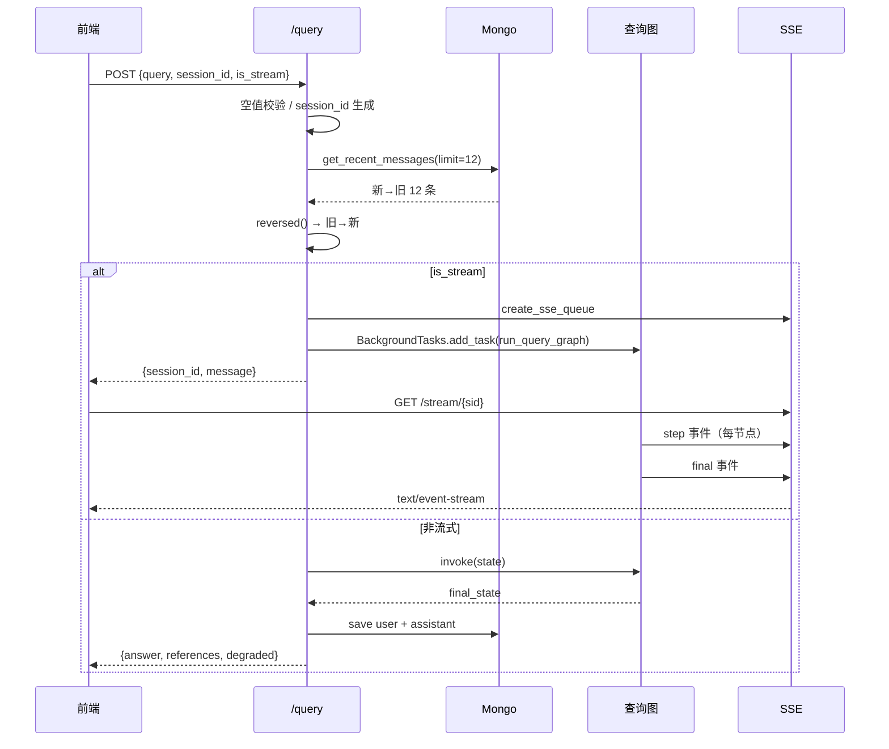

# 查询_09 API 与 SSE —— 入口、流式通道、历史落库

> 文件：`api/query_service.py`、`utils/sse_utils.py`、`utils/clients/mongo_history_utils.py`、`page/chat.html`
> 职责：把查询图包成一个 HTTP 服务，并把"节点级进度"实时推给前端。

## 一、两个接口模式

```python
class QueryRequest(BaseModel):
    query: str
    session_id: str = None      # 空则新建
    is_stream: bool = False
```

| 模式 | 行为 | 返回 |
|---|---|---|
| `is_stream=False` | 同步执行整张图（`query_app.invoke`） | 直接返回 `answer` / `references` / `degraded` |
| `is_stream=True` | 后台执行（`BackgroundTasks`），立即返回 | `{session_id, message}`，前端再订阅 SSE |

流式模式返回得很快（几十毫秒），真正的计算在后台线程里跑。前端拿到 `session_id` 后立刻 `new EventSource('/stream/' + sid)`。

## 二、`/query` 的完整流程



### 2.1 历史拉取：一个必须记住的 `reversed()`

```python
history = []
try:
    history = list(reversed(get_recent_messages(session_id, limit=12)))
except Exception as e:
    logger.warning(f"[{session_id}] 历史拉取失败（降级单轮模式）：{e}")
```

`get_recent_messages` 的实现：

```python
cursor = mongo_tool.chat_message.find(query).sort("ts", DESCENDING).limit(limit)
```

**按 `ts` 降序取最近 12 条**，返回的是"新→旧"。

而图里的节点都用 `history[-6:]` / `history[-4:]` 取"最近几轮"——**这要求列表是"旧→新"**。所以 API 层必须 `reversed()` 一次。

这就是注释里写的：

> get_recent_messages 按 ts 倒序返回（新→旧），这里统一转为时间正序（旧→新），下游节点取 history[-N:] 才能拿到"最近"的对话。

**历史 bug 记录**：之前漏了这个 `reversed()`，`history[-6:]` 取到的是**最旧的 6 条**。表现是多轮对话"记不住上一轮"，但偶尔又能记住很早的内容——非常难排查。如果你看到多轮改写失效，第一件事是确认这个反转还在。

⚠️ 顺带一提：`get_recent_messages` 的 docstring 写着"结果按时间正序排列，可直接喂给LLM作为上下文"，**与代码相反**。以代码为准。

### 2.2 历史拉取失败不影响主流程

Mongo 挂了 → `history=[]` → 退化为单轮问答。这是个合理的降级：问答本身不依赖历史，只有指代消解需要。

### 2.3 当前问题不在历史里

保存历史发生在**图执行完之后**：

```python
save_chat_message(session_id=..., role="user", text=user_query)
save_chat_message(session_id=..., role="assistant", text=answer, references=references)
```

而历史是在执行**之前**拉的。所以本次问题不会重复出现在 `history` 里——否则改写节点会看到"用户刚问过一模一样的问题"，可能产生奇怪的改写。

## 三、`run_query_graph`：后台执行 + 事件推送

```python
def run_query_graph(session_id: str, user_query: str, history: list):
    try:
        create_sse_queue(session_id)
        update_task_status(session_id, TASK_STATUS_PROCESSING)

        state = create_query_default_state(
            session_id=session_id, original_query=user_query, is_stream=True, history=history)
        push_to_session(session_id, "step", {"node": "start", "message": "开始处理您的问题"})

        final_state = dict(state)
        for event in query_app.stream(state, stream_mode="updates"):
            for node_name, node_result in event.items():
                push_to_session(session_id, "step", {"node": node_name})
                if isinstance(node_result, dict):
                    final_state.update(node_result)
        ...
```

### 3.1 `stream_mode="updates"` 的含义

LangGraph 的 `stream` 有多种模式：

| 模式 | 产出 |
|---|---|
| `values` | 每步的**完整状态**（大） |
| `updates` | 每步**该节点返回的增量**（小） |
| `messages` | token 级 LLM 输出（需要模型支持） |

这里用 `updates`——每个节点跑完给一个 `{node_name: node_result}`，正好用来做"节点级进度"。

```python
final_state = dict(state)
for event in ...:
    for node_name, node_result in event.items():
        final_state.update(node_result)
```

`final_state` 是本地累积的状态副本，因为 `stream` 不返回最终状态（它是个生成器）。逐节点 `update` 等价于 LangGraph 的浅合并。

### 3.2 一个重要的限制：这不是"打字机"流式

`SSEEvent.DELTA`（`"delta"`）在 `sse_utils` 里定义了，但**全项目没有任何地方 push 它**。

也就是说：

- 推的是"节点完成"事件（`node_query_rewrite`、`node_intent_route`…）；
- `answer` 是在最后**一次性**推给前端的（`FINAL` 事件）。

用户看到的"AI 正在思考"是节点进度的效果，不是逐字生成。真正的 token 流式需要：

1. `node_answer_output` 改成 `llm.stream(prompt)`；
2. 用 `stream_mode="messages"` 或手动 `push_to_session(session_id, "delta", {"text": chunk})`；
3. 前端 `addEventListener('delta')` 追加文本。

这是当前实现的一个**功能边界**，不是 bug。

### 3.3 收尾：三件事的顺序

```python
update_task_status(session_id, TASK_STATUS_COMPLETED)
push_to_session(session_id, SSEEvent.FINAL, {
    "answer": answer, "references": references, "degraded": degraded, "status": "completed"})
remove_sse_queue(session_id)          # 移除队列引用（重放缓冲保留）
schedule_session_cleanup(session_id)  # 5 分钟后清理缓冲
```

顺序很关键：

1. 先推 `final`，前端收到才收尾；
2. 再 `remove_sse_queue` —— 队列去掉，但**重放缓冲还在**，断线重连能补发；
3. 最后 `schedule_session_cleanup` —— 延迟 300 秒彻底清掉。

如果先 `remove_sse_queue` 再 push，事件进不了队列，前端永远收不到 `final`。

### 3.4 异常路径

```python
except Exception as e:
    update_task_status(session_id, TASK_STATUS_FAILED)
    logger.exception(f"[{session_id}] 流式查询执行失败")
    push_to_session(session_id, SSEEvent.ERROR, {"error": str(e)})
    remove_sse_queue(session_id)
    schedule_session_cleanup(session_id)
```

异常也推 `error` 事件（而不是只记日志），否则前端会一直等到 180 秒超时。

注意：图内部的节点异常大多已经被 catch（各节点自己有降级），能走到这里的通常是**图之外的错误**（状态构建失败、Mongo 写入抛错没被内层 catch 等）。

## 四、SSE 的实现细节

### 4.1 四个全局字典

```python
_session_stream: Dict[str, queue.Queue] = {}          # 活跃队列
_session_replay: Dict[str, List[dict]] = {}           # 事件重放缓冲
_session_next_id: Dict[str, int] = {}                 # 下一个事件 id
_session_last_active: Dict[str, float] = {}           # 最后活跃时间（清理依据）
```

### 4.2 事件格式

```python
def _sse_pack(event: str, data: Dict[str, Any], event_id: Optional[int] = None) -> str:
    payload = json.dumps(data, ensure_ascii=False)
    if event_id is not None:
        return f"id: {event_id}\nevent: {event}\ndata: {payload}\n\n"
    return f"event: {event}\ndata: {payload}\n\n"
```

标准 SSE 格式，`id:` 是关键——浏览器会自动记住最后一个 id，断线重连时通过 `Last-Event-ID` 头带回来。

### 4.3 `push_to_session`：写缓冲 + 投队列

```python
event_id = _session_next_id.get(session_id, 1)
_session_next_id[session_id] = event_id + 1
_session_last_active[session_id] = time.time()
replay = _session_replay.setdefault(session_id, [])
replay.append({"id": event_id, "event": event, "data": data})
if len(replay) > 200:
    del replay[: len(replay) - 200]        # 只保留最近 200 条

stream_queue = get_sse_queue(session_id)
if stream_queue:
    stream_queue.put({"event": event, "data": data, "id": event_id})
```

**即使没有监听者也写缓冲**——这是为了"前端订阅晚于任务开始"的场景：

```
POST /query 返回
   ↓（前端还没连上来，但后台已经开始跑）
节点事件陆续写入 replay
   ↓
前端连上 /stream → 补发 replay 里的全部事件
```

如果只在有队列时写，前端会丢掉开头的几个节点进度。

### 4.4 生成器：补发 → ready → 循环取队列

```python
async def sse_generator(session_id: str, request: Request):
    stream_queue = get_sse_queue(session_id)
    if stream_queue is None:
        # 任务已结束：输出重放缓冲后结束
        replay = _session_replay.get(session_id) or []
        last_id = _parse_last_event_id(request)
        missed = [item for item in replay if (last_id is None or item["id"] > last_id)]
        if missed:
            for item in missed:
                yield _sse_pack(item["event"], item["data"], item["id"])
            yield _sse_pack("close", {"message": "replay done"})
        else:
            yield _sse_pack("error", {"error": f"session {session_id} 无待补发事件"})
        return
    ...
```

两种情况：

| 队列存在（任务在跑） | 队列不存在（任务已结束） |
|---|---|
| 先补发 `id > Last-Event-ID` 的事件 | 补发所有缺失事件 |
| 发 `ready` | 发 `close`（重放完成） |
| 循环取队列，直到 `__close__` 或断开 | 直接结束 |

**为什么"任务已结束"也要能连**：用户刷新页面/网络抖动后重连，此时 `remove_sse_queue` 已经执行了。如果直接报错，用户就丢了答案。所以重放缓冲保留 5 分钟。

### 4.5 阻塞队列 + 事件循环

```python
loop = asyncio.get_running_loop()
...
msg = await loop.run_in_executor(None, stream_queue.get, True, 1.0)
```

`queue.Queue.get` 是**阻塞**调用，直接在 async 函数里调用会卡死整个事件循环。用 `run_in_executor` 丢到线程池，`timeout=1.0` 让它在 1 秒后抛 `Queue.Empty`，从而：

- 每秒有机会检查 `request.is_disconnected()`；
- 不会因为没人 push 事件而永久挂住。

这是 FastAPI 里"同步队列 → async 生成器"的标准桥接写法。

### 4.6 断开处理

```python
finally:
    _session_stream.pop(session_id, None)
```

**只移除队列，保留重放缓冲**。这样断线后重连还能补发；如果连缓冲一起删了，重连就什么都拿不到。

`except (asyncio.CancelledError, ConnectionResetError, BrokenPipeError): return` —— 客户端主动断开是正常现象，不打日志。

### 4.7 清理：双重校验的定时器

```python
def schedule_session_cleanup(session_id: str, delay: float = None):
    delay = REPLAY_TTL_SECONDS if delay is None else delay    # 默认 300 秒

    def _cleanup():
        if get_sse_queue(session_id) is not None:
            return                                  # 期间又建了新队列 → 不清理
        last_active = _session_last_active.get(session_id, 0)
        if time.time() - last_active < delay - 1:
            return                                  # 期间有新事件 → 不清理
        clear_session(session_id)

    timer = threading.Timer(delay, _cleanup)
    timer.daemon = True
    timer.start()
```

两重校验的意义：

- **新队列**：同一会话又发了一次提问（`create_sse_queue` 重新建队列），此时清理会误删新任务的数据；
- **活跃时间**：重连补发也算活跃，说明还有人关注，延后清理。

`daemon=True` 保证定时器不阻止进程退出。

`delay - 1` 的 `-1` 是留给定时器自身调度误差的余量。

## 五、前端：三种 error 的处理

```javascript
es.addEventListener('error', e => {
  if (e.data) {
    // 后端推送的业务错误事件（带 data）：展示错误并收尾
    ...
    finishSend(es);
  } else if (es.readyState === EventSource.CLOSED) {
    // 原生连接错误且无法自动重连（如服务下线）
    ...
    finishSend(es);
  }
  // readyState === CONNECTING：浏览器正自动重连（自动携带 Last-Event-ID 精确补发），不做干预
});
```

`error` 事件在 SSE 里有**两种完全不同的来源**，必须区分：

| 来源 | `e.data` | `readyState` | 处理 |
|---|---|---|---|
| 后端 `event: error` | 有 JSON | `OPEN` | 展示业务错误，收尾 |
| 网络断开（浏览器弹的） | `undefined` | `CONNECTING` | **不干预**，等自动重连 |
| 网络断开且不再重连 | `undefined` | `CLOSED` | 提示"连接中断" |

**不干预 CONNECTING 是最容易写错的地方**：如果一收到 error 就 `es.close()`，就扼杀了浏览器的自动重连（而重连会带 `Last-Event-ID` 精确补发）。用户网络抖一下，答案就永远丢了。

### 5.1 180 秒兜底

```javascript
sendTimer = setTimeout(() => {
  aiDiv.querySelector('.answer').innerHTML = '⚠️ 响应超时，请刷新或重试';
  stepsDone(aiDiv);
  finishSend(es);
}, 180000);
```

防的是"后端任务挂死但不报错"——没有终态事件，前端会永久禁用发送按钮。

180 秒的取值：正常 content 查询 ~7 秒，留足 25 倍余量（冷启动要加载 BGE/reranker，可能几十秒）。

### 5.2 节点名转中文

```javascript
const NODE_CN = {
  'node_query_rewrite': '问题改写', 'node_intent_route': '意图识别', ...
};
```

后端推的是节点 ID，前端自己映射。**注意后端 `task_utils._NODE_NAME_TO_CN` 里也有一份映射**（导入服务用的），两处需要同步维护——新增节点时容易漏。

## 六、历史管理接口

```python
@app.get("/history/{session_id}")     # limit=50，新→旧
@app.delete("/history/{session_id}")  # delete_many
```

前端 `loadHistory()` 拿到的是新→旧，所以又 `reverse()` 了一次：

```javascript
(d.items || []).reverse().forEach(m => addMsg(m.role, m.text));
```

**这是第三处需要反转的地方**（Mongo DESC → API 原样 → 前端反转）。整条链路上"顺序"是个反复出现的坑：

| 层 | 顺序 | 是否需要反转 |
|---|---|---|
| Mongo 查询 | 新→旧（DESC） | — |
| API 拉历史给图 | 旧→新 | ✅ `reversed()` |
| API `/history` 给前端 | 新→旧（原样） | ❌ |
| 前端渲染 | 旧→新 | ✅ `.reverse()` |

## 七、任务状态的一个"半成品"

```python
update_task_status(session_id, TASK_STATUS_PROCESSING)   # run_query_graph 开始
update_task_status(session_id, TASK_STATUS_COMPLETED)    # 成功
update_task_status(session_id, TASK_STATUS_FAILED)       # 失败
```

这三行写的是 `utils/task_utils` 的内存态任务表——但**查询服务没有暴露 `/status/{session_id}` 接口**（那是导入服务的接口，跑在 8000 端口）。

所以这些状态更新目前**没有任何消费者**，属于预留。真正的进度是靠 SSE 事件推的。

不影响正确性，但读代码时容易误以为"有个状态查询接口"。

## 八、部署约束（重要）

SSE 的队列、重放缓冲、事件 id 都是**进程内内存**：

| 约束 | 后果 |
|---|---|
| 必须单进程 | 多 worker 时，SSE 请求可能落到另一个进程，读不到队列 → 前端拿到"无待补发事件" |
| 重启即丢 | 任务执行中重启，前端连不上，只能重新提问 |
| 状态与实例绑定 | 无法水平扩容（除非引入 Redis pub/sub） |

当前用 `uvicorn.run(app, host="127.0.0.1", port=8001)` 单进程启动，所以没问题。**部署时不要加 `--workers`**。

`X-Accel-Buffering: no` 响应头是为了让 Nginx 不缓冲 SSE 流（否则事件会攒着一起发，进度条变成"一次性全亮"）。

## 九、端到端时序（一次流式问答）

> 下面的时间数值是**示意**（按实测总量级编排），不是精确测量值；事件顺序中三路召回的先后是不确定的。

```
t=0ms     POST /query {is_stream:true}
t=30ms    ← {session_id, message}；后台开始跑
t=30ms    EventSource 连 /stream/{sid}
t=35ms    ← ready
t=800ms   ← step: node_query_rewrite
t=1600ms  ← step: node_intent_route
t=1700ms  ← step: node_semantic_fanout
t=3800ms  ← step: node_search_embedding
t=3900ms  ← step: node_search_embedding_hyde      （并行，顺序不固定）
t=3950ms  ← step: node_question_filter
t=4000ms  ← step: node_rrf
t=4600ms  ← step: node_rerank
t=6900ms  ← step: node_answer_output
t=6950ms  ← final {answer, references, degraded:false, status:"completed"}
           （后台 remove_sse_queue → 5 分钟后 clear_session）
```

三路召回的事件**到达顺序不固定**，取决于哪个节点先跑完。前端是"追加"式渲染，所以顺序不影响展示。

## 十、调试手册

| 现象 | 原因 | 排查 |
|---|---|---|
| 多轮记不住上文 | `reversed()` 丢失 | 看 `history` 首尾的 ts |
| 前端一直转圈到 180s | 没收到 `final` | 看后台日志是否 `remove_sse_queue` 早于 push |
| 只看到部分节点进度 | 订阅晚于任务开始且 replay 失败 | 看 `push_to_session` 是否写入了缓冲 |
| `无待补发事件` | 超过 5 分钟 TTL / 服务重启 | 正常，重新提问 |
| SSE 一次性全亮 | Nginx 缓冲 | 确认 `X-Accel-Buffering: no` |
| 多 worker 下随机失败 | 内存态队列不共享 | 单进程启动 |
| 断网后答案丢失 | 前端在 error 时 close 了 | 见第五节（CONNECTING 不要干预） |
| 历史接口顺序颠倒 | 少了一次 reverse | 见第六节 |

## 十一、设计取舍

| 决定 | 替代方案 | 为什么选现在这个 |
|---|---|---|
| 后台任务 + SSE 订阅 | 请求内直接流式返回 | 便于"先返回 session_id 再订阅"，且能重连 |
| 内存队列 | Redis pub/sub | 单机够用，零依赖 |
| 事件重放缓冲 | 只推给当前监听者 | 支持"订阅晚到"与"断线重连" |
| 5 分钟 TTL | 永久保留 | 防止内存随会话增长 |
| 节点级进度 | token 级流式 | LLM 流式改造未做（DELTA 预留） |
| 单进程 | 多 worker | SSE 状态在内存，无法跨进程 |
